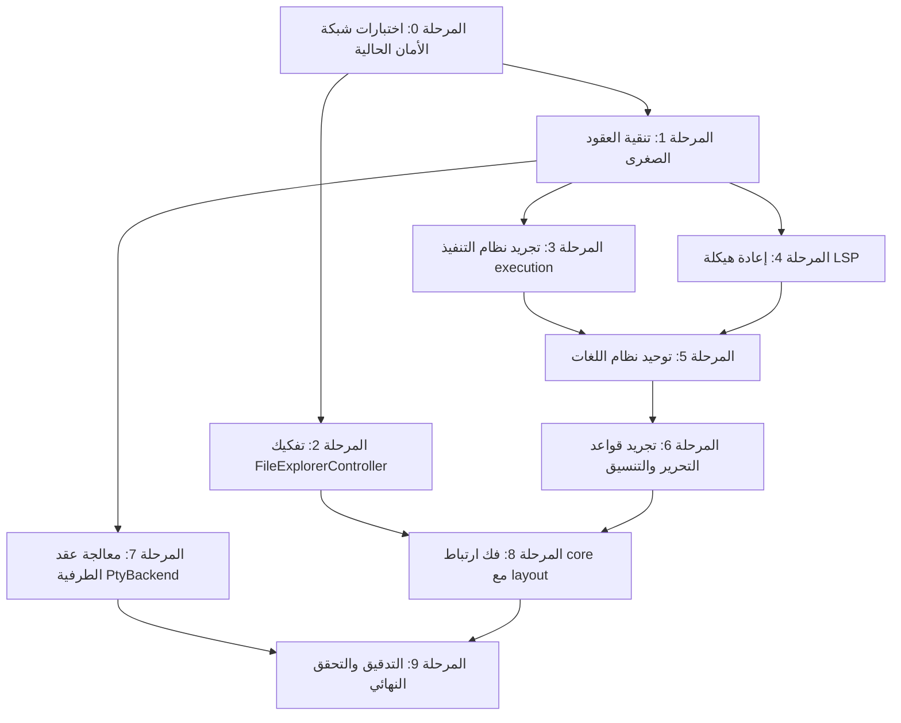
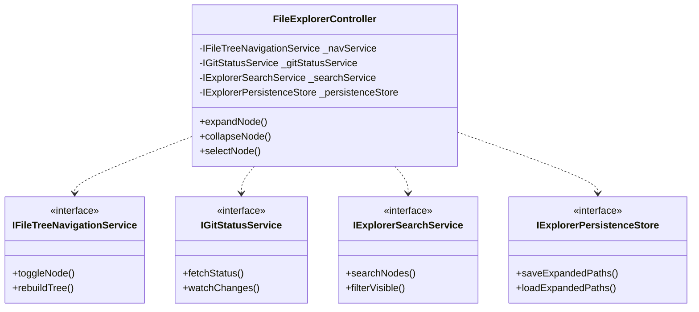
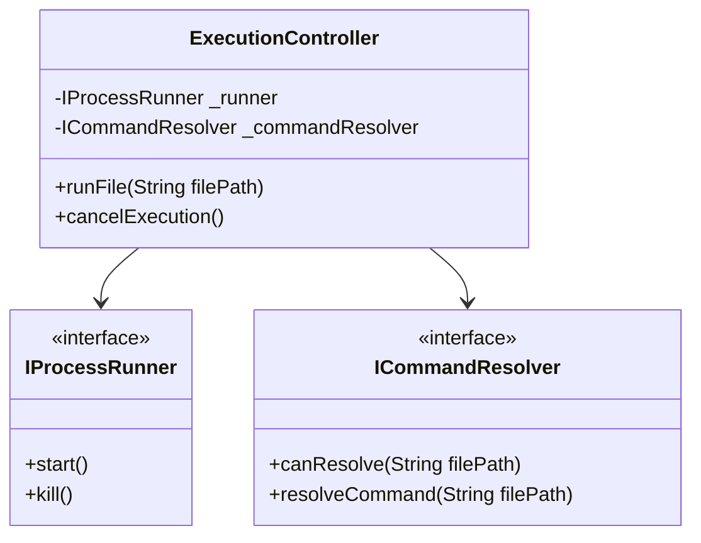
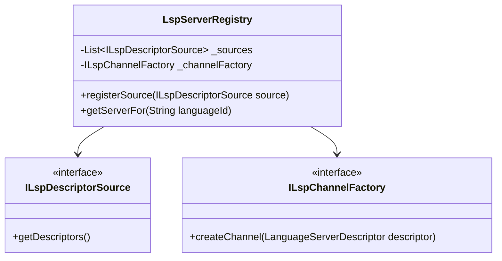

# خطة التنفيذ الشاملة لتطبيق مبادئ SOLID على مجلد `lib/core`

> **مرجع التحليل الأساسي:** [تحليل مبادئ SOLID لمجلد core](file:///home/osm/flutter_projects/code_editor/docs/core_solid_analysis.ar.md)  
> **حالة المشروع:** مسودة تنفيذية متسلسلة  
> **اللغة:** Dart / Flutter  
> **الهدف:** إعادة هيكلة وتحسين معمارية النواة (`lib/core`) دون كسر أي وظائف تشغيلية حالية مع ضمان قابلية الاختبار والصيانة والتوسع.

---

## فهرس المحتويات

1. [الرؤية الاستراتيجية ومبادئ التنفيذ](#1-الرؤية-الاستراتيجية-ومبادئ-التنفيذ)
2. [مخطط الاعتماديات ومصفوفة المراحل](#2-مخطط-الاعتماديات-ومصفوفة-المراحل)
3. [المرحلة 0: بناء شبكة الأمان والاختبارات المرجعية (Test Infrastructure)](#المرحلة-0-بناء-شبكة-الأمان-والاختبارات-المرجعية)
4. [المرحلة 1: تنقية الحدود والعقود الصغرى منخفضة المخاطر](#المرحلة-1-تنقية-الحدود-والعقود-الصغرى-منخفضة-المخاطر)
5. [المرحلة 2: تفكيك وتوزيع مسؤوليات `FileExplorerController`](#المرحلة-2-تفكيك-وتوزيع-مسؤوليات-fileexplorercontroller)
6. [المرحلة 3: تجريد نظام التنفيذ وحل الأوامر (`execution`)](#المرحلة-3-تجريد-نظام-التنفيذ-وحل-الأوامر-execution)
7. [المرحلة 4: إعادة هيكلة سجل خوادم LSP ومصانع القنوات (`lsp`)](#المرحلة-4-إعادة-هيكلة-سجل-خوادم-lsp-ومصانع-القنوات-lsp)
8. [المرحلة 5: توحيد النظام البيئي للغات البرمجية (`languages`)](#المرحلة-5-توحيد-النظام-البيئي-للغات-البرمجية-languages)
9. [المرحلة 6: تجريد قواعد التنسيق وتحرير المدخلات (`editor`)](#المرحلة-6-تجريد-قواعد-التنسيق-وتحرير-المدخلات-editor)
10. [المرحلة 7: معالجة فجوة عقد الطرفية `PtyBackend` (`terminal`)](#المرحلة-7-معالجة-فجوة-عقد-الطرفية-ptybackend-terminal)
11. [المرحلة 8: فك ارتباط النواة بحزم العرض والواجهة (`core` vs `layout`)](#المرحلة-8-فك-ارتباط-النواة-بحزم-العرض-والواجهة-core-vs-layout)
12. [المرحلة 9: التحقق النهائي والتدقيق الشامل والأداء](#المرحلة-9-التحقق-النهائي-والتدقيق-الشامل-والأداء)
13. [سجل الملفات الجديدة والمعدلة](#سجل-الملفات-الجديدة-والمعدلة)
14. [قواعد العمل وضوابط الدمج (Pull Request Guidelines)](#قواعد-العمل-وضوابط-الدمج)

---

## 1. الرؤية الاستراتيجية ومبادئ التنفيذ

تعتمد هذه الخطة على مبدأ **"التطوير الآمن خطوة بخطوة" (Stepwise Refactoring)** بدون إيقاف العمل في المشروع، مع الالتزام بالمعايير التالية:

1. **عدم كسر الواجهات البرمجية العامة فوراً (Backward Compatibility):**
   - استخدام تقنية **Adapter Pattern** أو الواجهات الموجهة (Delegation) في الكائنات الضخمة مثل `FileExplorerController` أثناء عملية التفكيك لضمان استمرار عمل شاشات الـ UI الحالية.
   - وضع علامة `@deprecated` على التوابع والخصائص المزمع نقلها لفترة انتقالية محددة قبل الحذف.

2. **الأولوية للاختبار أولاً (Safety Harness First):**
   - لا يتم لمس أي كائن برمجي قبل توفير اختبارات سلوكية (Unit/Integration Tests) تغطي السلوك الحالي بنسبة مقبولة تمنع الـ Regressions.

3. **حقن التبعيات والتجريد (Dependency Inversion):**
   - استبدال الـ Singletons والمراجع المباشرة بحقن عبر الـ Constructors أو عبر موفر خدمة مركزي (Service Locator/Provider).

---

## 2. مخطط الاعتماديات ومصفوفة المراحل



| المرحلة | الأولوية | المخاطرة التقنية | مستوى الجهد | التبعيات المباشرة |
| :--- | :---: | :---: | :---: | :--- |
| **0. Test Harness** | عاجلة | منخفضة جداً | متوسط | لا يوجد |
| **1. Minor Contracts** | مرتفعة | منخفضة | بسيط | المرحلة 0 |
| **2. FileExplorer** | حرجة | مرتفعة | كبير جداً | المرحلة 0 |
| **3. Execution System** | مرتفعة | متوسطة | متوسط | المرحلة 1 |
| **4. LSP System** | مرتفعة | متوسطة | متوسط | المرحلة 1 |
| **5. Languages Eco** | متوسطة | متوسطة | متوسط | المرحلتان 3 و 4 |
| **6. Editor Rules** | متوسطة | منخفضة | متوسط | المرحلة 5 |
| **7. Pty Terminal** | منخفضة | منخفضة | بسيط | المرحلة 1 |
| **8. Core-Layout Decouple** | مرتفعة | متوسطة | متوسط | المرحلتان 2 و 6 |
| **9. Final Audit** | ختامية | منخفضة | متوسط | جميع المراحل |

---

## المرحلة 0: بناء شبكة الأمان والاختبارات المرجعية

### الهدف

إنشاء مجموعة اختبارات وحدة وسلوك (Regression Safety Net) لكل من `FileExplorerController`، `ExecutionController`، `LspServerRegistry`، و`EditorInputFormatter` لضمان عدم حدوث أي تراجع سلوكي أثناء إعادة الهيكلة.

### المهام التنفيذية التفصيلية

- [x] **مهمة 0.1: اختبارات مسار استكشاف الملفات (`FileExplorerController`)**
  - **الملف المستهدف للإنشاء:** `test/core/file_system/file_explorer_controller_test.dart`
  - **المحتوى:**
    - اختبار فتح وإغلاق المجلدات الشجرية (Expand/Collapse).
    - اختبار تحديد العناصر وتحديث العقد النشطة (Selection & Active Node).
    - اختبار السلوك عند استدعاء البحث والفلترة.
    - اختبار قراءة وتحديث حالة Git (Mocked Git Process).
    - اختبار استرجاع وحفظ الحالة (Persistence State Mock).
  - **معيار القبول:** نجاح اختبارات التغطية السلوكية بنسبة 100% دون أخطاء تشغيلية.

- [x] **مهمة 0.2: اختبارات مشغل العمليات ونظام التنفيذ (`ExecutionController`)**
  - **الملف المستهدف للإنشاء:** `test/core/execution/execution_controller_test.dart`
  - **المحتوى:**
    - محاكاة تشغيل الأوامر ومراقبة تدفق الخرج (Stdout/Stderr Streams).
    - اختبار إلغاء العملية وقفل التنفيذ (Cancel / Concurrent lock).
  - **معيار القبول:** تحقق دورة حياة الأمر كاملة بالاعتماد على Fake Process Runner.

- [x] **مهمة 0.3: اختبارات سجل اللغات وخوادم LSP (`LspServerRegistry`)**
  - **الملف المستهدف للإنشاء:** `test/core/lsp/lsp_server_registry_test.dart`
  - **المحتوى:**
    - اختبار تسجيل خادم لغة عبر واصفات (Descriptors).
    - التحقق من معالجة طلب بدء الخادم واسترجاع الخادم المسجل حسب نوع الملف أو اللغة.
  - **معيار القبول:** عمل السجل بشكل مستقل عن بيئة التشغيل الفعلية.

- [x] **مهمة 0.4: اختبارات منسق المدخلات والمسافات البادئة (`EditorInputFormatter`)**
  - **الملف المستهدف للإنشاء:** `test/core/editor/editor_input_formatter_test.dart`
  - **المحتوى:**
    - اختبار إدخال سطر جديد وحساب المسافة البادئة للأقواس `{}` في Dart و Python.
    - اختبار الحذف العكسي وإكمال علامات التنصيص والأقواس تلقائياً.
  - **معيار القبول:** ثبات سلوك التنسيق عبر حالات الإدخال المختلفة.

---

## المرحلة 1: تنقية الحدود والعقود الصغرى منخفضة المخاطر

### الهدف

معالجة الانتهاكات البسيطة لمبادئ ISP و OCP في كائنات الدعم والإعدادات لتمهيد المسار للأجزاء الكبيرة.

### المهام التنفيذية التفصيلية

- [x] **مهمة 1.1: تقسيم واجهة خدمات فتح الملفات (`EditorFileOpener`)**
  - **الملف المعني:** `lib/core/file_system/services/editor_file_opener.dart`
  - **المشكلة:** كائن `EditorFileOpener` قد يدمج بين منطق فتح المحرر ومنطق التنقل للسطور.
  - **الإجراء:** التأكد من صغر حجم الواجهة وتجريدها كعقد نقي:

    ```dart
    abstract class EditorFileOpener {
      Future<void> openFile(String path, {int? line, int? column});
      Future<bool> canOpenFile(String path);
    }
    ```

  - **معيار القبول:** توافق كامل مع استدعاءات `FileExplorerController` دون اقتران بنوع شاشة محددة.

- [x] **مهمة 1.2: تجريد تفضيلات التنسيق (`EditorFormattingPreferences`)**
  - **الملف المعني:** `lib/core/editor/formatting/editor_formatting_preferences.dart`
  - **المشكلة:** اعتماد مباشر على التخزين أو القيم الثابتة.
  - **الإجراء:** استخراج عقد `IEditorFormattingPreferencesStore` لعزل التخزين المحلي عن منطق التفضيلات.

---

## المرحلة 2: تفكيك وتوزيع مسؤوليات `FileExplorerController`

### الهدف

تفكيك الكائن الأضخم في النظام (904 أسطر، 7 مسؤوليات متباينة) وتطبيق مبدأ المسؤلية الفردية (SRP) ومبدأ الفصل بين الواجهات (ISP).



### المهام التنفيذية التفصيلية

- [x] **مهمة 2.1: استخراج خدمة إدارة وتحديث حالة Git (`GitStatusService`)**
  - **الملف الجديد:** `lib/core/file_system/services/git_status_service.dart`
  - **المحتوى البرمجي:**

    ```dart
    abstract class IGitStatusService {
      Stream<Map<String, GitFileStatus>> get statusStream;
      Future<void> refreshStatus(String rootPath);
      GitFileStatus? getStatusForPath(String path);
    }

    class ProcessGitStatusService implements IGitStatusService {
      final ProcessRunner processRunner;
      ProcessGitStatusService({required this.processRunner});
      // نقل منطق استدعاء git status وتحليله من FileExplorerController
    }
    ```

  - **معيار القبول:** تفريغ كود استدعاء `git` من المتحكم ونقله كلياً إلى الخدمة المستقلة مع توفير اختبارات وحدة منفصلة.

- [x] **مهمة 2.2: استخراج خدمة البحث والفلترة (`ExplorerSearchService`)**
  - **الملف الجديد:** `lib/core/file_system/services/explorer_search_service.dart`
  - **المحتوى:**
    - استخراج منطق تصفية شجرة الملفات بالاسم أو النمط أو اللواحق (Glob / Substring match).
    - دعم الإلغاء وحساب المطابقات دون التعديل على بنية العقد الأصلية.
  - **معيار القبول:** تمكين اختبار خوارزمية الفلترة دون تهيئة شجرة ملفات حية في الذاكرة.

- [x] **مهمة 2.3: استخراج مخزن استمرارية الحالة (`ExplorerPersistenceStore`)**
  - **الملف الجديد:** `lib/core/file_system/services/explorer_persistence_store.dart`
  - **المحتوى:**
    - واجهة `IExplorerPersistenceStore` لحفظ وقراءة المسارات المفتوحة (Expanded Paths) والملف المختار.
    - تنفيذ افتراضي `SharedPrefsExplorerPersistenceStore` أو `InMemoryExplorerPersistenceStore` للاختبارات.
  - **معيار القبول:** التخلص من أي وصول مباشر لـ `SharedPreferences` من داخل المتحكم.

- [x] **مهمة 2.4: استخراج منطق الفرز والترتيب (`FileTreeSorter`)**
  - **الملف الجديد:** `lib/core/file_system/utils/file_tree_sorter.dart`
  - **المحتوى:**
    - فئات معزولة لمقارنة الملفات والمجلدات (المجلدات أولاً، حسب الاسم، حسب تاريخ التعديل).
  - **معيار القبول:** سهولة تبديل استراتيجية الترتيب مستقبلاً عبر Strategy Pattern.

- [x] **مهمة 2.5: استخراج كائن حالة العرض وحصر النطاق (`FileExplorerScope` / `State`)**
  - **الملف الجديد:** `lib/core/file_system/models/file_explorer_state.dart`
  - **المحتوى:**
    - كائن غير قابل للتغيير (Immutable State) يحتوي على: `rootPath`، `expandedPaths`، `selectedPath`، `searchQuery`، `gitStatuses`.
  - **معيار القبول:** إمكانية مراقبة الحالة كـ Stream أو `ValueListenable` نقي.

- [x] **مهمة 2.6: إعادة صياغة `FileExplorerController` كمنسق (Facade / Orchestrator)**
  - **الملف المعني:** `lib/core/file_system/controllers/file_explorer_controller.dart`
  - **الإجراء:**
    - تقليص حجم الملف من 904 أسطر إلى أقل من 250 سطراً.
    - حقن الخدمات المستخرجة عبر الـ Constructor مع توفير معاملات افتراضية للمحافظة على التوافق الرجعي:

      ```dart
      class FileExplorerController extends ChangeNotifier {
        final FileSystemService fileSystemService;
        final IGitStatusService gitStatusService;
        final IExplorerSearchService searchService;
        final IExplorerPersistenceStore persistenceStore;
        final EditorFileOpener fileOpener;
        // ... تفويض الأوامر للخدمات وتحديث المستمعين
      }
      ```

  - **معيار القبول:** مرور جميع اختبارات `file_explorer_controller_test.dart` بنجاح دون أي تعديل في واجهات العرض (UI).

---

## المرحلة 3: تجريد نظام التنفيذ وحل الأوامر (`execution`)

### الهدف

معالجة اقتران `ExecutionController` بـ `ProcessRunner` الملموس، وجعل تحديد الأوامر لنوع الملف مفتوحاً للتمديد (OCP) عبر نمط Strategy بدلاً من switch/if المتصلبة.



### المهام التنفيذية التفصيلية

- [x] **مهمة 3.1: استخراج واجهة لمشغل العمليات (`IProcessRunner`)**
  - **الملف الجديد:** `lib/core/execution/models/process_runner_interface.dart`
  - **المحتوى:**

    ```dart
    abstract class IProcessRunner {
      Future<ProcessExecutionResult> run(
        String executable,
        List<String> arguments, {
        String? workingDirectory,
        Map<String, String>? environment,
      });

      Future<IExecutionProcess> start(
        String executable,
        List<String> arguments, {
        String? workingDirectory,
        Map<String, String>? environment,
      });
    }
    ```

  - **معيار القبول:** جعل `ProcessRunner` الحالي ينفذ `IProcessRunner` وإمكانية حقن `MockProcessRunner` بالكامل.

- [x] **مهمة 3.2: إنشاء واجهة استراتيجية حل الأوامر (`ICommandResolver`)**
  - **الملف الجديد:** `lib/core/execution/resolvers/command_resolver.dart`
  - **المحتوى:**

    ```dart
    abstract class ICommandResolver {
      bool canResolve(String filePath);
      ExecutionPlan resolve(String filePath, {Map<String, dynamic>? context});
    }
    ```

  - **معيار القبول:** عزل منطق "كيفية تشغيل ملف Dart / Python / Shell" خارج المتحكم.

- [x] **مهمة 3.3: تنفيذ محلل أوامر مركب وقابل للتمديد (`CompositeCommandResolver`)**
  - **الملف الجديد:** `lib/core/execution/resolvers/composite_command_resolver.dart`
  - **المحتوى:**
    - فئة مجمعة تدعم تسجيل استراتيجيات تشغيل جديدة وقت التشغيل (Plugins/Extensions):

      ```dart
      class CompositeCommandResolver implements ICommandResolver {
        final List<ICommandResolver> _resolvers = [];
        void registerResolver(ICommandResolver resolver) => _resolvers.insert(0, resolver);
        // ...
      }
      ```

  - **معيار القبول:** سهولة إضافة دعم تشغيل لغة جديدة دون تعديل شفرة `ExecutionController`.

- [x] **مهمة 3.4: تحديث `ExecutionController` للعمل مع العقود الجديدة**
  - **الملف المعني:** `lib/core/execution/execution_controller.dart`
  - **الإجراء:** استبدال الاعتمادات المباشرة بالواجهات الجديدة والتأكد من دعم إلغاء العمليات الآمن.
  - **معيار القبول:** نجاح اختبارات التشغيل والمحاكاة لجميع أنواع الملفات المعتمدة.

---

## المرحلة 4: إعادة هيكلة سجل خوادم LSP ومصانع القنوات (`lsp`)

### الهدف

تحويل `LspServerRegistry` من مستودع يحتوي على تهيئات ثابتة مسبقة لجميع اللغات إلى سجل مرن يقبل المساهمات من مصادر خارجية (Open-Closed Principle)، وتجريد آلية إنشاء قنوات الاتصال (LspChannelFactory).



### المهام التنفيذية التفصيلية

- [x] **مهمة 4.1: استخراج واجهة مصدر واصفات خوادم اللغات (`ILspDescriptorSource`)**
  - **الملف الجديد:** `lib/core/lsp/registry/lsp_descriptor_source.dart`
  - **المحتوى:**

    ```dart
    abstract class ILspDescriptorSource {
      Future<List<LanguageServerDescriptor>> loadDescriptors();
    }
    ```

  - **معيار القبول:** إمكانية تحميل خوادم اللغات من ملفات إعدادات (JSON/YAML) أو مساهمات برمجية دون كتابة شفرات داخل السجل.

- [x] **مهمة 4.2: تجريد مصنع قنوات اتصال LSP (`ILspChannelFactory`)**
  - **الملف الجديد:** `lib/core/lsp/connection/lsp_channel_factory.dart`
  - **المحتوى:**

    ```dart
    abstract class ILspChannelFactory {
      Future<LspChannel> createChannel(LanguageServerDescriptor descriptor);
    }

    class ProcessLspChannelFactory implements ILspChannelFactory {
      // نقل منطق بناء LspProcessChannel الحالي إلى هذا المصنع
    }
    ```

  - **معيار القبول:** إمكانية اختبار عميل LSP عبر `MockLspChannelFactory` (بدون تشغيل عمليات حقيقية في النظام).

- [x] **مهمة 4.3: إعادة بناء `LspServerRegistry` ليعتمد على حقن المصادر والمصانع**
  - **الملف المعني:** `lib/core/lsp/registry/lsp_server_registry.dart`
  - **الإجراء:**
    - التخلص من قائمة الواصفات المكتوبة يدوياً (Hardcoded list).
    - تحويله إلى كائن ينسق بين الواصفات المسجلة والعملاء النشطين ومصنع القنوات.
  - **معيار القبول:** استقلال سجل LSP الكامل عن أنظمة التشغيل ومسارات الخوادم الافتراضية.

---

## المرحلة 5: توحيد النظام البيئي للغات البرمجية (`languages`)

### الهدف

دمج المفاهيم المشتتة للغات عبر النواة (حيث توجد تهيئات لـ LSP في مجلد `lsp`، وتحديد لغات في `execution`، وتنسيق في `editor`) في تعريف موحد للغة البرمجية (Language Definition).

### المهام التنفيذية التفصيلية

- [x] **مهمة 5.1: تصميم نموذج تعريف اللغة الموحد (`LanguageDefinition`)**
  - **الملف الجديد:** `lib/core/languages/models/language_definition.dart`
  - **المحتوى:**

    ```dart
    class LanguageDefinition {
      final String id; // e.g. "dart"
      final String name; // e.g. "Dart"
      final List<String> extensions; // [".dart"]
      final List<String> filenames; // ["pubspec.yaml"]
      final LanguageServerDescriptor? lspDescriptor;
      final ICommandResolver? defaultExecutionResolver;
      final LanguageIndentationRules? indentationRules;

      const LanguageDefinition({
        required this.id,
        required this.name,
        required this.extensions,
        this.filenames = const [],
        this.lspDescriptor,
        this.defaultExecutionResolver,
        this.indentationRules,
      });
    }
    ```

  - **معيار القبول:** كائن شامل جامع لكل قدرات اللغة في المحرر دون إجبار أي لغة على توفير كل الميزات.

- [x] **مهمة 5.2: إنشاء سجل اللغات المركزي (`LanguageRegistry`)**
  - **الملف الجديد:** `lib/core/languages/registry/language_registry.dart`
  - **المحتوى:**
    - كائن مركزي لتسجيل واستعلام اللغات حسب الامتداد أو المعرف أو اسم الملف.
  - **معيار القبول:** استعلام موحد للغة عبر كافة وحدات `core`.

- [x] **مهمة 5.3: ترحيل تعريفات اللغات الحالية (Dart, Python, Web, C/C++)**
  - **الملف الجديد:** `lib/core/languages/definitions/built_in_languages.dart`
  - **المحتوى:** توفير الإعدادات المدمجة عبر السجل الموحد كحزمة افتراضية.
  - **معيار القبول:** مطابقة تامة مع الوظائف القائمة لجميع اللغات المدعومة حالياً.

---

## المرحلة 6: تجريد قواعد التنسيق وتحرير المدخلات (`editor`)

### الهدف

تفكيك `EditorInputFormatter` وتخليصه من الشروط البرمجية الخاصة بلغات محددة (مثل فحص امتدادات `.py` داخل معالجة مسافات الإدخال) التزاماً بمبدأ المسؤولية الفردية (SRP) والانفتاح/الإغلاق (OCP).

### المهام التنفيذية التفصيلية

- [x] **مهمة 6.1: استخراج عقد قواعد المحاذاة والمسافات البادئة للغة (`LanguageIndentationRules`)**
  - **الملف الجديد:** `lib/core/editor/indentation/language_indentation_rules.dart`
  - **المحتوى:**

    ```dart
    abstract class LanguageIndentationRules {
      bool shouldIndentAfterLine(String lineText);
      bool shouldOutdentLine(String lineText);
      int calculateIndentIncrement(String previousLine);
      List<String> get autoClosePairs;
    }
    ```

  - **معيار القبول:** استخراج خوارزمية إزاحة النقطتين الرأسيتين `:` للغة Python وخوارزمية الأقواس المتعرجة `{}` لـ C/Dart في أصناف منفصلة.

- [x] **مهمة 6.2: إعادة هيكلة `EditorInputFormatter` للعمل كمنفذ استراتيجي**
  - **الملف المعني:** `lib/core/editor/indentation/editor_input_formatter.dart`
  - **الإجراء:**
    - استقبال `LanguageIndentationRules` ديناميكياً بناءً على ملف الوثيقة المحررة.
    - إزالة أي استعلام مباشر عن اسم اللغة أو امتداد الملف من قلب حلقة معالجة الأحرف.
  - **معيار القبول:** تقليل أسطر الملف من 385 إلى نحو 180 سطراً مع الحفاظ على دقة التنسيق بنسبة 100%.

---

## المرحلة 7: معالجة فجوة عقد الطرفية `PtyBackend` (`terminal`)

### الهدف

سد الفجوة في واجهة `PtyBackend` حيث تحتوي على استدعاء `resize(cols, rows)` بينما لا توفر بعض بيئات الطرفية دعماً لتغيير الحجم، مما كان يتسبب إما في استثناءات غير متوقعة أو سلوك صامت ينتهك مبدأ استبدال ليزكوف (LSP).

### المهام التنفيذية التفصيلية

- [x] **مهمة 7.1: إضافة فحص إمكانية تغيير الحجم لعقد `PtyBackend`**
  - **الملف المعني:** `lib/core/terminal/pty/pty_backend.dart`
  - **التعديل المقترح:**

    ```dart
    abstract class PtyBackend {
      Stream<List<int>> get out;
      Stream<bool> get exit;
      void write(List<int> data);
      
      /// يشير إلى ما إذا كان المشغل يدعم إرسال إشارات تغيير الأبعاد
      bool get supportsResize => true;
      
      void resize(int cols, int rows);
      Future<int> get exitCode;
      Future<void> terminate();
    }
    ```

  - **معيار القبول:** توفير قيمة واضحة ومعيارية لجميع المشغلات الحالية والبديلة.

- [x] **مهمة 7.2: تحديث `ProcessPtyBackend` و `TerminalService`**
  - **الملف المعني:** `lib/core/terminal/services/terminal_service.dart`
  - **الإجراء:** فحص `supportsResize` قبل استدعاء `resize` لمنع أي سلوك خاطئ أثناء تغيير أبعاد الواجهة.
  - **معيار القبول:** سلامة عمل الطرفية عند تصغير وتكبير النافذة مع جميع المنصات.

---

## المرحلة 8: فك ارتباط النواة بحزم العرض والواجهة (`core` vs `layout`)

### الهدف

إزالة الاستيرادات العكسية الممنوعة في المعمارية النظيفة حيث تستورد بعض ملفات `core` كائنات من طبقة `layout` أو `ui` (انفصال طبقات المعمارية النظيفة).

### المهام التنفيذية التفصيلية

- [x] **مهمة 8.1: فحص وتحليل الاستيرادات المتقاطعة (Cross-layer imports)**
  - استخدام أداة فحص ثابتة لرصد أي استيراد لـ `package:code_editor/layout/...` أو `package:code_editor/features/...` داخل مجلد `lib/core`.

- [x] **مهمة 8.2: استبدال استيرادات الواجهة بأحداث أو إشعارات عامة**
  - استبدال أي مرجع لـ UI Models بـ Callbacks أو Notifiers أو Event Streams مستقلة داخل `core`.
  - نقل أي منطق تحكم مختص بتموضع النوافذ من `core` إلى طبقة `layout`.

- [x] **مهمة 8.3: تفعيل قيود التحليل الثابت (`custom lint / analysis_options.yaml`)**
  - أضيف اختبار معماري في `test/architecture/core_layer_imports_test.dart` لمنع
    استيراد طبقة العرض مستقبلًا داخل `lib/core`؛ لا يوفر محلل Dart المدمج قاعدة
    حدود استيراد قابلة للتهيئة في `analysis_options.yaml`.

    ```yaml
    analyzer:
      errors:
        # منع الاستيرادات المتقاطعة
    ```

  - **معيار القبول:** خلو مجلد `lib/core` بالكامل من أي استيراد يعتمد على طبقات أعلى.

---

## المرحلة 9: التحقق النهائي والتدقيق الشامل والأداء

### الهدف

ضمان سلامة البناء المعماري، واجتياز كافة الفحوصات الآلية، والتحقق من الأداء وسرعة الاستجابة.

### المهام التنفيذية التفصيلية

- [x] **مهمة 9.1: تشغيل حزمة الاختبارات الكاملة**
  - تشغيل أمر: `flutter test`
  - التأكد من اجتياز 100% من الاختبارات المعيارية والجديدة.

- [x] **مهمة 9.2: فحص التحليل الاستاتيكي الكامل**
  - تشغيل أمر: `dart analyze`
  - معالجة أي تحذيرات (Warnings/Hints) نتجت عن التجريد أو الترحيل.

- [ ] **مهمة 9.3: اختبار التوافق مع التطبيق الحي (Manual Smoke Testing)**
  - تم التحقق من تشغيل تطبيق Linux في وضع debug واجتازت الاختبارات الآلية
    لمسارات التصفح والتنفيذ وLSP؛ لا يزال التفاعل اليدوي الشامل غير معتمد.
  - فتح مشروع حقيقي في المحرر.
  - اختبار التصفح الشجري، تشغيل الأوامر، خادم LSP وإبراز الأخطاء، وحفظ الحالة.
  - التأكد من عدم وجود تسريبات ذاكرة (Memory Leaks) في الـ Streams.

- [x] **مهمة 9.4: توثيق المعمارية الجديدة للـ Core**
  - إنشاء ملف دليل مطوري النواة: `docs/core_architecture.ar.md` يوضح سبل تمديد النواة وإضافة خدمات جديدة بسهولة.

---

## سجل الملفات الجديدة والمعدلة

### الملفات الجديدة المقترحة (15 ملفاً)

| المسار | الوصف | المرحلة |
| :--- | :--- | :---: |
| `lib/core/file_system/services/git_status_service.dart` | استخراج منطق Git من مستعرض الملفات | 2 |
| `lib/core/file_system/services/explorer_search_service.dart` | خدمة البحث وتصفية الشجرة | 2 |
| `lib/core/file_system/services/explorer_persistence_store.dart` | حفظ واسترجاع حالة الشجرة | 2 |
| `lib/core/file_system/utils/file_tree_sorter.dart` | استراتيجية ترتيب الملفات والمجلدات | 2 |
| `lib/core/file_system/models/file_explorer_state.dart` | حالة مستعرض الملفات ككائن مستقل | 2 |
| `lib/core/execution/models/process_runner_interface.dart` | واجهة تجريد تشغيل العمليات | 3 |
| `lib/core/execution/resolvers/command_resolver.dart` | واجهة استراتيجية حل الأوامر | 3 |
| `lib/core/execution/resolvers/composite_command_resolver.dart` | جامع ومنسق استراتيجيات الأوامر | 3 |
| `lib/core/lsp/registry/lsp_descriptor_source.dart` | واجهة مصادر خوادم LSP | 4 |
| `lib/core/lsp/connection/lsp_channel_factory.dart` | مصنع مجرد لقنوات اتصال LSP | 4 |
| `lib/core/languages/models/language_definition.dart` | كائن تعريف اللغة الموحد | 5 |
| `lib/core/languages/registry/language_registry.dart` | السجل المركزي الموحد للغات | 5 |
| `lib/core/languages/definitions/built_in_languages.dart` | الإعدادات الافتراضية للغات المدمجة | 5 |
| `lib/core/editor/indentation/language_indentation_rules.dart` | استراتيجيات المحاذاة حسب اللغة | 6 |
| `docs/core_architecture.ar.md` | دليل المعمارية الجديد للمطورين | 9 |

### أهم الملفات المستهدفة بإعادة الهيكلة والتنقيح (12 ملفاً)

| الملف الحالي | حجم التعديل | الهدف المعماري |
| :--- | :---: | :--- |
| `lib/core/file_system/controllers/file_explorer_controller.dart` | جذري (كبير جداً) | تطبيق SRP وتحويله لمنسق واستخراج 5 خدمات |
| `lib/core/execution/execution_controller.dart` | متوسط | الاعتماد على `IProcessRunner` و `ICommandResolver` |
| `lib/core/execution/process_runner.dart` | بسيط | تنفيذ `IProcessRunner` |
| `lib/core/lsp/registry/lsp_server_registry.dart` | جوهري | تحويله لسجل مفتوح للتمديد (OCP) |
| `lib/core/lsp/connection/lsp_process_channel.dart` | بسيط | ربطه بمصنع القنوات |
| `lib/core/editor/indentation/editor_input_formatter.dart` | جوهري | عزل قواعد لغات البرمجة (OCP/SRP) |
| `lib/core/editor/formatting/editor_formatting_preferences.dart` | بسيط | عزل طبقة التخزين المستمر |
| `lib/core/terminal/pty/pty_backend.dart` | بسيط | إضافة `supportsResize` لدعم مبدأ LSP |
| `lib/core/terminal/pty/process_pty_backend.dart` | بسيط | تحديث الخصائص الداعمة |
| `lib/core/terminal/services/terminal_service.dart` | بسيط | فحص إمكانية التحجيم قبل التنفيذ |
| `lib/core/file_system/services/editor_file_opener.dart` | بسيط | تدقيق حدود الواجهة |
| `analysis_options.yaml` | تدقيق | ضبط قواعد الاستيراد ومنع الاختراق المعماري |

---

## قواعد العمل وضوابط الدمج (Pull Request Guidelines)

1. **حجم طلب الدمج (PR Sizing):** يجب ألا يتجاوز كل PR مرحلة واحدة أو مهمة فرعية مستقلة، لتسهيل المراجعة وتجنب تضارب التعديلات (Merge Conflicts).
2. **قاعدة عدم التراجع (No Regression Rule):** لن يُقبل أي PR يكسر أياً من اختبارات `flutter test` أو يسبب أخطاء في `dart analyze`.
3. **التوثيق الفوري:** كل واجهة جديدة تُضاف يجب أن تحتوي على توثيق DartDoc كامل (`///`) يوضح الغرض منها وشروط الاستخدام.
4. **التوافق العكسي المرحلي:** يمنع حذف أي دالة عامة مستخدمة في الـ UI حالياً بشكل مفاجئ؛ بل يتم تحويلها لاستدعاء الخدمة الجديدة مع وضع وسم `@deprecated` حتى اكتمال المرحلة 8.
