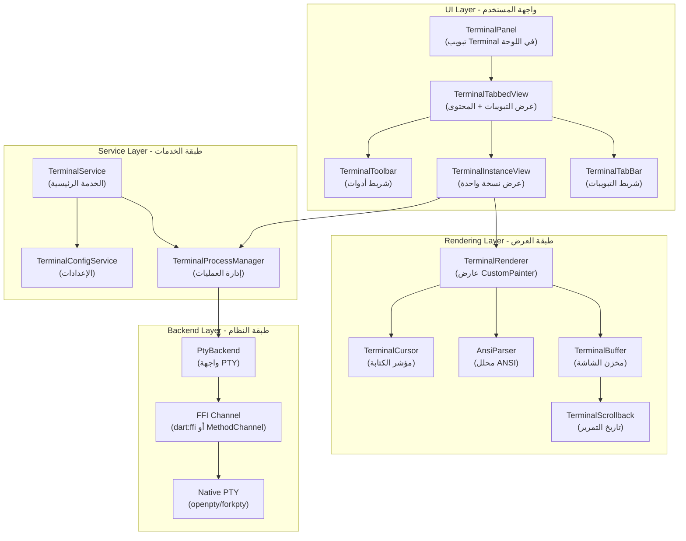

# خطة تنفيذ نظام Terminal المدمج

> خطة تنفيذية شاملة لبناء نظام طرفية مدمجة في محرر الأكواد Flutter
> مستندة إلى تحليل: [`vscode_terminal_system_analysis.md`](file:///home/osm/flutter_projects/code_editor/docs/vscode_terminal_system_analysis.md)

---

## الحالة الراهنة للمشروع

### ما هو موجود حالياً

- **لوحة سفلية** ([`panel_widget.dart`](file:///home/osm/flutter_projects/code_editor/lib/parts/panel/panel_widget.dart)) مدمج بها تبويب Terminal فعلي.
- **نظام طرفية أساسي مكتمل**: مخزن شاشة وتاريخ تمرير، تحليل ANSI/CSI/OSC، إدخال لوحة المفاتيح، تعدد الجلسات، تحديد/نسخ/لصق، وتبديل الشاشة البديلة.
- **خلفية العمليات** تستخدم `Process.start()` لتمرير stdin/stdout/stderr، وعلى Linux تشغّل العملية داخل pseudo-terminal عبر `script` حتى يعمل shell التفاعلي دون تحذيرات job control.
- **الربط مع السمة والتخطيط** موجود في ([`editor_theme.dart`](file:///home/osm/flutter_projects/code_editor/lib/core/theme/editor_theme.dart)) و`TerminalScope`.

### حدود الإصدار الأولي

- اعتماد Linux على أداة `script` يتطلب توفرها على النظام؛ تغيير الحجم لا يرسل إشعار `SIGWINCH`. المنصات الأخرى ما زالت تستخدم تمرير الأنابيب ولا توفر PTY أصلياً.
- Split View وShell Integration الأصلي (مثل اكتشاف الأوامر/المجلدات عبر hooks) مؤجلان للمراحل المستقبلية.
- لا يستهدف الإصدار الأولي محاكاة كاملة لكل امتدادات xterm أو دعم جميع أنظمة التشغيل.

تُشغّل اختبارات الطرفية المركزة بواسطة `flutter test test/terminal`.

---

## الهندسة المعمارية المستهدفة



---

## هيكل الملفات المستهدف

```
lib/
├── core/
│   └── terminal/
│       ├── models/
│       │   ├── terminal_state.dart              # حالة الطرفية
│       │   ├── terminal_profile.dart            # ملفات Shell الشخصية
│       │   ├── terminal_cell.dart               # خلية واحدة (حرف + نمط)
│       │   ├── terminal_style.dart              # نمط النص (لون + bold + ...)
│       │   └── terminal_color_palette.dart      # 256 لون ANSI
│       │
│       ├── buffer/
│       │   ├── terminal_buffer.dart             # المخزن الرئيسي
│       │   ├── terminal_line.dart               # سطر واحد
│       │   ├── terminal_scrollback.dart         # تاريخ التمرير
│       │   └── terminal_cursor.dart             # حالة المؤشر
│       │
│       ├── parser/
│       │   ├── ansi_parser.dart                 # محلل التسلسلات الهاربة
│       │   ├── escape_handler.dart              # معالج CSI/OSC/DCS
│       │   ├── csi_handler.dart                 # أوامر CSI (تحريك، مسح، ...)
│       │   └── osc_handler.dart                 # أوامر OSC (عنوان، ألوان)
│       │
│       ├── pty/
│       │   ├── pty_backend.dart                 # واجهة PTY مجردة
│       │   ├── native_pty_backend.dart          # تنفيذ PTY الأصلي (FFI)
│       │   ├── process_pty_backend.dart         # تنفيذ بديل (Process.start)
│       │   └── pty_options.dart                 # خيارات إنشاء PTY
│       │
│       ├── services/
│       │   ├── terminal_service.dart            # الخدمة الرئيسية
│       │   ├── terminal_process_manager.dart    # إدارة عملية لكل نسخة
│       │   ├── terminal_config_service.dart     # إعدادات الطرفية
│       │   └── flow_control.dart                # التحكم بالتدفق
│       │
│       └── input/
│           ├── terminal_input_handler.dart      # معالج إدخال لوحة المفاتيح
│           └── terminal_key_map.dart            # تعيين المفاتيح → تسلسلات ANSI
│
├── parts/
│   └── panel/
│       └── views/
│           └── terminal/
│               ├── terminal_panel_view.dart     # واجهة التبويب الرئيسية
│               ├── terminal_tabbed_view.dart    # إدارة التبويبات المتعددة
│               ├── terminal_tab_bar.dart        # شريط تبويبات الطرفيات
│               ├── terminal_instance_view.dart  # عرض نسخة واحدة
│               ├── terminal_renderer.dart       # CustomPainter للعرض
│               ├── terminal_toolbar.dart        # شريط أدوات الطرفية
│               └── terminal_selection.dart      # تحديد النص
│
└── (ملفات موجودة تحتاج تعديل)
    ├── parts/panel/panel_widget.dart            # ← ربط التبويب الجديد
    ├── core/theme/editor_theme.dart             # ← إضافة ألوان الطرفية
    └── layout/models/layout_state.dart          # ← (جاهز، لا يحتاج تعديل)
```

---

## المراحل التنفيذية

---

## المرحلة 1: النماذج الأساسية والمخزن المؤقت (Terminal Buffer)

> **الهدف**: بناء طبقة البيانات التي تمثل شاشة الطرفية في الذاكرة
> **المدة المقدرة**: جلسة واحدة
> **الاعتماديات**: لا شيء

### 1.1 نموذج الخلية والنمط

**الملف**: `lib/core/terminal/models/terminal_style.dart`

```dart
/// نمط نص خلية واحدة في الطرفية
class TerminalStyle {
  final int foregroundIndex;   // فهرس لون المقدمة (0-255 أو -1 للافتراضي)
  final int backgroundIndex;  // فهرس لون الخلفية
  final bool bold;
  final bool italic;
  final bool underline;
  final bool strikethrough;
  final bool dim;
  final bool inverse;         // عكس الألوان
  final bool hidden;

  const TerminalStyle({...});
  static const defaultStyle = TerminalStyle(...);

  TerminalStyle copyWith({...});
}
```

**الملف**: `lib/core/terminal/models/terminal_cell.dart`

```dart
/// خلية واحدة في شبكة الطرفية
class TerminalCell {
  String character;      // الحرف (أو '' لخلية فارغة)
  TerminalStyle style;   // النمط المطبق
  int width;             // عرض الحرف (1 عادي، 2 لأحرف CJK)

  TerminalCell({...});
  static TerminalCell empty() => TerminalCell(character: '', style: TerminalStyle.defaultStyle, width: 1);

  void reset() { ... }
}
```

### 1.2 نموذج السطر

**الملف**: `lib/core/terminal/buffer/terminal_line.dart`

```dart
/// سطر واحد في الطرفية (صف من الخلايا)
class TerminalLine {
  final List<TerminalCell> cells;
  bool isWrapped;        // هل هذا السطر امتداد للسطر السابق

  TerminalLine(int cols) : cells = List.generate(cols, (_) => TerminalCell.empty()), isWrapped = false;

  /// إضافة/إزالة خلايا عند تغيير العرض
  void resize(int newCols);

  /// مسح السطر
  void clear([TerminalStyle? style]);

  /// الحصول على النص الخام
  String toPlainText();
}
```

### 1.3 المخزن المؤقت الرئيسي

**الملف**: `lib/core/terminal/buffer/terminal_buffer.dart`

```dart
/// المخزن المؤقت الذي يمثل شاشة الطرفية + تاريخ التمرير
class TerminalBuffer {
  int _cols;    // عدد الأعمدة
  int _rows;    // عدد الصفوف المرئية
  List<TerminalLine> _lines;               // الأسطر الحالية
  final List<TerminalLine> _scrollback;    // تاريخ التمرير
  int _maxScrollback;                      // الحد الأقصى لتاريخ التمرير

  int get cols => _cols;
  int get rows => _rows;
  int get scrollbackLength => _scrollback.length;

  TerminalBuffer({required int cols, required int rows, int maxScrollback = 1000});

  /// الحصول على خلية في موقع معين
  TerminalCell cellAt(int row, int col);

  /// كتابة حرف في الموقع الحالي
  void writeChar(String char, TerminalStyle style);

  /// تمرير لأعلى (سطر جديد في الأسفل)
  void scrollUp([int lines = 1]);

  /// تمرير لأسفل
  void scrollDown([int lines = 1]);

  /// مسح الشاشة
  void clear();

  /// تغيير الحجم
  void resize(int newCols, int newRows);

  /// الحصول على سطر من تاريخ التمرير
  TerminalLine? scrollbackLine(int index);
}
```

### 1.4 حالة المؤشر

**الملف**: `lib/core/terminal/buffer/terminal_cursor.dart`

```dart
/// حالة مؤشر الكتابة
class TerminalCursor {
  int row;
  int col;
  bool visible;
  CursorShape shape;      // block, underline, bar
  bool blinking;

  TerminalCursor({this.row = 0, this.col = 0, this.visible = true, ...});

  /// حفظ/استعادة الموقع (DECSC/DECRC)
  void save();
  void restore();

  /// تحريك المؤشر مع فحص الحدود
  void moveTo(int row, int col, {required int maxRows, required int maxCols});
  void moveRelative(int dRow, int dCol, {required int maxRows, required int maxCols});
}

enum CursorShape { block, underline, bar }
```

### 1.5 لوحة الألوان

**الملف**: `lib/core/terminal/models/terminal_color_palette.dart`

```dart
/// جدول ألوان الطرفية (256 لون)
class TerminalColorPalette {
  /// الألوان الـ 16 الأساسية (قابلة للتخصيص عبر السمة)
  final List<Color> ansiColors; // 16 لون

  /// ألوان 6×6×6 المكعبية (index 16-231)
  static List<Color> get cubeColors => [...];

  /// تدرج الرمادي (index 232-255)
  static List<Color> get grayscaleColors => [...];

  /// ألوان خاصة
  final Color foreground;
  final Color background;
  final Color cursor;
  final Color selectionBackground;

  const TerminalColorPalette({...});

  /// ترجمة فهرس لون إلى Color
  Color resolve(int index);

  /// لوحة داكنة افتراضية
  static const dark = TerminalColorPalette(...);
}
```

### 1.6 حالة الطرفية المجمعة

**الملف**: `lib/core/terminal/models/terminal_state.dart`

```dart
/// الحالة الكاملة لنسخة طرفية واحدة
class TerminalState extends ChangeNotifier {
  final String id;
  String title;
  String? shellType;
  String? workingDirectory;

  final TerminalBuffer buffer;
  final TerminalCursor cursor;
  final TerminalColorPalette palette;
  TerminalStyle currentStyle;

  // مناطق التمرير
  int scrollTop;
  int scrollBottom;

  // أوضاع الطرفية
  bool altBuffer;           // Alternate Screen Buffer (vim, less...)
  bool bracketedPasteMode;
  bool applicationCursorKeys;
  bool autoWrapMode;
  bool insertMode;

  TerminalState({required int cols, required int rows, required this.id, ...});

  void notify() => notifyListeners();
}
```

### مخرجات المرحلة 1

- [x] `terminal_style.dart` - نمط الخلية
- [x] `terminal_cell.dart` - خلية واحدة
- [x] `terminal_line.dart` - سطر واحد
- [x] `terminal_buffer.dart` - المخزن المؤقت
- [x] `terminal_cursor.dart` - المؤشر
- [x] `terminal_color_palette.dart` - الألوان
- [x] `terminal_state.dart` - الحالة المجمعة

---

## المرحلة 2: محلل ANSI (ANSI/VT Parser)

> **الهدف**: تحليل تسلسلات ANSI الهاربة وتطبيقها على المخزن المؤقت
> **المدة المقدرة**: جلسة واحدة
> **الاعتماديات**: المرحلة 1

### 2.1 المحلل الرئيسي (State Machine)

**الملف**: `lib/core/terminal/parser/ansi_parser.dart`

```dart
/// آلة حالة لتحليل بيانات الطرفية (مستوحاة من vt100.net/emu/dec_ansi_parser)
class AnsiParser {
  final TerminalState _state;
  final CsiHandler _csiHandler;
  final OscHandler _oscHandler;
  final EscapeHandler _escHandler;

  _ParserState _parserState = _ParserState.ground;
  final StringBuffer _paramBuffer = StringBuffer();
  final StringBuffer _oscBuffer = StringBuffer();

  AnsiParser(this._state)
    : _csiHandler = CsiHandler(_state),
      _oscHandler = OscHandler(_state),
      _escHandler = EscapeHandler(_state);

  /// معالجة سلسلة بيانات واردة من العملية
  void write(String data) {
    for (int i = 0; i < data.length; i++) {
      final char = data.codeUnitAt(i);
      _processChar(char, data[i]);
    }
    _state.notify();
  }

  void _processChar(int code, String char) {
    switch (_parserState) {
      case _ParserState.ground:
        _handleGround(code, char);
      case _ParserState.escape:
        _handleEscape(code, char);
      case _ParserState.csiEntry:
      case _ParserState.csiParam:
        _handleCsi(code, char);
      case _ParserState.oscString:
        _handleOsc(code, char);
      // ...
    }
  }

  void _handleGround(int code, String char) {
    if (code == 0x1B) {       // ESC
      _parserState = _ParserState.escape;
    } else if (code == 0x07) { // BEL
      // صوت الجرس
    } else if (code == 0x08) { // BS (Backspace)
      _state.cursor.moveRelative(0, -1, ...);
    } else if (code == 0x09) { // HT (Tab)
      _handleTab();
    } else if (code == 0x0A || code == 0x0B || code == 0x0C) { // LF/VT/FF
      _handleLineFeed();
    } else if (code == 0x0D) { // CR (Carriage Return)
      _state.cursor.col = 0;
    } else if (code >= 0x20) { // حرف قابل للطباعة
      _handlePrintableChar(char);
    }
  }
}

enum _ParserState {
  ground,
  escape,
  escapeIntermediate,
  csiEntry,
  csiParam,
  csiIntermediate,
  oscString,
  dcsEntry,
  dcsParam,
}
```

### 2.2 معالج أوامر CSI

**الملف**: `lib/core/terminal/parser/csi_handler.dart`

```dart
/// معالج تسلسلات CSI (Control Sequence Introducer)
/// الصيغة: ESC [ <params> <final>
class CsiHandler {
  final TerminalState _state;
  CsiHandler(this._state);

  void handle(String params, String finalChar) {
    final args = _parseParams(params);
    switch (finalChar) {
      case 'A': _cursorUp(args);           // CUU
      case 'B': _cursorDown(args);         // CUD
      case 'C': _cursorForward(args);      // CUF
      case 'D': _cursorBackward(args);     // CUB
      case 'H': case 'f': _cursorPosition(args);  // CUP
      case 'J': _eraseInDisplay(args);     // ED
      case 'K': _eraseInLine(args);        // EL
      case 'L': _insertLines(args);        // IL
      case 'M': _deleteLines(args);        // DL
      case 'P': _deleteChars(args);        // DCH
      case 'S': _scrollUp(args);           // SU
      case 'T': _scrollDown(args);         // SD
      case 'X': _eraseChars(args);         // ECH
      case 'd': _linePositionAbsolute(args); // VPA
      case 'G': case '`': _cursorCharAbsolute(args); // CHA
      case 'm': _selectGraphicRendition(args); // SGR
      case 'r': _setScrollRegion(args);    // DECSTBM
      case 'h': _setMode(args, true);      // SM
      case 'l': _setMode(args, false);     // RM
      case 'n': _deviceStatusReport(args); // DSR
      case 's': _state.cursor.save();      // SCP
      case 'u': _state.cursor.restore();   // RCP
      case '@': _insertChars(args);        // ICH
      case 'c': _sendDeviceAttributes(args); // DA
    }
  }

  /// SGR - تعيين سمات النص (ألوان، bold، ...)
  void _selectGraphicRendition(List<int> args) {
    if (args.isEmpty) args = [0];
    int i = 0;
    while (i < args.length) {
      final code = args[i];
      switch (code) {
        case 0:  _state.currentStyle = TerminalStyle.defaultStyle; // Reset
        case 1:  _state.currentStyle = _state.currentStyle.copyWith(bold: true);
        case 2:  _state.currentStyle = _state.currentStyle.copyWith(dim: true);
        case 3:  _state.currentStyle = _state.currentStyle.copyWith(italic: true);
        case 4:  _state.currentStyle = _state.currentStyle.copyWith(underline: true);
        case 7:  _state.currentStyle = _state.currentStyle.copyWith(inverse: true);
        case 8:  _state.currentStyle = _state.currentStyle.copyWith(hidden: true);
        case 9:  _state.currentStyle = _state.currentStyle.copyWith(strikethrough: true);
        case 22: _state.currentStyle = _state.currentStyle.copyWith(bold: false, dim: false);
        case 23: _state.currentStyle = _state.currentStyle.copyWith(italic: false);
        case 24: _state.currentStyle = _state.currentStyle.copyWith(underline: false);
        case 27: _state.currentStyle = _state.currentStyle.copyWith(inverse: false);
        case 28: _state.currentStyle = _state.currentStyle.copyWith(hidden: false);
        case 29: _state.currentStyle = _state.currentStyle.copyWith(strikethrough: false);
        // ألوان المقدمة (30-37)
        case >= 30 && <= 37:
          _state.currentStyle = _state.currentStyle.copyWith(foregroundIndex: code - 30);
        // ألوان الخلفية (40-47)
        case >= 40 && <= 47:
          _state.currentStyle = _state.currentStyle.copyWith(backgroundIndex: code - 40);
        // 256 لون / True Color
        case 38: i = _handleExtendedColor(args, i, isForeground: true);
        case 48: i = _handleExtendedColor(args, i, isForeground: false);
        // ألوان ساطعة (90-97, 100-107)
        case >= 90 && <= 97:
          _state.currentStyle = _state.currentStyle.copyWith(foregroundIndex: code - 90 + 8);
        case >= 100 && <= 107:
          _state.currentStyle = _state.currentStyle.copyWith(backgroundIndex: code - 100 + 8);
        case 39: _state.currentStyle = _state.currentStyle.copyWith(foregroundIndex: -1); // Default FG
        case 49: _state.currentStyle = _state.currentStyle.copyWith(backgroundIndex: -1); // Default BG
      }
      i++;
    }
  }
}
```

### 2.3 معالج أوامر OSC

**الملف**: `lib/core/terminal/parser/osc_handler.dart`

```dart
/// معالج تسلسلات OSC (Operating System Command)
/// الصيغة: ESC ] <Ps> ; <Pt> BEL/ST
class OscHandler {
  final TerminalState _state;
  OscHandler(this._state);

  void handle(String data) {
    final semicolonIndex = data.indexOf(';');
    if (semicolonIndex == -1) return;

    final ps = int.tryParse(data.substring(0, semicolonIndex)) ?? -1;
    final pt = data.substring(semicolonIndex + 1);

    switch (ps) {
      case 0:  // تعيين عنوان الأيقونة + العنوان
      case 2:  // تعيين عنوان النافذة
        _state.title = pt;
      case 7:  // تعيين المجلد الحالي (URI)
        _handleSetCwd(pt);
      case 8:  // رابط تشعبي (Hyperlink)
        _handleHyperlink(pt);
      case 10: // استعلام/تعيين لون المقدمة
      case 11: // استعلام/تعيين لون الخلفية
      case 12: // استعلام/تعيين لون المؤشر
        break; // للتوسعة المستقبلية
    }
  }
}
```

### 2.4 معالج التسلسلات الهاربة البسيطة

**الملف**: `lib/core/terminal/parser/escape_handler.dart`

```dart
/// معالج تسلسلات ESC البسيطة (غير CSI/OSC)
class EscapeHandler {
  final TerminalState _state;
  EscapeHandler(this._state);

  void handle(String char) {
    switch (char) {
      case '7': // DECSC - حفظ المؤشر
        _state.cursor.save();
      case '8': // DECRC - استعادة المؤشر
        _state.cursor.restore();
      case 'D': // IND - تمرير لأسفل
        _handleIndex();
      case 'E': // NEL - سطر جديد
        _state.cursor.col = 0;
        _handleIndex();
      case 'M': // RI - تمرير عكسي
        _handleReverseIndex();
      case 'c': // RIS - إعادة تعيين كاملة
        _fullReset();
      case '=': // DECKPAM - وضع لوحة المفاتيح الرقمية
      case '>': // DECKPNM - وضع لوحة المفاتيح العادية
        break;
    }
  }
}
```

### مخرجات المرحلة 2

- [x] `ansi_parser.dart` - آلة حالة التحليل
- [x] `csi_handler.dart` - أوامر CSI (~30 أمر)
- [x] `osc_handler.dart` - أوامر OSC
- [x] `escape_handler.dart` - تسلسلات ESC

---

## المرحلة 3: خلفية العمليات (PTY Backend)

> **الهدف**: تشغيل shell حقيقي مع PTY أو بديل Process.start مع تعيين إدخال/إخراج
> **المدة المقدرة**: جلسة واحدة
> **الاعتماديات**: لا شيء (مستقلة)

### 3.1 الواجهة المجردة

**الملف**: `lib/core/terminal/pty/pty_backend.dart`

```dart
/// واجهة مجردة لخلفية PTY
abstract class PtyBackend {
  /// تشغيل العملية
  Future<void> start({
    required String executable,
    List<String> args = const [],
    String? workingDirectory,
    Map<String, String>? environment,
    required int cols,
    required int rows,
  });

  /// إرسال بيانات إلى العملية (إدخال المستخدم)
  void write(String data);

  /// تغيير حجم الطرفية
  void resize(int cols, int rows);

  /// إيقاف العملية
  void kill([ProcessSignal signal = ProcessSignal.sigterm]);

  /// حدث بيانات واردة من العملية
  Stream<String> get onData;

  /// حدث خروج العملية
  Stream<int> get onExit;

  /// هل العملية تعمل
  bool get isRunning;

  /// تنظيف الموارد
  void dispose();
}
```

### 3.2 التنفيذ باستخدام Process.start (المرحلة الأولى)

**الملف**: `lib/core/terminal/pty/process_pty_backend.dart`

```dart
/// تنفيذ PTY مبسط باستخدام Process.start مع runInShell
/// هذا ليس PTY حقيقي لكنه يعمل للأوامر الأساسية
class ProcessPtyBackend implements PtyBackend {
  Process? _process;
  final _dataController = StreamController<String>.broadcast();
  final _exitController = StreamController<int>.broadcast();

  @override
  Future<void> start({...}) async {
    final env = {
      ...Platform.environment,
      'TERM': 'xterm-256color',
      'COLUMNS': '$cols',
      'LINES': '$rows',
      ...?environment,
    };

    _process = await Process.start(
      executable,
      args,
      workingDirectory: workingDirectory,
      environment: env,
      runInShell: false,  // تشغيل مباشر بدون shell وسيط
    );

    _process!.stdout.transform(utf8.decoder).listen(
      (data) => _dataController.add(data),
    );
    _process!.stderr.transform(utf8.decoder).listen(
      (data) => _dataController.add(data),
    );
    _process!.exitCode.then((code) {
      _exitController.add(code);
    });
  }

  @override
  void write(String data) {
    _process?.stdin.write(data);
  }

  @override
  void resize(int cols, int rows) {
    // Process.start لا يدعم SIGWINCH → يُتجاهل
  }

  // ...
}
```

### 3.3 خيارات PTY

**الملف**: `lib/core/terminal/pty/pty_options.dart`

```dart
/// خيارات إنشاء عملية طرفية
class PtyOptions {
  final String executable;       // /bin/bash, /bin/zsh, ...
  final List<String> args;
  final String workingDirectory;
  final Map<String, String> environment;
  final int cols;
  final int rows;
  final String termType;         // xterm-256color

  const PtyOptions({
    required this.executable,
    this.args = const [],
    required this.workingDirectory,
    this.environment = const {},
    this.cols = 80,
    this.rows = 24,
    this.termType = 'xterm-256color',
  });

  /// كشف الشل الافتراضي للنظام
  static String get defaultShell {
    if (Platform.isLinux || Platform.isMacOS) {
      return Platform.environment['SHELL'] ?? '/bin/bash';
    } else if (Platform.isWindows) {
      return Platform.environment['COMSPEC'] ?? 'cmd.exe';
    }
    return '/bin/sh';
  }
}
```

### 3.4 ملف Shell الشخصي

**الملف**: `lib/core/terminal/models/terminal_profile.dart`

```dart
/// ملف شخصي لشل (Shell Profile)
class TerminalProfile {
  final String name;
  final String executablePath;
  final List<String> args;
  final IconData? icon;
  final Color? color;
  final Map<String, String> environment;

  const TerminalProfile({...});

  /// اكتشاف الملفات الشخصية المتاحة على النظام
  static Future<List<TerminalProfile>> detectAvailableProfiles() async {
    final profiles = <TerminalProfile>[];
    final shellsToCheck = ['/bin/bash', '/bin/zsh', '/bin/fish', '/bin/sh'];

    for (final shell in shellsToCheck) {
      if (await File(shell).exists()) {
        profiles.add(TerminalProfile(
          name: path.basename(shell),
          executablePath: shell,
          icon: Icons.terminal,
        ));
      }
    }
    return profiles;
  }
}
```

### مخرجات المرحلة 3

- [x] `pty_backend.dart` - واجهة مجردة
- [x] `process_pty_backend.dart` - تنفيذ Process.start
- [x] `pty_options.dart` - خيارات الإنشاء
- [x] `terminal_profile.dart` - ملفات Shell الشخصية

---

## المرحلة 4: الخدمات وإدارة العمليات

> **الهدف**: ربط PTY Backend مع ANSI Parser والمخزن المؤقت + إدارة دورة حياة الطرفيات
> **المدة المقدرة**: جلسة واحدة
> **الاعتماديات**: المرحلة 1 + 2 + 3

### 4.1 مدير عملية الطرفية

**الملف**: `lib/core/terminal/services/terminal_process_manager.dart`

```dart
/// يربط PTY Backend مع ANSI Parser والمخزن المؤقت لنسخة طرفية واحدة
class TerminalProcessManager {
  final TerminalState state;
  final PtyBackend _backend;
  final AnsiParser _parser;
  final FlowController _flowControl;

  StreamSubscription<String>? _dataSub;
  StreamSubscription<int>? _exitSub;

  TerminalProcessManager({
    required this.state,
    PtyBackend? backend,
  }) : _backend = backend ?? ProcessPtyBackend(),
       _parser = AnsiParser(state),
       _flowControl = FlowController();

  /// بدء العملية
  Future<void> start([PtyOptions? options]) async {
    final opts = options ?? PtyOptions(
      executable: PtyOptions.defaultShell,
      workingDirectory: Directory.current.path,
      cols: state.buffer.cols,
      rows: state.buffer.rows,
    );

    await _backend.start(
      executable: opts.executable,
      args: opts.args,
      workingDirectory: opts.workingDirectory,
      environment: opts.environment,
      cols: opts.cols,
      rows: opts.rows,
    );

    _dataSub = _backend.onData.listen(_onDataReceived);
    _exitSub = _backend.onExit.listen(_onProcessExit);
  }

  void _onDataReceived(String data) {
    if (_flowControl.shouldPause(data.length)) {
      // إيقاف مؤقت (Flow Control)
    }
    _parser.write(data);
    _flowControl.acknowledge(data.length);
  }

  void _onProcessExit(int exitCode) {
    state.title = '${state.title} [exited: $exitCode]';
    state.notify();
  }

  /// إرسال إدخال المستخدم
  void sendInput(String data) {
    _backend.write(data);
  }

  /// تغيير حجم الطرفية
  void resize(int cols, int rows) {
    state.buffer.resize(cols, rows);
    _backend.resize(cols, rows);
  }

  /// إيقاف العملية
  void kill() => _backend.kill();

  void dispose() {
    _dataSub?.cancel();
    _exitSub?.cancel();
    _backend.dispose();
  }
}
```

### 4.2 التحكم بالتدفق

**الملف**: `lib/core/terminal/services/flow_control.dart`

```dart
/// التحكم بتدفق البيانات لمنع إغراق الذاكرة
/// مستوحى من نظام Flow Control في VS Code
class FlowController {
  static const highWatermark = 100000;  // إيقاف مؤقت عند هذا الحد
  static const lowWatermark = 5000;     // استئناف عند هذا الحد
  static const ackSize = 5000;          // حجم الإقرار

  int _unacknowledgedChars = 0;
  bool _isPaused = false;

  bool get isPaused => _isPaused;

  /// هل يجب إيقاف القراءة مؤقتاً
  bool shouldPause(int incomingChars) {
    _unacknowledgedChars += incomingChars;
    if (_unacknowledgedChars >= highWatermark) {
      _isPaused = true;
      return true;
    }
    return false;
  }

  /// إقرار باستلام البيانات
  void acknowledge(int processedChars) {
    _unacknowledgedChars -= processedChars;
    if (_unacknowledgedChars < 0) _unacknowledgedChars = 0;
    if (_isPaused && _unacknowledgedChars <= lowWatermark) {
      _isPaused = false;
    }
  }
}
```

### 4.3 الخدمة الرئيسية

**الملف**: `lib/core/terminal/services/terminal_service.dart`

```dart
/// الخدمة الرئيسية لإدارة جميع نسخ الطرفيات
class TerminalService extends ChangeNotifier {
  final List<TerminalInstance> _instances = [];
  int _activeIndex = -1;

  List<TerminalInstance> get instances => List.unmodifiable(_instances);
  TerminalInstance? get activeInstance =>
    _activeIndex >= 0 && _activeIndex < _instances.length
      ? _instances[_activeIndex]
      : null;
  int get activeIndex => _activeIndex;

  /// إنشاء طرفية جديدة
  Future<TerminalInstance> createTerminal({
    PtyOptions? options,
    String? title,
    TerminalProfile? profile,
  }) async {
    final state = TerminalState(
      id: 'term_${DateTime.now().millisecondsSinceEpoch}',
      cols: options?.cols ?? 80,
      rows: options?.rows ?? 24,
    );
    state.title = title ?? profile?.name ?? 'Terminal ${_instances.length + 1}';

    final manager = TerminalProcessManager(state: state);
    final instance = TerminalInstance(state: state, processManager: manager);

    _instances.add(instance);
    _activeIndex = _instances.length - 1;
    notifyListeners();

    await manager.start(options ?? PtyOptions(
      executable: profile?.executablePath ?? PtyOptions.defaultShell,
      args: profile?.args ?? [],
      workingDirectory: Directory.current.path,
    ));

    return instance;
  }

  /// تبديل الطرفية النشطة
  void setActiveTerminal(int index) {
    if (index >= 0 && index < _instances.length) {
      _activeIndex = index;
      notifyListeners();
    }
  }

  /// إغلاق طرفية
  void closeTerminal(int index) {
    if (index >= 0 && index < _instances.length) {
      _instances[index].dispose();
      _instances.removeAt(index);
      if (_activeIndex >= _instances.length) {
        _activeIndex = _instances.length - 1;
      }
      notifyListeners();
    }
  }

  /// إغلاق جميع الطرفيات
  void disposeAll() {
    for (final instance in _instances) {
      instance.dispose();
    }
    _instances.clear();
    _activeIndex = -1;
  }
}

/// نسخة طرفية واحدة (حالة + مدير عمليات)
class TerminalInstance {
  final TerminalState state;
  final TerminalProcessManager processManager;

  TerminalInstance({required this.state, required this.processManager});

  void dispose() {
    processManager.dispose();
    state.dispose();
  }
}
```

### 4.4 خدمة الإعدادات

**الملف**: `lib/core/terminal/services/terminal_config_service.dart`

```dart
/// إعدادات الطرفية
class TerminalConfigService extends ChangeNotifier {
  String fontFamily;
  double fontSize;
  double lineHeight;
  double letterSpacing;
  CursorShape cursorShape;
  bool cursorBlinking;
  int scrollbackLines;
  bool copyOnSelection;
  bool enableBell;
  bool smoothScrolling;

  TerminalConfigService({
    this.fontFamily = 'JetBrains Mono, Fira Code, monospace',
    this.fontSize = 13.0,
    this.lineHeight = 1.2,
    this.letterSpacing = 0.0,
    this.cursorShape = CursorShape.block,
    this.cursorBlinking = true,
    this.scrollbackLines = 1000,
    this.copyOnSelection = false,
    this.enableBell = false,
    this.smoothScrolling = false,
  });

  /// حساب أبعاد الحرف بناءً على الخط الحالي
  Size measureCharSize(BuildContext context) {
    final painter = TextPainter(
      text: TextSpan(text: 'W', style: TextStyle(
        fontFamily: fontFamily, fontSize: fontSize,
        letterSpacing: letterSpacing,
      )),
      textDirection: TextDirection.ltr,
    )..layout();
    return Size(painter.width, painter.height * lineHeight);
  }
}
```

### مخرجات المرحلة 4

- [x] `terminal_process_manager.dart` - ربط PTY + Parser + Buffer
- [x] `flow_control.dart` - التحكم بالتدفق
- [x] `terminal_service.dart` - الخدمة الرئيسية + TerminalInstance
- [x] `terminal_config_service.dart` - الإعدادات

---

## المرحلة 5: معالج الإدخال (Input Handler)

> **الهدف**: تحويل أحداث لوحة المفاتيح إلى تسلسلات ANSI وإرسالها للعملية
> **المدة المقدرة**: جلسة واحدة
> **الاعتماديات**: المرحلة 4

### 5.1 خريطة المفاتيح

**الملف**: `lib/core/terminal/input/terminal_key_map.dart`

```dart
/// تعيين المفاتيح الخاصة إلى تسلسلات ANSI
class TerminalKeyMap {
  /// مفتاح → تسلسل ANSI (الوضع العادي)
  static const normalMode = <LogicalKeyboardKey, String>{
    LogicalKeyboardKey.arrowUp:    '\x1b[A',
    LogicalKeyboardKey.arrowDown:  '\x1b[B',
    LogicalKeyboardKey.arrowRight: '\x1b[C',
    LogicalKeyboardKey.arrowLeft:  '\x1b[D',
    LogicalKeyboardKey.home:       '\x1b[H',
    LogicalKeyboardKey.end:        '\x1b[F',
    LogicalKeyboardKey.insert:     '\x1b[2~',
    LogicalKeyboardKey.delete:     '\x1b[3~',
    LogicalKeyboardKey.pageUp:     '\x1b[5~',
    LogicalKeyboardKey.pageDown:   '\x1b[6~',
    LogicalKeyboardKey.f1:         '\x1bOP',
    LogicalKeyboardKey.f2:         '\x1bOQ',
    LogicalKeyboardKey.f3:         '\x1bOR',
    LogicalKeyboardKey.f4:         '\x1bOS',
    LogicalKeyboardKey.f5:         '\x1b[15~',
    // ... F6-F12
    LogicalKeyboardKey.tab:        '\t',
    LogicalKeyboardKey.escape:     '\x1b',
    LogicalKeyboardKey.backspace:  '\x7f',
    LogicalKeyboardKey.enter:      '\r',
  };

  /// مفتاح → تسلسل ANSI (وضع Application Cursor)
  static const applicationMode = <LogicalKeyboardKey, String>{
    LogicalKeyboardKey.arrowUp:    '\x1bOA',
    LogicalKeyboardKey.arrowDown:  '\x1bOB',
    LogicalKeyboardKey.arrowRight: '\x1bOC',
    LogicalKeyboardKey.arrowLeft:  '\x1bOD',
    LogicalKeyboardKey.home:       '\x1bOH',
    LogicalKeyboardKey.end:        '\x1bOF',
  };

  /// تحويل Ctrl+حرف إلى رمز تحكم
  static String? ctrlKey(String char) {
    final code = char.toUpperCase().codeUnitAt(0);
    if (code >= 0x41 && code <= 0x5A) { // A-Z
      return String.fromCharCode(code - 0x40);
    }
    return null;
  }
}
```

### 5.2 معالج الإدخال

**الملف**: `lib/core/terminal/input/terminal_input_handler.dart`

```dart
/// يحول أحداث لوحة المفاتيح من Flutter إلى تسلسلات ANSI
class TerminalInputHandler {
  final TerminalProcessManager _processManager;
  final TerminalState _state;

  TerminalInputHandler({
    required TerminalProcessManager processManager,
    required TerminalState state,
  }) : _processManager = processManager,
       _state = state;

  /// معالجة حدث مفتاح من RawKeyboardListener / KeyboardListener
  KeyEventResult handleKeyEvent(KeyEvent event) {
    if (event is! KeyDownEvent && event is! KeyRepeatEvent) {
      return KeyEventResult.ignored;
    }

    final key = event.logicalKey;
    final isCtrl = HardwareKeyboard.instance.isControlPressed;
    final isAlt = HardwareKeyboard.instance.isAltPressed;
    final isShift = HardwareKeyboard.instance.isShiftPressed;

    // Ctrl+C → إرسال SIGINT (0x03)
    if (isCtrl && key == LogicalKeyboardKey.keyC) {
      _processManager.sendInput('\x03');
      return KeyEventResult.handled;
    }

    // Ctrl+D → EOF (0x04)
    if (isCtrl && key == LogicalKeyboardKey.keyD) {
      _processManager.sendInput('\x04');
      return KeyEventResult.handled;
    }

    // Ctrl+Z → SIGTSTP (0x1A)
    if (isCtrl && key == LogicalKeyboardKey.keyZ) {
      _processManager.sendInput('\x1a');
      return KeyEventResult.handled;
    }

    // Ctrl+حرف آخر
    if (isCtrl && !isAlt) {
      final char = event.character;
      if (char != null) {
        final ctrlChar = TerminalKeyMap.ctrlKey(char);
        if (ctrlChar != null) {
          _processManager.sendInput(ctrlChar);
          return KeyEventResult.handled;
        }
      }
    }

    // Alt+حرف → ESC + الحرف
    if (isAlt && !isCtrl) {
      final char = event.character;
      if (char != null) {
        _processManager.sendInput('\x1b$char');
        return KeyEventResult.handled;
      }
    }

    // مفاتيح خاصة (أسهم، Home، End، ...)
    final keyMap = _state.applicationCursorKeys
      ? TerminalKeyMap.applicationMode
      : TerminalKeyMap.normalMode;

    if (keyMap.containsKey(key)) {
      var seq = keyMap[key]!;
      // إضافة modifier إن وُجد
      if (isShift || isCtrl || isAlt) {
        seq = _addModifier(seq, isShift: isShift, isCtrl: isCtrl, isAlt: isAlt);
      }
      _processManager.sendInput(seq);
      return KeyEventResult.handled;
    }

    // حرف عادي قابل للطباعة
    final char = event.character;
    if (char != null && char.isNotEmpty && !isCtrl) {
      _processManager.sendInput(char);
      return KeyEventResult.handled;
    }

    return KeyEventResult.ignored;
  }

  String _addModifier(String baseSeq, {
    bool isShift = false, bool isCtrl = false, bool isAlt = false,
  }) {
    int mod = 1;
    if (isShift) mod += 1;
    if (isAlt) mod += 2;
    if (isCtrl) mod += 4;
    // تحويل \x1b[A → \x1b[1;${mod}A
    if (baseSeq.startsWith('\x1b[') && baseSeq.length == 3) {
      return '\x1b[1;${mod}${baseSeq[2]}';
    }
    return baseSeq;
  }
}
```

### مخرجات المرحلة 5

- [x] `terminal_key_map.dart` - خريطة المفاتيح
- [x] `terminal_input_handler.dart` - معالج الإدخال

---

## المرحلة 6: واجهة العرض (Terminal UI)

> **الهدف**: بناء العارض المرئي (CustomPainter) وواجهة المستخدم الكاملة
> **المدة المقدرة**: جلستان
> **الاعتماديات**: المرحلة 1-5

### 6.1 عارض الطرفية

**الملف**: `lib/parts/panel/views/terminal/terminal_renderer.dart`

```dart
/// عارض الطرفية باستخدام CustomPainter للأداء الأمثل
class TerminalRenderer extends CustomPainter {
  final TerminalState state;
  final TerminalConfigService config;
  final TerminalColorPalette palette;
  final Size charSize;
  final int scrollOffset;         // إزاحة التمرير
  final TextSelection? selection; // نص محدد

  TerminalRenderer({
    required this.state,
    required this.config,
    required this.palette,
    required this.charSize,
    this.scrollOffset = 0,
    this.selection,
  });

  @override
  void paint(Canvas canvas, Size size) {
    _drawBackground(canvas, size);
    _drawLines(canvas, size);
    _drawSelection(canvas, size);
    _drawCursor(canvas, size);
  }

  void _drawBackground(Canvas canvas, Size size) {
    canvas.drawRect(
      Rect.fromLTWH(0, 0, size.width, size.height),
      Paint()..color = palette.background,
    );
  }

  void _drawLines(Canvas canvas, Size size) {
    final visibleRows = state.buffer.rows;
    for (int row = 0; row < visibleRows; row++) {
      _drawLine(canvas, row);
    }
  }

  void _drawLine(Canvas canvas, int row) {
    // رسم كل خلية مع لون خلفيتها ثم النص
    for (int col = 0; col < state.buffer.cols; col++) {
      final cell = state.buffer.cellAt(row, col);
      final x = col * charSize.width;
      final y = row * charSize.height;

      // رسم الخلفية إن كانت مختلفة عن الافتراضية
      if (cell.style.backgroundIndex >= 0) {
        canvas.drawRect(
          Rect.fromLTWH(x, y, charSize.width, charSize.height),
          Paint()..color = palette.resolve(cell.style.backgroundIndex),
        );
      }

      // رسم الحرف
      if (cell.character.isNotEmpty && cell.character != ' ') {
        final tp = TextPainter(
          text: TextSpan(
            text: cell.character,
            style: _buildTextStyle(cell.style),
          ),
          textDirection: TextDirection.ltr,
        )..layout();
        tp.paint(canvas, Offset(x, y));
      }
    }
  }

  void _drawCursor(Canvas canvas, Size size) {
    if (!state.cursor.visible) return;
    final x = state.cursor.col * charSize.width;
    final y = state.cursor.row * charSize.height;

    final paint = Paint()..color = palette.cursor;
    switch (state.cursor.shape) {
      case CursorShape.block:
        paint.style = PaintingStyle.fill;
        canvas.drawRect(Rect.fromLTWH(x, y, charSize.width, charSize.height), paint);
      case CursorShape.underline:
        final underlineY = y + charSize.height - 2;
        canvas.drawRect(Rect.fromLTWH(x, underlineY, charSize.width, 2), paint);
      case CursorShape.bar:
        canvas.drawRect(Rect.fromLTWH(x, y, 2, charSize.height), paint);
    }
  }

  TextStyle _buildTextStyle(TerminalStyle style) {
    Color fg = style.foregroundIndex >= 0
      ? palette.resolve(style.foregroundIndex)
      : palette.foreground;

    if (style.dim) fg = fg.withValues(alpha: 0.5);
    if (style.inverse) fg = palette.background;

    return TextStyle(
      fontFamily: config.fontFamily,
      fontSize: config.fontSize,
      color: fg,
      fontWeight: style.bold ? FontWeight.bold : FontWeight.normal,
      fontStyle: style.italic ? FontStyle.italic : FontStyle.normal,
      decoration: TextDecoration.combine([
        if (style.underline) TextDecoration.underline,
        if (style.strikethrough) TextDecoration.lineThrough,
      ]),
      letterSpacing: config.letterSpacing,
    );
  }

  @override
  bool shouldRepaint(TerminalRenderer oldDelegate) => true; // دائماً يعيد الرسم
}
```

### 6.2 واجهة نسخة الطرفية

**الملف**: `lib/parts/panel/views/terminal/terminal_instance_view.dart`

```dart
/// واجهة عرض نسخة طرفية واحدة (الإدخال + العرض + التمرير)
class TerminalInstanceView extends StatefulWidget {
  final TerminalInstance instance;
  final TerminalConfigService config;

  const TerminalInstanceView({required this.instance, required this.config, super.key});

  @override
  State<TerminalInstanceView> createState() => _TerminalInstanceViewState();
}

class _TerminalInstanceViewState extends State<TerminalInstanceView> {
  late final TerminalInputHandler _inputHandler;
  final FocusNode _focusNode = FocusNode();
  final ScrollController _scrollController = ScrollController();
  Size _charSize = Size.zero;
  int _scrollOffset = 0;

  @override
  void initState() {
    super.initState();
    _inputHandler = TerminalInputHandler(
      processManager: widget.instance.processManager,
      state: widget.instance.state,
    );
    widget.instance.state.addListener(_onStateChanged);
  }

  void _onStateChanged() {
    if (mounted) setState(() {});
  }

  @override
  Widget build(BuildContext context) {
    return LayoutBuilder(
      builder: (context, constraints) {
        _updateDimensions(constraints);
        return GestureDetector(
          onTap: () => _focusNode.requestFocus(),
          onPanStart: _onSelectionStart,     // بداية تحديد النص
          onPanUpdate: _onSelectionUpdate,
          onPanEnd: _onSelectionEnd,
          child: KeyboardListener(
            focusNode: _focusNode,
            autofocus: true,
            onKeyEvent: _inputHandler.handleKeyEvent,
            child: Listener(
              onPointerSignal: _onScroll,      // عجلة التمرير
              child: CustomPaint(
                painter: TerminalRenderer(
                  state: widget.instance.state,
                  config: widget.config,
                  palette: TerminalColorPalette.dark,
                  charSize: _charSize,
                  scrollOffset: _scrollOffset,
                ),
                size: Size(constraints.maxWidth, constraints.maxHeight),
              ),
            ),
          ),
        );
      },
    );
  }

  void _updateDimensions(BoxConstraints constraints) {
    _charSize = widget.config.measureCharSize(context);
    final newCols = (constraints.maxWidth / _charSize.width).floor();
    final newRows = (constraints.maxHeight / _charSize.height).floor();

    if (newCols != widget.instance.state.buffer.cols ||
        newRows != widget.instance.state.buffer.rows) {
      widget.instance.processManager.resize(newCols.clamp(1, 500), newRows.clamp(1, 200));
    }
  }

  void _onScroll(PointerSignalEvent event) {
    if (event is PointerScrollEvent) {
      setState(() {
        final delta = event.scrollDelta.dy > 0 ? 3 : -3;
        _scrollOffset = (_scrollOffset + delta).clamp(
          0,
          widget.instance.state.buffer.scrollbackLength,
        );
      });
    }
  }

  @override
  void dispose() {
    widget.instance.state.removeListener(_onStateChanged);
    _focusNode.dispose();
    _scrollController.dispose();
    super.dispose();
  }
}
```

### 6.3 شريط تبويبات الطرفيات

**الملف**: `lib/parts/panel/views/terminal/terminal_tab_bar.dart`

```dart
/// شريط التبويبات داخل تبويب TERMINAL
class TerminalTabBar extends StatelessWidget {
  final TerminalService terminalService;
  final EditorThemeData theme;

  const TerminalTabBar({required this.terminalService, required this.theme, super.key});

  @override
  Widget build(BuildContext context) {
    return Container(
      height: 28,
      padding: const EdgeInsets.symmetric(horizontal: 4),
      decoration: BoxDecoration(
        color: theme.panelBackground,
        border: Border(bottom: BorderSide(color: theme.panelBorder, width: 0.5)),
      ),
      child: Row(
        children: [
          // قائمة التبويبات
          Expanded(
            child: ListView.builder(
              scrollDirection: Axis.horizontal,
              itemCount: terminalService.instances.length,
              itemBuilder: (context, index) {
                final instance = terminalService.instances[index];
                final isActive = index == terminalService.activeIndex;
                return _buildTab(instance, index, isActive);
              },
            ),
          ),
          // أزرار الإجراءات
          _buildIconButton(Icons.add, 'New Terminal', () async {
            await terminalService.createTerminal();
          }),
          _buildIconButton(Icons.splitscreen, 'Split Terminal', () {
            // تقسيم الطرفية (مرحلة مستقبلية)
          }),
          _buildIconButton(Icons.delete_outline, 'Kill Terminal', () {
            terminalService.closeTerminal(terminalService.activeIndex);
          }),
        ],
      ),
    );
  }

  Widget _buildTab(TerminalInstance instance, int index, bool isActive) {
    return GestureDetector(
      onTap: () => terminalService.setActiveTerminal(index),
      child: Container(
        padding: const EdgeInsets.symmetric(horizontal: 8),
        margin: const EdgeInsets.symmetric(horizontal: 1, vertical: 3),
        decoration: BoxDecoration(
          color: isActive ? theme.tabActiveBackground : Colors.transparent,
          borderRadius: BorderRadius.circular(4),
        ),
        child: Row(
          mainAxisSize: MainAxisSize.min,
          children: [
            Icon(Icons.terminal, size: 12, color: isActive ? theme.accentColor : theme.panelTitleInactive),
            const SizedBox(width: 4),
            Text(
              instance.state.title,
              style: TextStyle(
                fontSize: 11,
                color: isActive ? theme.panelTitleActive : theme.panelTitleInactive,
              ),
            ),
            const SizedBox(width: 4),
            // زر إغلاق التبويب
            InkWell(
              onTap: () => terminalService.closeTerminal(index),
              child: Icon(Icons.close, size: 12, color: theme.panelTitleInactive),
            ),
          ],
        ),
      ),
    );
  }
}
```

### 6.4 واجهة لوحة الطرفية الكاملة

**الملف**: `lib/parts/panel/views/terminal/terminal_panel_view.dart`

```dart
/// الواجهة الكاملة لتبويب TERMINAL في اللوحة السفلية
class TerminalPanelView extends StatefulWidget {
  const TerminalPanelView({super.key});

  @override
  State<TerminalPanelView> createState() => _TerminalPanelViewState();
}

class _TerminalPanelViewState extends State<TerminalPanelView> {
  late final TerminalService _terminalService;
  late final TerminalConfigService _configService;

  @override
  void initState() {
    super.initState();
    _terminalService = TerminalService();
    _configService = TerminalConfigService();

    // إنشاء طرفية أولى تلقائياً
    _terminalService.createTerminal();
    _terminalService.addListener(() {
      if (mounted) setState(() {});
    });
  }

  @override
  Widget build(BuildContext context) {
    final theme = EditorTheme.of(context);

    return Column(
      children: [
        // شريط التبويبات الداخلي
        TerminalTabBar(terminalService: _terminalService, theme: theme),

        // محتوى الطرفية النشطة
        Expanded(
          child: _terminalService.activeInstance != null
            ? TerminalInstanceView(
                key: ValueKey(_terminalService.activeInstance!.state.id),
                instance: _terminalService.activeInstance!,
                config: _configService,
              )
            : Center(
                child: Column(
                  mainAxisSize: MainAxisSize.min,
                  children: [
                    Icon(Icons.terminal, size: 48, color: theme.panelTitleInactive),
                    const SizedBox(height: 8),
                    Text(
                      'No active terminal',
                      style: TextStyle(color: theme.panelTitleInactive, fontSize: 13),
                    ),
                    const SizedBox(height: 12),
                    ElevatedButton.icon(
                      onPressed: () => _terminalService.createTerminal(),
                      icon: const Icon(Icons.add, size: 16),
                      label: const Text('New Terminal'),
                    ),
                  ],
                ),
              ),
        ),
      ],
    );
  }

  @override
  void dispose() {
    _terminalService.disposeAll();
    _terminalService.dispose();
    super.dispose();
  }
}
```

### 6.5 شريط أدوات الطرفية

**الملف**: `lib/parts/panel/views/terminal/terminal_toolbar.dart`

```dart
/// شريط أدوات إضافي (اختياري) يظهر عند hover أعلى يمين الطرفية
class TerminalToolbar extends StatelessWidget {
  final TerminalInstance instance;
  final TerminalService terminalService;
  final EditorThemeData theme;

  const TerminalToolbar({...});

  @override
  Widget build(BuildContext context) {
    return Container(
      padding: const EdgeInsets.all(2),
      decoration: BoxDecoration(
        color: theme.panelBackground.withValues(alpha: 0.95),
        borderRadius: BorderRadius.circular(4),
        border: Border.all(color: theme.panelBorder),
      ),
      child: Row(
        mainAxisSize: MainAxisSize.min,
        children: [
          _iconButton(Icons.content_copy, 'Copy', _copySelection),
          _iconButton(Icons.content_paste, 'Paste', _paste),
          _iconButton(Icons.clear_all, 'Clear', _clear),
          _iconButton(Icons.north, 'Scroll to Top', _scrollToTop),
          _iconButton(Icons.south, 'Scroll to Bottom', _scrollToBottom),
        ],
      ),
    );
  }
}
```

### 6.6 تحديد النص

**الملف**: `lib/parts/panel/views/terminal/terminal_selection.dart`

```dart
/// إدارة تحديد النص في الطرفية
class TerminalSelection {
  int? startRow;
  int? startCol;
  int? endRow;
  int? endCol;

  bool get isActive => startRow != null && endRow != null;

  /// بدء التحديد
  void start(int row, int col) { ... }

  /// تحديث نهاية التحديد
  void update(int row, int col) { ... }

  /// إنهاء التحديد
  void end() { ... }

  /// مسح التحديد
  void clear() { ... }

  /// هل الخلية ضمن التحديد
  bool contains(int row, int col) { ... }

  /// الحصول على النص المحدد
  String getSelectedText(TerminalBuffer buffer) { ... }
}
```

### مخرجات المرحلة 6

- [x] `terminal_renderer.dart` - CustomPainter
- [x] `terminal_instance_view.dart` - واجهة النسخة
- [x] `terminal_tab_bar.dart` - شريط التبويبات
- [x] `terminal_panel_view.dart` - واجهة اللوحة الكاملة
- [x] `terminal_toolbar.dart` - شريط أدوات
- [x] `terminal_selection.dart` - تحديد النص

---

## المرحلة 7: التكامل والربط مع المشروع

> **الهدف**: ربط نظام الطرفية مع اللوحة السفلية والسمات الموجودة
> **المدة المقدرة**: جلسة واحدة
> **الاعتماديات**: المرحلة 6

### 7.1 تعديل `panel_widget.dart`

**التغيير**: استبدال الطرفية الوهمية بـ `TerminalPanelView`

```diff
// في ملف panel_widget.dart
 case PanelTab.terminal:
-  return Container(
-    padding: const EdgeInsets.all(12),
-    color: theme.panelBackground,
-    child: SingleChildScrollView(
-      // ... نص وهمي ...
-    ),
-  );
+  return const TerminalPanelView();
```

### 7.2 إضافة ألوان الطرفية للسمة

**التغيير**: إضافة حقول جديدة في `editor_theme.dart`

```dart
// إضافة في EditorThemeData:
final Color terminalBackground;
final Color terminalForeground;
final Color terminalCursor;
final Color terminalSelectionBackground;
final List<Color> terminalAnsiColors; // 16 لون
```

### 7.3 ربط زر "New Terminal" في شريط اللوحة

**التغيير**: ربط `_buildActionIcon(Icons.add, ...)` في `panel_widget.dart`

```dart
// تمرير TerminalService وربط الزر
_buildActionIcon(Icons.add, 'New Terminal', theme, () {
  terminalService.createTerminal();
  layoutController.selectPanelTab(PanelTab.terminal);
}),
```

### 7.4 InheritedWidget / Scope للطرفية

```dart
/// توفير TerminalService عبر شجرة الـ Widget
class TerminalScope extends InheritedWidget {
  final TerminalService terminalService;
  const TerminalScope({required this.terminalService, required super.child, super.key});

  static TerminalService of(BuildContext context) {
    return context.dependOnInheritedWidgetOfExactType<TerminalScope>()!.terminalService;
  }

  @override
  bool updateShouldNotify(TerminalScope oldWidget) =>
    terminalService != oldWidget.terminalService;
}
```

### مخرجات المرحلة 7

- [x] تعديل `panel_widget.dart` - ربط الطرفية الحقيقية
- [x] تعديل `editor_theme.dart` - ألوان الطرفية
- [x] إنشاء `TerminalScope` - InheritedWidget

---

## ملخص المراحل

```mermaid
gantt
    title خطة تنفيذ نظام Terminal
    dateFormat  X
    axisFormat %s

    section المرحلة 1
    النماذج والمخزن المؤقت     :m1, 0, 1

    section المرحلة 2
    محلل ANSI                  :m2, after m1, 1

    section المرحلة 3
    خلفية العمليات PTY          :m3, 0, 1

    section المرحلة 4
    الخدمات وإدارة العمليات      :m4, after m2, 1

    section المرحلة 5
    معالج الإدخال               :m5, after m4, 1

    section المرحلة 6
    واجهة العرض UI              :m6, after m5, 2

    section المرحلة 7
    التكامل والربط              :m7, after m6, 1
```



| المرحلة | الوصف | عدد الملفات | الاعتماديات |
| --------- | ------- | ------------- | ------------- |
| **1** | النماذج والمخزن المؤقت | 7 ملفات | لا شيء |
| **2** | محلل ANSI (Parser) | 4 ملفات | المرحلة 1 |
| **3** | خلفية العمليات (PTY) | 4 ملفات | لا شيء (متوازية مع 1-2) |
| **4** | الخدمات وإدارة العمليات | 4 ملفات | المرحلة 1+2+3 |
| **5** | معالج الإدخال | 2 ملفات | المرحلة 4 |
| **6** | واجهة العرض (UI) | 6 ملفات | المرحلة 1-5 |
| **7** | التكامل والربط | 3 تعديلات | المرحلة 6 |
| **المجموع** | | **30 ملف** | |

---

## ترتيب التنفيذ الأمثل

> [!TIP]
> المراحل 1+3 يمكن تنفيذها **بالتوازي** لأنهما مستقلتان.

```
الجلسة 1: المرحلة 1 (النماذج) + المرحلة 3 (PTY)
الجلسة 2: المرحلة 2 (ANSI Parser)
الجلسة 3: المرحلة 4 (الخدمات) + المرحلة 5 (الإدخال)
الجلسة 4: المرحلة 6 (واجهة العرض)
الجلسة 5: المرحلة 7 (التكامل) + الاختبار والتحسين
```

---

## مراحل مستقبلية (بعد الإطلاق الأولي)

| المرحلة | الوصف | الأولوية |
| --------- | ------- | ---------- |
| **8** | Split View (تقسيم الطرفية أفقياً/عمودياً) | متوسطة |
| **9** | بحث في النص (Search) | متوسطة |
| **10** | PTY أصلي عبر FFI (بدلاً من Process.start) | عالية |
| **11** | Shell Integration (كشف الأوامر والمجلد الحالي) | منخفضة |
| **12** | سحب وإفلات التبويبات (Drag & Drop) | منخفضة |
| **13** | إعادة تشغيل سلسة (Seamless Relaunch) | منخفضة |
| **14** | دعم الصور في الطرفية (iTerm2 Protocol) | منخفضة |
| **15** | Ligature Support | منخفضة |
