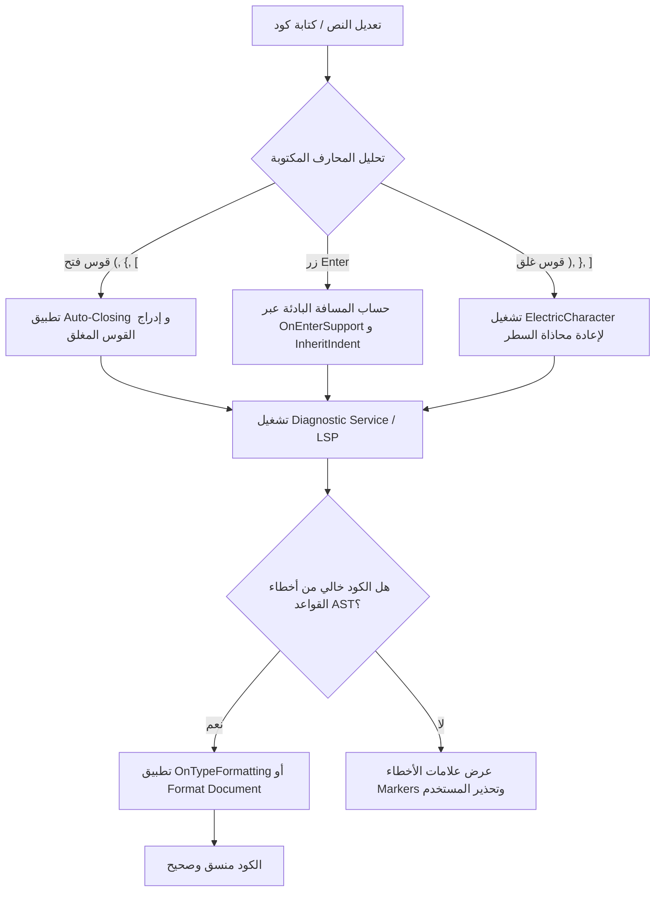

# تحليل الشامل لخصائص وإمكانيات محرر VS Code (Monaco Editor Architecture)

تصف هذه الوثيقة تحليلاً شاملاً ودقيقاً لبنية وآليات محرر VS Code استناداً إلى الشفرة المصدرية للمشروع في `/home/osm/Downloads/vscode-main/vscode-main`. تغطي هذه الوثيقة آليات تنسيق الأكواد (Code Formatting)، المسافات البادئة (Indentation / Spacing 4)، معالجة الانتقال لسطر جديد (On Enter Rules)، إغلاق الأقواس التلقائي `(`, `{`, `[` (Auto-Closing & Electric Characters)، إضافة إلى الخصائص المتقدمة الأخرى للمحرر مثل إكمال الكود (IntelliSense)، طي الأكواد (Code Folding)، تعدد المؤشرات (Multi-Cursor)، التنقل بين التعاريف (Go to Definition)، التعديل المترابط (Linked Editing)، التلميحات المضمنة (Inlay Hints)، القوالب الجاهزة (Snippets)، وآليات التحقق من صحة الكود.

---

## 1. بنية وتنسيق الأكواد (Code Formatting Architecture)

يعتمد نظام تنسيق الكود في VS Code على معمارية مزودي التنسيق (Formatting Providers) التي تتكامل مع محرك Monaco Editor وبروتوكول سيرفر اللغة (LSP).

### 1.1 المكونات والمزودون الأساسيون (Formatting Providers)

توجد التعريفات الأساسية في `src/vs/editor/common/languages.ts` والتحكم الداخلي في `src/vs/editor/contrib/format/browser/format.ts`:

1. **`DocumentFormattingEditProvider`**:
   - مسجل لتنسيق المستند بالكامل (`editor.action.formatDocument`).
   - يوفر الدالة `provideDocumentFormattingEdits(model, options, token)`.
2. **`DocumentRangeFormattingEditProvider`**:
   - مسجل لتنسيق جزء محدد من المستند (`editor.action.formatSelection`).
   - يوفر الدالة `provideDocumentRangeFormattingEdits(model, range, options, token)`.
3. **`OnTypeFormattingEditProvider`**:
   - ينفذ التنسيق اللحظي أثناء كتابة محارف معينة (مثل `;`, `}`, `\n`).
   - يوفر الدالة `provideOnTypeFormattingEdits(model, position, ch, options, token)`.

### 1.2 محفزات التنسيق (Formatting Triggers)

| المحفز (Trigger) | الاختصار / الإعداد | الملف المسؤول / الدالة | الوصف |
| :--- | :--- | :--- | :--- |
| **Format Document** | `Shift + Alt + F` | `formatActions.ts` | تنسيق الكود للملف بالكامل بطلب صريح من المستخدم. |
| **Format Selection** | `Ctrl + K, Ctrl + F` | `formatActions.ts` | تنسيق التحديد (Selection Ranges) الحالي فقط. |
| **Format On Type** | `editor.formatOnType: true` | `FormatOnType` class | يتم استدعاؤه فور كتابة أحرف محددة معتمدة من اللغة. |
| **Format On Save** | `editor.formatOnSave: true` | `saveParticipants.ts` | تشغيل التنسيق تلقائياً قبل حفظ الملف على القرص. |
| **Format On Paste** | `editor.formatOnPaste: true` | `copyPasteController.ts` | تنسيق الجزء الملصق فور إدخاله. |

### 1.3 تطبيق التعديلات (Formatting Edits Execution)

تُرجع الملحقات (Extensions) مصفوفة من كائنات `TextEdit` التي تحتوي على `range` و `text` الجديد.
تتم إدارة تطبيق التعديلات عبر `FormattingEdit.execute` لضمان:

- عدم تلف مؤشر الكتابة (Cursor Position).
- دمج التعديلات في مكدس التراجع والإعادة (Undo/Redo Stack) كعملية واحدة atomic.

---

## 2. إدارة المسافات البادئة وحجم التاب (Spacing 4 & Indentation)

تتم إدارة المسافات البادئة عبر خيارات نموذج النص `ITextModel` وخدمات اكتشاف المحاذاة.

### 2.1 إعدادات التنسيق والمسافات (Indentation Options)

في `src/vs/editor/common/config/editorOptions.js` و `model.ts`:

- **`editor.tabSize`**: تحديد عدد المسافات لكل Tab (القيمة الافتراضية الشائعة هي `4`).
- **`editor.indentSize`**: حجم المسافة البادئة عند استخدام المسافات (يمكن أن يساوي `tabSize` أو يختلف عنه).
- **`editor.insertSpaces`**: قيمة بولية (`true` لاستخدام Spaces مثل 4 مسافات، أو `false` لاستخدام Tab الحقيقي `\t`).
- **`editor.detectIndentation`**: عندما تكون `true`، يكتشف المحرر تلقائياً نمط الملف المفتوح.

### 2.2 خوارزمية اكتشاف المسافات تلقائياً (`IndentationGuesser`)

الملف المسؤول: `src/vs/editor/common/model/indentationGuesser.ts`

يقوم الكائن `guessIndentation` بفحص أسطر الملف عند فتحه:

1. يحلل الفرق في المسافات البادئة بين الأسطر المتتالية (`spacesDiff`).
2. يستبعد أسطر المحاذاة الشكلية (مثل محاذاة معاملات الدوال أو المتغيرات المتعددة).
3. يحسب نسبة استخدام Spaces مقابل Tabs ويحدد هل المسافة البادئة 2 أم 4 مسافات تلقائياً.

### 2.3 تحويل المسافات البادئة (Indentation Conversion)

الملف المسؤول: `src/vs/editor/contrib/indentation/browser/indentation.ts`

يقدم المحرر أوامر مدمجة للتحويل والتعديل:

- **`IndentationToSpacesAction` (`editor.action.indentationToSpaces`)**: تحويل كافة علامات `\t` إلى مسافات (مثلاً 4 مسافات).
- **`IndentationToTabsAction` (`editor.action.indentationToTabs`)**: تحويل المسافات البادئة إلى Tabs.
- **`ChangeIndentationSizeAction` (`editor.action.changeTabSize`)**: تغيير حجم التاب ديناميكياً.

---

## 3. السلوك عند الانتقال إلى سطر جديد (`Enter` / Newline Rules)

عند قيام المستخدم بالضغط على زر `Enter` لإنشاء سطر جديد، يحلل المحرر سياق السطر الحالي لتعيين مستوى المسافة البادئة الصحيح.

### 3.1 معالجة زر الإدخال (`OnEnterSupport`)

الملف المسؤول: `src/vs/editor/common/languages/supports/onEnter.ts`

تعتمد الدالة `OnEnterSupport.onEnter()` على القواعد التالية لحساب `EnterAction`:

| الإجراء (`IndentAction`) | النتيجة والتعريف | مثال |
| :--- | :--- | :--- |
| **`None`** | الحفاظ على نفس المستوى الحالي للمسافة البادئة. | سطر عادي بين تعليمتين. |
| **`Indent`** | زيادة مستوى المسافة البادئة بمقدار واحد (مثلاً إضافة 4 مسافات). | الضغط على Enter بعد فتح قوس `{` أو شرط `if (...)`. |
| **`IndentOutdent`** | إضافة سطر جديد بمسافة بادئة زائدة + وضع القوس المغلق في السطر الذي يليه بمحاذاة القوس الفاتح. | الضغط على Enter بين `{` و `}`. |
| **`Outdent`** | تقليل مستوى المسافة البادئة للسطر الجديد بمقدار واحد. | الكلمات المفتاحية التابعة مثل `else` أو `catch`. |

### 3.2 تفاصيل السلوك عند الضغط على Enter بين `{` و `}`

عند الضغط على `Enter` عندما يكون مؤشر الكتابة بين قوسين متقابلين مثل `{` و `}`:

1. يتعرف المحرر على النمط عبر المطابقة المزدوجة (`beforeEnterText` ينتهي بـ `{` و `afterEnterText` يبدأ بـ `}`).
2. ترجع الدالة الإجراء `IndentAction.IndentOutdent`.
3. ينشئ المحرر سطرين:
   - **السطر الأول (المحتوى)**: منزاح بمقدار 4 مسافات إضافية، ويكون مؤشر الكتابة مستقراً فيه.
   - **السطر الثاني (القوس المغلق `}`)**: يعود إلى نفس مستوى المسافة البادئة للقوس الفاتح.

### 3.3 حاسبة الانزياح التلقائي (`autoIndent.ts`)

الملف المسؤول: `src/vs/editor/common/languages/autoIndent.ts`

تنفذ الدالة `getInheritIndentForLine()` الخوارزمية التالية:

1. تبحث صعوداً عن أحدث سطر غير فارغ ينتمي لنفس اللغة.
2. تفحص `IndentRules` للغة:
   - `increaseIndentPattern`: تعبير نمطي (Regex) للأسطر التي تزيد الانزياح.
   - `decreaseIndentPattern`: تعبير نمطي للأسطر التي تنقص الانزياح.
   - `indentNextLinePattern`: زيادة الانزياح للسطر التالي فقط.
   - `unIndentedLinePattern`: الأسطر التي يتم تجاهل حساب الانزياح منها.
3. تطبق المسافة البادئة الناتجة على السطر الجديد فور إنشائه.

---

## 4. السلوك عند كتابة الأقواس تلقائياً `(`, `{`, `[` (Auto-Closing & Electric Characters)

يتفاعل المحرر لحظياً مع كتابة الأقواس المفتوحة والمغلقة لتسهيل تجربة الكتابة وضمان سلامة القواعد.

### 4.1 إغلاق الأقواس التلقائي (`CharacterPairSupport`)

الملف المسؤول: `src/vs/editor/common/languages/supports/characterPair.ts`

يحدد الملف الأزواج المزدوجة للغات:

- `('(', ')')`, `('{', '}')`, `('[', ']')`, `('"', '"')`, `('\'', '\'')`.

#### وضعيات التفعيل (`editor.autoClosingBrackets`)

1. **`always`**: إدراج قوس الإغلاق دائماً فور كتابة قوس الفتح.
2. **`languageDefined`** (الافتراضي): الاعتماد على قواعد اللغة المعرفة.
3. **`beforeWhitespace`**: إدراج قوس الإغلاق فقط إذا كان الحرف التالي عبارة عن مسافة فارغة أو نهاية سطر.
4. **`never`**: تعطيل الإغلاق التلقائي.

#### محاصرة التحديد (Surrounding Selection)

عند تحديد نص بالماوس أو الكيبورد ثم كتابة `(`, `{`, أو `[`:

- لا يتم استبدال النص المحدد بالحرف، بل يتم إحاطة النص المحدد بين القوسين الفاتح والمغلق تلقائياً.

### 4.2 الأحرف الكهربائية وتعديل المحاذاة اللحظي (`BracketElectricCharacterSupport`)

الملف المسؤول: `src/vs/editor/common/languages/supports/electricCharacter.ts`

عندما يقوم المستخدم بكتابة قوس مغلق مثل `}` أو `]` أو `)` في بداية سطر جديد:

1. يعتبر المحرر هذه المحارف **أحرفاً كهربائية (Electric Characters)**.
2. تقوم الدالة `onElectricCharacter()` بالبحث التراجعي عن القوس المفتوح المطابق في المستند.
3. إذا تبين أن القوس المغلق موجود في سطر منفرد، يتم فوراً تعديل المسافة البادئة (Indentation) للسطر الحالي لتتطابق تماماً مع مستوى السطر المشتمل على القوس المفتوح المطابق.

---

## 5. خصائص مكملة متقدمة للمحرر (Advanced Editor Capabilities)

تتوسع إمكانيات محرر VS Code لتشمل مجموعة واسعة من الخصائص التفاعلية المسؤولة عن تحسين إنتاجية المطور:

### 5.1 الإكمال الذكي للكود (`IntelliSense / Suggest System`)

الملف المسؤول: `src/vs/editor/contrib/suggest/browser/suggestController.ts`

- **`CompletionItemProvider`**: يوفر قائمة المكملات (Completions) المشتملة على الدوال، المتغيرات، والكلمات المفتاحية.
- **أحرف التحفيز (`triggerCharacters`)**: فتح قائمة التوصيات تلقائياً عند كتابة محارف معينة (مثل `.` في الكائنات أو `::` أو `<`).
- **المحارف الملتزمة (`commitCharacters`)**: إدراج العنصر المظلل فور كتابة أحرف مثل `(`, `.`, `;`.
- **ذاكرة الاقتراحات (`SuggestMemory`)**: إعادة ترتيب القائمة وتفضيل العناصر التي كرر المستخدم اختيارها سابقاً.

### 5.2 طي الأكواد وقوائم الانزياح (`Code Folding`)

الملف المسؤول: `src/vs/editor/contrib/folding/browser/folding.ts`

- **`FoldingRangeProvider`**: مزود نطاقات الطي بناءً على الهيكل البرمجي.
- **`IndentRangeProvider`**: مزود طي يعتمد على مستوى المسافة البادئة (Indentation-based Folding)، وهو مفيد جداً للغات مثل Python و YAML.
- **`SyntaxFoldingRangeProvider`**: طي يعتمد على الشجرة النحوية والأقواس وأقسام المنطقة مثل `//#region` و `//#endregion`.

### 5.3 تعدد المؤشرات والتحديد المتقدم (`Multi-Cursor & Selections`)

الملف المسؤول: `src/vs/editor/contrib/multicursor/browser/multicursor.ts`

- **إضافة مؤشر إضافي**: `Alt + Click` أو `Ctrl + Alt + Up/Down` لإدراج مؤشرات متعددة تعمل بشكل متوازٍ.
- **تحديد المطابق التالي (`Select Highlights`)**: الضغط على `Ctrl + D` للبحث عن النص المحدد وإضافة مؤشر في المطابقة التالية تلقائياً.
- **التحديد الكتل العمودي (`Box / Column Selection`)**: `Shift + Alt + Mouse Drag` للتحديد والتحرير العمودي عبر الأسطر المتعددة.

### 5.4 التنقل البرمجي والمعاينة السريعة (`Go to Symbol & Peek View`)

الملف المسؤول: `src/vs/editor/contrib/gotoSymbol/browser/goToCommands.ts`

- **الانتقال للتعريف (`Go to Definition - F12`)**: استخدام `DefinitionProvider` للقفز المباشر لمكان تعريف المتغير أو الدالة.
- **البحث عن المراجع (`Find References - Shift+F12`)**: استخدام `ReferenceProvider` لعرض كافة أماكن استخدام الرمز.
- **نافذة المعاينة (`Peek View Widget`)**: إظهار المعاينة الشجرية للمراجع أو التعاريف داخل المحرر دون إغلاق الملف الحالي.

### 5.5 الإكمال المباشر والذكاء الاصطناعي (`Inline Completions & Ghost Text`)

الملف المسؤول: `src/vs/editor/contrib/inlineCompletions/browser/inlineCompletionsController.ts`

- **`InlineCompletionsProvider`**: مزود الإكمال المباشر الذي يعرض نصاً رمادياً مؤقتاً (Ghost Text) داخل السطر الحالي.
- **التكامل مع المساعدات الذكية**: يُستخدم هذا المكون من قبل مساعدات الذكاء الاصطناعي (مثل GitHub Copilot) لاقتراح كتل برمجية كاملة يقبلها المستخدم بزر `Tab`.

### 5.6 التعديل المترابط للأوساط والأقواس (`Linked Editing Ranges`)

الملف المسؤول: `src/vs/editor/contrib/linkedEditing/browser/linkedEditing.ts`

- **`LinkedEditingRangeProvider`**: يربط النطاقات النصية المتقابلة معاً.
- **النتيجة العملية**: عند تعديل اسم وسم الفتح في ملفات HTML/XML مثل `
` يغير المحرر اسم وسم الإغلاق `
` تلقائياً وفي نفس اللحظة.

### 5.7 التلميحات المضمنة وتواقيع الدوال (`Inlay Hints & Parameter Hints`)

الملفات المسؤولة: `src/vs/editor/contrib/inlayHints/` و `src/vs/editor/contrib/parameterHints/`

- **التلميحات المضمنة (`Inlay Hints`)**: إدراج أسماء المعاملات المتوقعة `foo(bar: 123)` أو الأنواع المستنتجة `val x: String` داخل كود المحرر بشكل بصري خفيف لا يغير النص الفعلي.
- **تلميحات التواقيع (`Parameter Hints`)**: فتح صندوق تلميح يحتوي على توقيع الدالة والمعامل الحالي فور كتابة `(` أو `,`.

### 5.8 إدارة القوالب الجاهزة (`Snippets & Template Expansion`)

الملف المسؤول: `src/vs/editor/contrib/snippet/browser/snippetController2.ts`

- **محطات التنقل (`TabStops`)**: التنقل بين خانات القالب عبر `Tab` (`$1`, `$2`).
- **المتغيرات الديناميكية**: دعم استبدال القيم الحية مثل اسم الملف (`$TM_FILENAME`) أو التاريخ والوقت أثناء التوسيع.

### 5.9 البحث والاستبدال المتقدم داخل المحرر (`In-Editor Find & Replace`)

الملف المسؤول: `src/vs/editor/contrib/find/browser/findController.ts`

- دعم التعبيرات النمطية (Regular Expressions).
- البحث الحساس لحالة الأحرف (Match Case) والكلمات الكاملة (Whole Word).
- استبدال الكلمات عبر النطاق المحدد من النص فقط (Find in Selection).

---

## 6. خطوات وآليات التحقق من صحة وتنسيق الكود (Code Verification Steps)

تتنوع خطوات التحقق من صحة الكود وتنسيقه بين فحص أخطاء البناء القواعدي (Syntax Verification) وضمان قواعد التنسيق الشكلي (Formatting Standard Verification).

### 6.1 آليات التشخيص وإشارات الأخطاء (Diagnostics & Markers System)

الملف المسؤول: `src/vs/platform/markers/common/markers.ts` و `IMarkerService`

1. **التحقق اللحظي عبر سيرفر اللغة (LSP Diagnostics)**:
   - عند كل تعديل في الكود، يرسل المحرر حدث `textDocument/didChange`.
   - يقوم محرك اللغة (مثل TypeScript Language Service) بفحص الشجرة النحوية (AST).
   - ترجع الأخطاء في صورة `Diagnostic` وتحول إلى `IMarker` لتعلم المستخدم بوجود أخطاء بناء أو أقواس غير مغلقة.
2. **شريط الحالة وإشارات الوصول**:
   - يتم تشغيل إشارات صوتية وبرمجية (`AccessibilitySignal.format`) للتحقق من نجاح عملية التنسيق.

### 6.2 قواعد التنسيق للمشروع (Project Formatting Standards)

يحتوي مشروع VS Code نفسه على ملفات تعريف لضمان الاتساق:

- **`.editorconfig`**: يحدد حجم المسافات البادئة لكل امتداد ملف (مثلاً `indent_style = tab` أو `indent_size = 4`).
- **`eslint.config.js`**: يحدد قواعد تنسيق وتدقيق كود JavaScript/TypeScript.
- **`tsfmt.json`**: إعدادات تنسيق ملفات TypeScript.

### 6.3 اختبارات الوحدة المؤتمتة للتنسيق والمسافات (Automated Unit Testing)

توجد ملفات الاختبار في:

- `src/vs/editor/contrib/indentation/test/browser/indentation.test.ts`
- `src/vs/editor/test/common/modes/supports/indentationRules.ts`
- `src/vs/editor/contrib/format/test/browser/`

تتأكد هذه الاختبارات من:

1. دقة حساب المسافات البادئة عند استخدام 4 مسافات أو Tabs.
2. سلامة تطبيق قواعد `onEnter` عند الضغط على زر Enter داخل الهياكل البرمجية المختلفة.
3. عدم تغيير سلامة الكود البرمجي (AST Integrity) بعد تطبيق التنسيق.

### 6.4 الخطوات الموصى بها للتحقق من تنسيق وصحة الكود عند تطوير محرر

#### خطوات التحقق التشغيلية

1. **التحقق من اكتمال الأقواس (Bracket Pair Balance Check)**:
   - التحقق من تكافؤ عدد أقواس الفتح والإغلاق وعدم وجود أقواس معلقة.
2. **التحقق من مسافات السطر البادئة (Indentation Alignment Check)**:
   - التأكد من أن السطر ينتهي أو يبدأ بمضاعفات حجم التاب المحدد (مثلاً 4, 8, 12 مسافة).
3. **التحقق عبر مخرجات التنسيق (Format Application Validation)**:
   - مقارنة نطاق النص قبل التنسيق وبعد التنسيق والتأكد من إزالة المسافات الزائدة في نهايات الأسطر (Trailing Whitespace).
4. **التحقق القواعدي (Syntax Diagnostics Pass)**:
   - التأكد من عدم توليد أي تحذيرات أو أخطاء جديدة في `IMarkerService`.

---

## 7. جدول ملخص شامل لإمكانيات المحرر

| الميزة / الخصيصة | الفئة / الملف المسؤول | النتيجة العملية |
| :--- | :--- | :--- |
| **تنسيق المستند** | `DocumentFormattingEditProvider` | تنسيق شامل للملف عند طلب المستخدم أو الحفظ. |
| **Spacing 4** | `tabSize: 4` + `IndentationGuesser` | إدراج 4 مسافات لكل انزياح واكتشاف التنسيق تلقائياً. |
| **سطر جديد بين `{}`** | `OnEnterSupport` (`IndentOutdent`) | إنشاء سطر منزاح بـ 4 مسافات وسطر تالٍ للقوس المغلق. |
| **كتابة الأقواس `(`, `{`, `[`** | `CharacterPairSupport` & `electricCharacter` | إغلاق القوس تلقائياً وإعادة محاذاة القوس المغلق عند كتابته. |
| **الإكمال الذكي (IntelliSense)** | `SuggestController` & `SuggestModel` | فتح قائمة الاقتراحات وإدراج الخيار المناسب. |
| **طي الأكواد (Code Folding)** | `FoldingController` & `IndentRangeProvider` | طي الأجزاء البرمجية بناءً على الهيكل أو الانزياح. |
| **تعدد المؤشرات (Multi-Cursor)** | `MultiCursorController` & `Ctrl+D` | تحرير متعدد في أماكن متفرقة بنفس الوقت. |
| **التنقل للتعاريف (Go to Def)** | `goToCommands.ts` & `Peek View` | القفز لمكان تعريف المتغيرات والدوال أو معاينتها. |
| **الإكمال المباشر (Inline AI)** | `InlineCompletionsController` & `GhostText` | اقتراح الكود المباشر الذكي القابل للقبول بزر Tab. |
| **التعديل المترابط (Linked Editing)** | `LinkedEditingController` | تعديل وسوم HTML/XML المتقابلة تلقائياً. |
| **التلميحات المضمنة (Inlay Hints)** | `InlayHintsController` | عرض أسماء المعاملات والأنواع المستنتجة بصرياً. |
| **القوالب الجاهزة (Snippets)** | `SnippetController2` | إدراج القوالب والتنقل بين خاناتها بزر Tab. |
| **التحقق من صحة الكود** | `IMarkerService` & Unit Tests | ضمان خلو الكود من الأخطاء القواعدية والمحافظة على التنسيق. |
