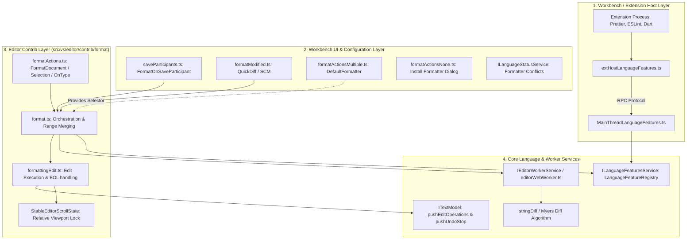
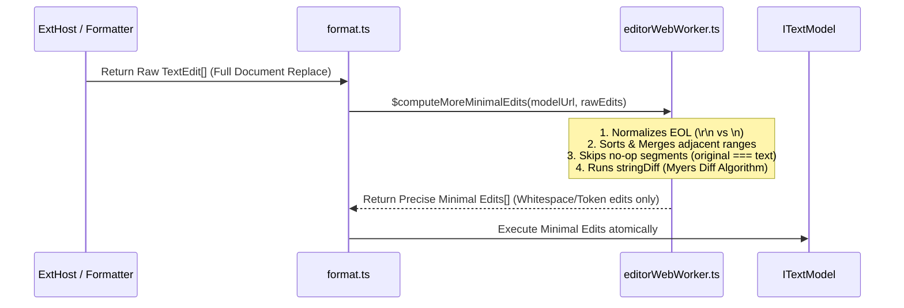
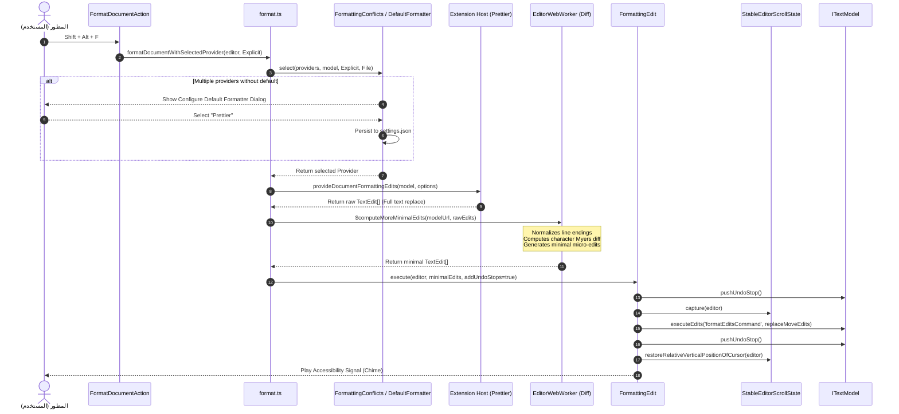

# التحليل المعماري الشامل لنظام وتنسيق الأكواد في VS Code (Code Formatting Architecture)

## الفهرس العام

1. [المقدمة والملخص التنفيذي](#1-المقدمة-والملخص-التنفيذي)
2. [الهيكل العام وطبقات المعمارية (Architectural Layers)](#2-الهيكل-العام-وطبقات-المعمارية-architectural-layers)
3. [أنواع التنسيق ونطاقاته (Formatting Types & Scopes)](#3-أنواع-التنسيق-ونطاقاته-formatting-types--scopes)
4. [واجهات المزودات وسجل الميزات (Providers & Language Feature Registry)](#4-واجهات-المزودات-وسجل-الميزات-providers--language-feature-registry)
5. [المزودات الاصطناعية (Synthetic Providers) والتوافق الخلفي](#5-المزودات-الاصطناعية-synthetic-providers-والتوافق-الخلفي)
6. [محرك حل النزاعات واختيار المنسق الافتراضي (Conflict Resolution & Default Formatter)](#6-محرك-حل-النزاعات-واختيار-المنسق-الافتراضي-conflict-resolution--default-formatter)
7. [محرك حساب التعديلات الدنيا (Minimal Edits Diff Engine) ودور WebWorker](#7-محرك-حساب-التعديلات-الدنيا-minimal-edits-diff-engine-ودور-webworker)
8. [آلية تنفيذ التعديلات واستقرار المحرر (FormattingEdit & Scroll/Cursor Stability)](#8-آلية-تنفيذ-التعديلات-واستقرار-المحرر-formattingedit--scrollcursor-stability)
9. [محفزات وسلوكيات التنسيق التلقائي (Automatic Formatting Behaviors)](#9-محفزات-وسلوكيات-التنسيق-التلقائي-automatic-formatting-behaviors)
   - [أ. التنسيق أثناء الكتابة (Format On Type)](#أ-التنسيق-أثناء-الكتابة-format-on-type)
   - [ب. التنسيق عند اللصق (Format On Paste)](#ب-التنسيق-عند-اللصق-format-on-paste)
   - [ج. التنسيق عند الحفظ (Format On Save & Save Participants)](#ج-التنسيق-عند-الحفظ-format-on-save--save-participants)
   - [د. تنسيق التغييرات والأسطر المعدلة (Format Modified Lines / SCM QuickDiff)](#د-تنسيق-التغييرات-والأسطر-المعدلة-format-modified-lines--scm-quickdiff)
10. [معمارية الامتدادات وعملية IPC (Extension Host IPC & Adapters)](#10-معمارية-الامتدادات-وعملية-ipc-extension-host-ipc--adapters)
11. [إلغاء العمليات والتعامل مع تسابق الأحداث (Cancellation & Race Conditions)](#11-إلغاء-العمليات-والتعامل-مع-تسابق-الأحداث-cancellation--race-conditions)
12. [مخطط تدفق البيانات الشامل (End-to-End Data Flow Sequence)](#12-مخطط-تدفق-البيانات-الشامل-end-to-end-data-flow-sequence)
13. [المقارنة المعمارية مع محررنا الحالي والدروس المستفادة لمشروع Flutter](#13-المقارنة-المعمارية-مع-محررنا-الحالي-والدروس-المستفادة-لمشروع-flutter)

---

## 1. المقدمة والملخص التنفيذي

يُعد نظام تنسيق الأكواد في **Visual Studio Code** أحد أرقى الأمثلة الهندسية على فصل المسؤوليات (Separation of Concerns)، وتحقيق التوازن الدقيق بين **الأداء الفائق بدون تجميد واجهة المستخدم (Non-blocking UI)**، **تجربة المستخدم السلسة (Seamless UX)**، و**المرونة اللانهائية للمطورين والامتدادات (Extensibility)**.

في العديد من المحررات البسيطة، يُنظر إلى «التنسيق» على أنه مجرد عملية استبدال لنص الملف بالكامل بنص مخرجات أداة خارجية (مثل Prettier أو Clang-Format أو dart format). ولكن هذا النهج الساذج يتسبب في كوارث برمجية وتجريبية:

1. **فقدان حالة المؤشرات والتحديدات (Loss of Selection & Cursor Jump)**: ارتداد المؤشر لبداية أو نهاية المستند.
2. **تدمير سجل التراجع (Polluting the Undo/Redo Stack)**: إدراج عمليات ضخمة تجعل التراجع عملية عشوائية.
3. **تدمير مصفوفات الإشارات المرجعية ونقاط التوقف والطي (Breakpoints & Code Folds Invalidation)**: لأن استبدال النص بالكامل يمسح معرفات الأسطر.
4. **تجميد الخيط الرئيسي (Main Thread Freezing)**: عند تنسيق ملفات تحوي عشرات الآلاف من الأسطر.

يقوم VS Code بحل هذه المشكلات جذرياً عبر معمارية متعددة الطبقات تتألف من:

- **عقود نقية (Pure Contracts)** تحددها طبقة `languages`.
- **وسيط لاختيار وتنسيق المزودات (`FormattingConflicts`)** يفصل النواة المستقلة (Monaco) عن واجهة سطح المكتب (Workbench).
- **محرك لتقليص التعديلات (`computeMoreMinimalEdits`)** يعمل داخل خيط منفصل (Web Worker) ليحول استبدال الملف الكامل إلى عمليات تعديل مجهرية (Micro Text Edits).
- **مُثبّت لحالة التمرير والمؤشر (`StableEditorScrollState`)**.
- **نظام تكامل متقدم مع إدارة الإصدارات (Git / SCM)** لتنسيق الأسطر المعدلة فقط دون المساس بباقي المستند المشترك مع فريق العمل.

---

## 2. الهيكل العام وطبقات المعمارية (Architectural Layers)

تتوزع كودات نظام التنسيق في شجرة مشروع VS Code (`/home/osm/Downloads/vscode-main/vscode-main`) عبر طبقات هندسية صارمة:



### توصيف الطبقات ومواقع الملفات في السورس كود

1. **طبقة تعريف العقود والأنماط (Domain Abstractions)**:
   - `src/vs/editor/common/languages.ts`: تُعرّف الواجهات الأساسية (`DocumentFormattingEditProvider`، `DocumentRangeFormattingEditProvider`، `OnTypeFormattingEditProvider`، `FormattingOptions`).
2. **طبقة تنسيق المحرر الأساسية (Editor Contrib Orchestration)**:
   - `src/vs/editor/contrib/format/browser/format.ts`: المحرك الأوسط، يحتوي على دمج النطاقات المتداخلة، وتحويل المزودات الاصطناعية، وإدارة كائنات الإلغاء، والتنسيق عبر المزود المختار.
   - `src/vs/editor/contrib/format/browser/formatActions.ts`: تسجيل أوامر المستخدم واختصارات لوحة المفاتيح وتتبع الكتابة واللصق (`FormatOnType`، `FormatOnPaste`).
   - `src/vs/editor/contrib/format/browser/formattingEdit.ts`: التطبيق الفعلي للتعديلات على `ITextModel` مع حفظ مواضع التمرير ووقفات التراجع (Undo Stops) ومعالجة نهاية الأسطر (EOL).
3. **طبقة تكامل واجهة المستخدم وبيئة العمل (Workbench Integration & Policies)**:
   - `src/vs/workbench/contrib/format/browser/formatActionsMultiple.ts`: معالجة النزاعات عند وجود أكثر من منسق، وتعيين المنسق الافتراضي `editor.defaultFormatter`، وقوائم QuickPick، وإشعارات شريط الحالة.
   - `src/vs/workbench/contrib/format/browser/formatModified.ts`: حساب التعديلات بالتعاون مع `IQuickDiffService` لميزة "Format Modified Lines".
   - `src/vs/workbench/contrib/codeEditor/browser/saveParticipants.ts`: المشاركة في دورة حياة الحفظ `FormatOnSaveParticipant`.
   - `src/vs/workbench/contrib/format/browser/formatActionsNone.ts`: السلوك المتبع عند غياب أي منسق (توجيه المستخدم لتثبيت منسق من المتجر).
4. **طبقة العمال والحوسبة الخلفية (Worker / Background Services)**:
   - `src/vs/editor/common/services/editorWebWorker.ts`: تنفيذ خوارزمية Diff المجهرية `$computeMoreMinimalEdits` خارج الخيط الرئيسي.
5. **طبقة الامتدادات ومضيف العمليات (Extension Host & IPC)**:
   - `src/vs/workbench/api/common/extHostLanguageFeatures.ts`: تحويل واجهات برمجة الامتدادات العامة (`vscode.DocumentFormattingEditProvider`) إلى صيغ داخلية.

---

## 3. أنواع التنسيق ونطاقاته (Formatting Types & Scopes)

يمتلك VS Code تصنيفاً دقيقاً لنطاقات وأنواع التنسيق، ولا يعاملها بنهج موحد بل يخصص لكل منها مسار تنفيذ فريد:

| نوع التنسيق | النطاق (Scope) | طريقة التحفيز (Trigger) | السلوك والقيود | الواجهة المسؤولة (Interface) |
| :--- | :--- | :--- | :--- | :--- |
| **Document Formatting** | كامل المستند (`1:1` إلى نهاية الملف) | صريح (Explicit): `Shift+Alt+F` أو من قائمة الأوامر | يتطلب اختيار منسق افتراضي في حال التعدد، ينسق كافة الأسطر، يعالج فواصل الأسطر EOL | `DocumentFormattingEditProvider` (أو Synthetic Range) |
| **Range / Selection Formatting** | تحديد واحد أو عدة تحديدات نشطة | صريح (Explicit): `Ctrl+K Ctrl+F` | يوسع التحديد الفارغ ليشمل كامل السطر الحالي، يدمج النطاقات المتلامسة أو المتقاطعة | `DocumentRangeFormattingEditProvider` |
| **Multi-Range Formatting** | مصفوفة نطاقات غير متصلة (`Range[]`) | برمجياً أو عبر التحديدات المتعددة | يستدعي `provideDocumentRangesFormattingEdits` إن وُجد دفعة واحدة، أو يستدعي الفردي بالتتابع ويدمج التصادمات | `DocumentRangeFormattingEditProvider` (method `provideDocumentRangesFormattingEdits`) |
| **Format On Type** | السطر/البلوك الحالي حول المؤشر | تلقائي وضمني (Implicit): عند كتابة محرف محفز (مثل `;`, `}`, `\n`) | خفيف وسريع جداً، يُلغى فوراً إذا كتب المستخدم قبل موضع التنسيق، لا يعمل مع التحديدات المتعددة | `OnTypeFormattingEditProvider` |
| **Format On Paste** | النطاق النصي الذي تم لصقه حديثاً | تلقائي (Implicit): فور حدث اللصق `onDidPaste` | يعمل بوضع صامت (`FormattingMode.Silent`)، يتطلب دعم التنسيق بالنطاق، لا يعمل مع التحديدات المتعددة | `DocumentRangeFormattingEditProvider` |
| **Format On Save** | كامل المستند أو الأسطر المعدلة فقط | تلقائي عند حفظ الملف (Explicit Save فقط) | يتبع إعداد `editor.formatOnSaveMode`، صامت، يظهر مؤشر تقدم في شريط الحالة مع رابط إعدادات | `DocumentFormattingEditProvider` أو `RangeFormattingProvider` |
| **Format Modified Lines** | الأسطر التي تغيرت مقارنة بمستودع Git | صريح أو عبر `formatOnSaveMode: 'modifications'` | يعتمد على `IQuickDiffService` لإنتاج النطاقات المتسخة (Dirty Diff) ثم ينسقها بدقة | `DocumentRangeFormattingEditProvider` + SCM Service |

---

## 4. واجهات المزودات وسجل الميزات (Providers & Language Feature Registry)

تعتمد البنية التحتية في `src/vs/editor/common/languages.ts` على واجهات صريحة تمثل العقد بين النواة والامتدادات:

```typescript
// 1. خيارات التنسيق الأساسية التي يرسلها المحرر للمزود
export interface FormattingOptions {
    tabSize: number;        // حجم المسافة الجدولة
    insertSpaces: boolean;   // استخدام المسافات عوضاً عن الجدولة الحقيقية
    [key: string]: boolean | number | string; // خيارات مخصصة إضافية
}

// 2. مزود تنسيق كامل المستند
export interface DocumentFormattingEditProvider {
    readonly extensionId?: ExtensionIdentifier;
    readonly displayName?: string;
    provideDocumentFormattingEdits(
        model: ITextModel,
        options: FormattingOptions,
        token: CancellationToken
    ): ProviderResult<TextEdit[]>;
}

// 3. مزود تنسيق نطاق أو عدة نطاقات
export interface DocumentRangeFormattingEditProvider {
    readonly extensionId?: ExtensionIdentifier;
    readonly displayName?: string;
    provideDocumentRangeFormattingEdits(
        model: ITextModel,
        range: Range,
        options: FormattingOptions,
        token: CancellationToken
    ): ProviderResult<TextEdit[]>;

    // دعم اختياري لتنسيق نطاقات متعددة دفعة واحدة (Batch)
    provideDocumentRangesFormattingEdits?(
        model: ITextModel,
        ranges: Range[],
        options: FormattingOptions,
        token: CancellationToken
    ): ProviderResult<TextEdit[]>;
}

// 4. مزود التنسيق أثناء الكتابة
export interface OnTypeFormattingEditProvider {
    readonly extensionId?: ExtensionIdentifier;
    autoFormatTriggerCharacters: string[]; // المحارف التي تطلق التنسيق (مثل ';', '}')
    provideOnTypeFormattingEdits(
        model: ITextModel,
        position: Position,
        ch: string,
        options: FormattingOptions,
        token: CancellationToken
    ): ProviderResult<TextEdit[]>;
}
```

### إدارة المزودات في `LanguageFeatureRegistry`

لا يتم تخزين المزودات في قائمة خطية بسيطة، بل تسجل في `LanguageFeatureRegistry<T>` التابع لـ `ILanguageFeaturesService`.

- يتم تقييم المزود عند طلبه لكل `ITextModel` بناءً على تطابق محدد المستند (Document Selector: لغة، مسار ملف، نمط Glob، نمط URI Scheme).
- توفر الدالة `ordered(model)` قائمة مرتبة تنازلياً حسب دقة التطابق (Score Match: تطابق لغة ومسار > تطابق لغة فقط > تطابق عام `*`).

---

## 5. المزودات الاصطناعية (Synthetic Providers) والتوافق الخلفي

أحد أذكى الحلول المعمارية في VS Code موجود في دالة:
`getRealAndSyntheticDocumentFormattersOrdered` بملف `format.ts`.

### المشكلة

بعض الامتدادات تسجل فقط `DocumentRangeFormattingEditProvider` (لأنها قادرة على تنسيق أي نطاق محدد)، ولكنها تهمل تسجيل `DocumentFormattingEditProvider` لتنسيق المستند كاملاً. إذا طلب المستخدم "Format Document"، فهل يفشل المحرر بحجة عدم وجود منسق مستند؟

### الحل المعماري في VS Code

يقوم المحرر تلقائياً بإنشاء **مزود اصطناعي (Synthetic Formatter)**:

1. يجمع كل منسقات المستند الأصلية (`documentFormattingEditProvider.ordered(model)`).
2. يمر على كل منسقات النطاق (`documentRangeFormattingEditProvider.ordered(model)`).
3. إذا وجد منسق نطاق لم يقم امتداده بتسجيل منسق مستند أصلي، يقوم بتغليفه ديناميكياً داخل كائن اصطناعي:

```typescript
result.push({
    displayName: formatter.displayName,
    extensionId: formatter.extensionId,
    provideDocumentFormattingEdits(model, options, token) {
        // يحول طلب تنسيق المستند إلى تنسيق نطاق يشمل كامل المستند!
        return formatter.provideDocumentRangeFormattingEdits(
            model,
            model.getFullModelRange(),
            options,
            token
        );
    }
});
```

بهذه الحيلة، يرتفع معدل التوافق مع امتدادات المجتمع بنسبة 100% دون أن يشعر المستخدم بأي خلل.

---

## 6. محرك حل النزاعات واختيار المنسق الافتراضي (Conflict Resolution & Default Formatter)

عند وجود أكثر من امتداد يدعم تنسيق نفس اللغة (مثال: في ملفات JavaScript يوجد `Prettier` و `TypeScript Language Features` و `Biome`)، كيف يتصرف VS Code؟

### 1. تجريد وسيط النزاعات (`FormattingConflicts`)

في نواة المحرر (`format.ts`)، توجد فئة مجردة ساكنة:

```typescript
export abstract class FormattingConflicts {
    private static readonly _selectors = new LinkedList<IFormattingEditProviderSelector>();

    static setFormatterSelector(selector: IFormattingEditProviderSelector): IDisposable {
        const remove = FormattingConflicts._selectors.unshift(selector);
        return { dispose: remove };
    }

    static async select<T>(formatter: T[], document: ITextModel, mode: FormattingMode, kind: FormattingKind): Promise<T | undefined> {
        if (formatter.length === 0) return undefined;
        const selector = Iterable.first(FormattingConflicts._selectors);
        return selector ? await selector(formatter, document, mode, kind) : undefined;
    }
}
```

- **Monaco Editor (النسخة المستقلة)**: تسجل `formatter[0]` كحل بدائي فوري.
- **VS Code Workbench**: تسجل فئة `DefaultFormatter` الكاملة في `formatActionsMultiple.ts`.

### 2. تدفق القرار والتحليل في `DefaultFormatter._analyzeFormatter`

تتبع العملية المراحل الآتية:

1. **فحص الإعدادات باللغة المحددة (Scoped Configuration Lookup)**:
   - يبحث عن قيمة المفتاح `editor.defaultFormatter` مع تمرير معرف اللغة ومسار الملف كـ Override:

   ```typescript
   const defaultFormatterId = this._configService.getValue<string>('editor.defaultFormatter', {
       resource: document.uri,
       overrideIdentifier: document.getLanguageId()
   });
   ```

2. **التحقق من المنسق المُهيأ**:
   - إذا كان معرف الامتداد مسجلاً وموجوداً في قائمة المزودات النشطة للملف، يتم اختياره فوراً.
   - إذا كان الامتداد مثبتاً ومفعلاً ولكنه لا يدعم نوع التنسيق المطلوب (مثلاً يدعم تنسيق المستند بالكامل ولا يدعم تنسيق النطاقات `Range`)، يُرجع VS Code رسالة واضحة للمستخدم:
     `"Extension 'X' is configured as formatter but it can only format 'Y'-files as a whole, not selections or parts of it."`
3. **غياب الإعداد مع وجود خيار وحيد**:
   - إذا لم يحدد المستخدم منسقاً افتراضياً، ولكن يوجد منسق واحد فقط مسجل للملف، يختاره المحرر تلقائياً دون إزعاج المستخدم.
4. **تعدد المنسقات مع عدم وجود إعداد (Conflict Resolution)**:
   - **الوضع الصريح (Explicit Mode - استدعاء مباشر من المستخدم)**:
     يُعرض صندوق حوار تأكيدي (`IDialogService.confirm`) بعنوان **"Configure Default Formatter"** مع زر `Configure...`.
     عند النقر، تُفتح قائمة `QuickPick` بأسماء الامتدادات المتاحة، وعند اختيار أحدها يتم تحديث وحفظ الإعداد تلقائياً في `settings.json` للغة المحددة:
     `"[typescript]": { "editor.defaultFormatter": "esbenp.prettier-vscode" }`
   - **الوضع الصامت (Silent Mode - مثل التنسيق عند الحفظ أو اللصق)**:
     لا يتم فتح نوافذ حوار تقطع انسيابية المستخدم؛ بدلاً من ذلك، يُرسل إشعار صامت (`NotificationPriority.SILENT`)، ويُسجل بند خطأ في **شريط الحالة (Language Status Bar)** مع أمر سريع قابل للنقر للتهيئة لاحقاً.

### 3. ترتيب الامتدادات ودعم الفئات في QuickPick

عند عرض خيارات المنسقات للمستخدم، يقوم المحرر بترتيب الامتدادات عبر خوارزمية ذكية:

- **الأولوية المطلقة (Ultimate Boost)**: للامتدادات التي قامت فعلياً بتسجيل منسق (Formatter Provider) نشط.
- **الأولوية الثانوية (Secondary Boost)**: للامتدادات المصنفة تحت فئة `Formatters` أو `Programming Languages` في `package.json`.
- الترتيب الأبجدي للاسم.

---

## 7. محرك حساب التعديلات الدنيا (Minimal Edits Diff Engine) ودور WebWorker

واحدة من أعظم الخصائص المعمارية في VS Code هي أن المحرر **لا يثق أبداً في دقة مخرجات أدوات التنسيق الخارجية**!

### المشكلة

أدوات مثل Prettier أو عمال اللغات تعيد عادة تعديلاً واحداً ضخماً:
`{ range: [1, 1 -> 5000, 80], text: "<كل النص الجديد المنسق>" }`
إذا استبدل المحرر 5000 سطر دفعة واحدة:

- سيفقد المستخدم موضع المؤشر تماماً.
- ستتلخبط حالة التمرير (Viewport Scroll).
- ستُحذف جميع الإشارات المرجعية والطي البرمجي.
- ستتضخم ذاكرة التراجع (Undo Buffer) بعملية استبدال كاملة لملف ضخم.

### الحل في VS Code

يتم تمرير مخرجات المنسق دائماً إلى:
`workerService.computeMoreMinimalEdits(model.uri, rawEdits)`



### خوارزمية العمل داخل `editorWebWorker.ts`

1. **فرز التعديلات ودمج النطاقات المتلامسة**:
   تُرتب التعديلات بحسب بدايتها، وتُنقل تعديلات نهاية السطر (EOL) إلى النهاية. إذا كان هناك تعديلان متجاوران يتشاركان نقطة البداية والنهاية، يتم دمجهما في نطاق واحد.
2. **استبعاد العمليات الصفرية (No-op Elimination)**:
   إذا كان النص الأصلي داخل النطاق مطابقاً تماماً للنص الجديد بعد توحيد فواصل الأسطر، يتم تجاهل التعديل فوراً.
3. **حساب الفارق المجهري (Micro-diffing via `stringDiff`)**:
   إذا كان حجم النصين أقل من حاجز الأمان `_diffLimit = 100,000` حرف، يستدعي المحرر خوارزمية `stringDiff` لحساب الفروقات الحرفية المحددة.
4. **توليد تعديلات دقيقة**:
   ينتج عن ذلك مصفوفة من التعديلات المجهرية؛ بدلاً من استبدال 5000 سطر، قد يعود التعديل كإضافة مسافتين في السطر 42 وحذف سطر فارغ في السطر 118 فقط!

---

## 8. آلية تنفيذ التعديلات واستقرار المحرر (FormattingEdit & Scroll/Cursor Stability)

في ملف `src/vs/editor/contrib/format/browser/formattingEdit.ts`، تتم إدارة الدورة الحرجة لتطبيق التعديلات على المستند عبر الفئة `FormattingEdit`:

```typescript
export class FormattingEdit {
    static execute(editor: ICodeEditor, _edits: TextEdit[], addUndoStops: boolean) {
        if (addUndoStops) {
            editor.pushUndoStop(); // فتح نقطة تراجع ذرية
        }
        
        // 1. التقاط حالة التمرير الحالية بالنسبة لموضع المؤشر
        const scrollState = StableEditorScrollState.capture(editor);
        
        // 2. معالجة وتطبيق أي تعديل على نظام نهاية الأسطر (EOL: CRLF / LF)
        const edits = FormattingEdit._handleEolEdits(editor, _edits);
        
        // 3. اختيار الاستراتيجية المناسبة لتطبيق التعديلات
        if (edits.length === 1 && FormattingEdit._isFullModelReplaceEdit(editor, edits[0])) {
            editor.executeEdits('formatEditsCommand', edits.map(edit => EditOperation.replace(Range.lift(edit.range), edit.text)));
        } else {
            // استخدام استراتيجية replaceMove للحفاظ على تحرك المؤشرات مع التعديل
            editor.executeEdits('formatEditsCommand', edits.map(edit => EditOperation.replaceMove(Range.lift(edit.range), edit.text)));
        }
        
        if (addUndoStops) {
            editor.pushUndoStop(); // إغلاق نقطة التراجع
        }
        
        // 4. استعادة موضع التمرير الرأسي النسبي للمؤشر بدقة تمنع القفز البصري
        scrollState.restoreRelativeVerticalPositionOfCursor(editor);
    }
}
```

### الخصائص الهندسية الفريدة في هذه المرحلة

1. **استقرار التمرير (`StableEditorScrollState`)**:
   يلتقط المحرر المسافة الرأسية بين المؤشر والحد العلوي لمنفذ العرض (Viewport). بعد تطبيق التعديلات التي قد تضيف أو تحذف أسطراً، يقوم بإعادة ضبط `scrollTop` بحيث يظل المؤشر ثابتاً في نفس النقطة البصرية على الشاشة أمام عين المستخدم.
2. **استراتيجية `replaceMove`**:
   تضمن أن العلامات (Markers) والمؤشرات الواقعة داخل نطاق التعديل يتم ترحيلها إلى نهاية النص المعدل بسلاسة بدلاً من إتلافها.
3. **الذرية في التراجع (`Undo Stops Isolation`)**:
   بوضع `pushUndoStop()` قبل وبعد التنفيذ، تُعامل عملية التنسيق المعقدة - مهما بلغ عدد التعديلات المجهرية فيها - كخطوة ذرية واحدة؛ بضغطة واحدة على `Ctrl+Z` يعود الكود تماماً كما كان قبل التنسيق.
4. **الإشارات الصوتية لإمكانية الوصول (Accessibility Signals)**:
   فور اكتمال التنسيق، يستدعي المحرر:
   `accessibilitySignalService.playSignal(AccessibilitySignal.format, { userGesture })`
   مما يُصدر نغمة سمعية مخصصة للمستخدمين ذوي الإعاقة البصرية تؤكد نجاح تنسيق النص.

---

## 9. محفزات وسلوكيات التنسيق التلقائي (Automatic Formatting Behaviors)

### أ. التنسيق أثناء الكتابة (Format On Type)

يُدار عبر المساهمة `FormatOnType` في `formatActions.ts`:

- **شروط التفعيل**:
  - خيار `editor.formatOnType` مفعل (افتراضياً `false`).
  - وجود منسق مسجل للملف يمتلك قائمة `autoFormatTriggerCharacters`.
  - وجود مؤشر واحد فقط دون تحديد محدد (Empty Selection).
- **التسجيل الذكي للأحداث**:
  يتم تحويل محارف التحفيز إلى مجموعة سريعة `CharacterSet`. عند كل نقرة زر `onDidType`، يتم فحص المحرف المدخل؛ إذا كان ضمن المحارف المحفزة (مثل إدخال `;` أو `}` أو Enter)، تنطلق العملية.
- **الحماية من تعارض الكتابة أثناء الحوسبة**:
  يثبت المحرر مراقباً فورياً على `onDidChangeModelContent`:
  إذا قام المستخدم بكتابة أي حرف في موضع يسبق السطر الحالي الذي يجري تنسيقه (`change.range.endLineNumber <= position.lineNumber`)، أو في حال تفريغ المستند (`isFlush`)، يتم إلغاء الـ `CancellationToken` فوراً وإسقاط التعديلات حتى لا تُطبق نتائج قديمة على كود جديد.

### ب. التنسيق عند اللصق (Format On Paste)

يُدار عبر `FormatOnPaste` في `formatActions.ts`:

- **شروط التفعيل**:
  - خيار `editor.formatOnPaste` مفعل.
  - وجود منسق يدعم النطاقات (`documentRangeFormattingEditProvider.has(model)`).
  - وجود مؤشر واحد.
- **الآلية**:
  فور وقوع حدث `onDidPaste({ range })`، يتم استدعاء `formatDocumentRangesWithSelectedProvider` وتمرير نطاق النص الملصوق فقط بوضع صامت (`FormattingMode.Silent`).

### ج. التنسيق عند الحفظ (Format On Save & Save Participants)

يُدار في `src/vs/workbench/contrib/codeEditor/browser/saveParticipants.ts` عبر الفئة `FormatOnSaveParticipant`:

- **دورة حياة الحفظ (Save Pipeline)**:
  عند طلب الحفظ، ينشئ المحرر خط أنابيب من المشتركين (`ITextFileSaveParticipant`) لمعالجة الملف قبل كتابته على القرص.
- **استثناء الحفظ التلقائي**:
  إذا كان الحفظ بسبب انتهاء مهلة التأخير (`context.reason === SaveReason.AUTO` الناتج عن `files.autoSave: "afterDelay"`)، يتم تجاوز التنسيق عمداً حتى لا يقفز الكود باستمرار أثناء توقف المستخدم اللحظي عن الكتابة.
- **أوضاع الحفظ (`editor.formatOnSaveMode`)**:
  1. `'file'`: ينسق كامل المستند عبر `formatDocumentWithSelectedProvider`.
  2. `'modifications'`: يستعلم عن التغييرات عبر `getModifiedRanges`؛ فإن لم تكن هناك تغييرات أو لا يوجد نظام تحكم بالنسخ (SCM)، لا يفعل شيئاً.
  3. `'modificationsIfAvailable'`: يحاول تنسيق الأسطر المعدلة فقط؛ وإذا كان الملف خارج مستودع Git، يتراجع تلقائياً لتنسيق الملف بأكمله!
- **عرض التقدم**:
  يعرض شريط الحالة رسالة:
  `"Running 'Prettier' Formatter (configure)."` مع رابط تشعبي مباشر ينقل المستخدم لإعدادات `editor.formatOnSave`.

### د. تنسيق التغييرات والأسطر المعدلة (Format Modified Lines / SCM QuickDiff)

يُدار في `src/vs/workbench/contrib/format/browser/formatModified.ts`:

- **المعضلة الشائعة في فرق العمل**:
  عند فتح ملف يحتوي على 3000 سطر غير منسقة وفق معاييرك، وإجراء تعديل على 5 أسطر فقط، فإن تنسيق الملف بالكامل سينشئ Git Diff هائل يفسد الـ Code Review ويغير الـ `git blame` لزملائك.
- **الحل في VS Code**:
  تستدعي دالة `getModifiedRanges`:
  1. جلب المورد الأصلي من مستودع Git عبر `IQuickDiffService.getOriginalResource`.
  2. استدعاء العامل لحساب الفروقات المتسخة `workerService.computeDirtyDiff(original, modified.uri)`.
  3. تحويل التغييرات إلى مصفوفة نطاقات `Range[]` تغطي بدقة أسطر البداية والنهاية للتعديلات فقط.
  4. استدعاء منسق النطاقات لتنسيق تلك الأسطر حصراً.

---

## 10. معمارية الامتدادات وعملية IPC (Extension Host IPC & Adapters)

في معمارية VS Code، تعمل الامتدادات (Extensions) في عملية نظام منفصلة تماماً تسمى **Extension Host Process**، بينما تعمل واجهة المحرر في **Renderer Process**.

```
[Renderer Process: MainThreadLanguageFeatures]
      │                               ▲
      │ 1. $provideDocumentFormattingEdits(handle, uri, options)
      ▼                               │
[Extension Host Process: ExtHostLanguageFeatures]
      │
      ├─► DocumentFormattingAdapter.provideDocumentFormattingEdits()
      │         │
      │         ▼
      │   vscode.DocumentFormattingEditProvider (Prettier / Clang / etc.)
      │         │
      │         ▼ Returns: vscode.TextEdit[]
      │
      └─► typeConvert.TextEdit.from() -> translates to internal DTOs
```

### محولات الامتدادات (Extension Adapters)

1. **`DocumentFormattingAdapter`**:
   يستقبل طلبات التنسيق من الخيط الرئيسي عبر مقبض عددي `handle`.
   يقوم بجلب كائن المستند `vscode.TextDocument` وتمريره للامتداد، ثم يُحوّل مخرجات الامتداد من كائنات `vscode.TextEdit` إلى كائنات داخلية `languages.TextEdit`.
2. **`RangeFormattingAdapter`**:
   يتعامل مع معلمات النطاق `IRange`. ويقوم بفحص إضافي: إذا كان المزود يدعم الدالة الاختيارية `provideDocumentRangesFormattingEdits`، يُبلغ الخيط الرئيسي عبر علامة `canFormatMultipleRanges = true` لتفعيل تنسيق المصفوفات دفعة واحدة.
3. **`OnTypeFormattingAdapter`**:
   يمرر المحرف المكتوب والموضع الحالي للسطر والعمود.

---

## 11. إلغاء العمليات والتعامل مع تسابق الأحداث (Cancellation & Race Conditions)

التنسيق عملية غير متزامنة (Asynchronous)، وقد تستغرق الأدوات الخارجية ثانية أو أكثر لمعالجة ملف ضخم. كيف يتجنب VS Code تطبيق تعديلات على ملف تم تعديله أثناء انتظار النتيجة؟

### مصادر كائنات الإلغاء (`EditorStateCancellationTokenSource`)

في ملف `format.ts`:

```typescript
cts = new EditorStateCancellationTokenSource(
    editorOrModel,
    CodeEditorStateFlag.Value | CodeEditorStateFlag.Position,
    undefined,
    token
);
```

- هذا الكائن يستمع إلى حالتين حرجتين في المحرر:
  1. `CodeEditorStateFlag.Value`: إذا تغير نص المستند بأي إدخال جديد أثناء انتظار التنسيق، يُلغى التنسيق فوراً.
  2. `CodeEditorStateFlag.Position`: إذا تحرك المؤشر في حالات معينة تستدعي الثبات.
- بالإضافة إلى ذلك، يتم فحص `cts.token.isCancellationRequested` في 4 محطات متتالية:
  1. قبل إرسال الطلب للمزود.
  2. بعد استلام النتائج الخام وقبل إرسالها للـ Worker.
  3. بعد حساب التعديلات الدنيا من الـ Worker.
  4. قبل تنفيذ `FormattingEdit.execute`.
إذا طُلب الإلغاء في أي لحظة، يتم التخلص من المخرجات وتجنب إفساد حالة المستند.

---

## 12. مخطط تدفق البيانات الشامل (End-to-End Data Flow Sequence)

يوضح المخطط التالي دورة حياة أمر "Format Document" من لحظة ضغط المفاتيح وحتى استقرار النص على الشاشة:



---

## 13. المقارنة المعمارية مع محررنا الحالي والدروس المستفادة لمشروع Flutter

بمقارنة ما تم اكتشافه وتحليله في كود VS Code مع محررنا الحالي (`lib/core/editor/`):

### الفجوات الهندسية الحالية في محرر Flutter

1. **الخلط بين Input Formatter وتنسيق الأكواد الكلي (Formatting vs Indentation)**:
   - في مشروعنا الحالي، يقوم `EditorInputFormatter` بمعالجة المسافات التلقائية عند الضغط على Enter وإغلاق الأقواس. لا يوجد لدينا طبقة منفصلة مستقلة لمزودات التنسيق الشاملة (Document/Range Formatters).
2. **غياب سجل الميزات وقنوات الاتصال (LanguageFeatureRegistry)**:
   - لا توجد واجهات موحدة تتيح تسجيل مزودات مثل `DocumentFormattingEditProvider` بحسب اللغة أو دعم مزودات متعددة مع حل النزاعات.
3. **غياب محرك التعديلات الدنيا (Minimal Diff Computation)**:
   - عند ربط منسق خارجي مستقبلاً (مثل `dart format` أو `prettier`)، فإن استبدال نص الملف دفعة واحدة في Flutter `TextEditingController` سيؤدي إلى وميض بصري (Flicker)، وفقدان موضع المؤشر ومستوى التمرير داخل الـ ScrollView، وتدمير شجرة الكتل المفسرة.
4. **غياب استقرار التمرير النسبي (Stable Scroll State)**:
   - لا توجد آلية تحفظ المسافة البصرية النسبية بين المؤشر وحدود الشاشة أثناء إعادة الحوسبة.

---

### خارطة الطريق الهندسية المقترحة لمشروعنا (Implementation Blueprint)

لتطبيق معمارية تحاكي كفاءة VS Code في بيئة Flutter و Dart، نوصي ببناء المكونات التالية:

#### 1. تعريف واجهات المزودات في طبقة النواة (`lib/core/editor/formatting/contracts.dart`)

```dart
abstract class DocumentFormattingEditProvider {
  String get id;
  String get displayName;
  
  Future<List<TextEdit>> provideDocumentFormattingEdits({
    required DocumentModel document,
    required FormattingOptions options,
    required CancellationToken token,
  });
}

abstract class DocumentRangeFormattingEditProvider {
  String get id;
  String get displayName;
  
  Future<List<TextEdit>> provideDocumentRangeFormattingEdits({
    required DocumentModel document,
    required TextRange range,
    required FormattingOptions options,
    required CancellationToken token,
  });
}
```

#### 2. حساب التعديلات الدنيا عبر عمال دارت الخلفيين (`Isolates`)

إنشاء `FormattingDiffWorker` يستغل ميزة `compute` أو `Isolate.run` لمقارنة النص القديم بالنص المنسق باستخدام خوارزمية Diff خطية (مثل Patience أو Myers)، لإنتاج قائمة بـ `TextEdit` تحافظ على مؤشرات ونقاط توقف Flutter.

#### 3. كائن حفظ استقرار العرض (`EditorViewportPreserver`)

قبل تطبيق التعديلات، يتم تسجيل:

- السطر الذي يقع فيه المؤشر حالياً.
- إزاحة التمرير النسبية في `ScrollController`.
وبعد تطبيق التعديل، يتم تصحيح إزاحة الـ `ScrollController` فورياً لمنع قفز الشاشة أمام المستخدم.

---

## الخاتمة

معمارية تنسيق الأكواد في VS Code ليست مجرد أداة مساعدة لتعديل النصوص، بل هي **منظومة حوسبة متكاملة** تجمع بين السرعة الفائقة عبر نقل الأعباء الثقيلة إلى Web Workers، والحفاظ على استقرار واجهة المستخدم عبر الحساب الدقيق للفوارق المجهرية، والذكاء في معالجة النزاعات وتوفير بدائل اصطناعية تضمن استمرارية العمل في مختلف البيئات واللغات. تمثل هذه المعمارية المعيار الذهبي الذي ينبغي الاقتداء به في تطوير وتوسيع محررنا الحالي.
