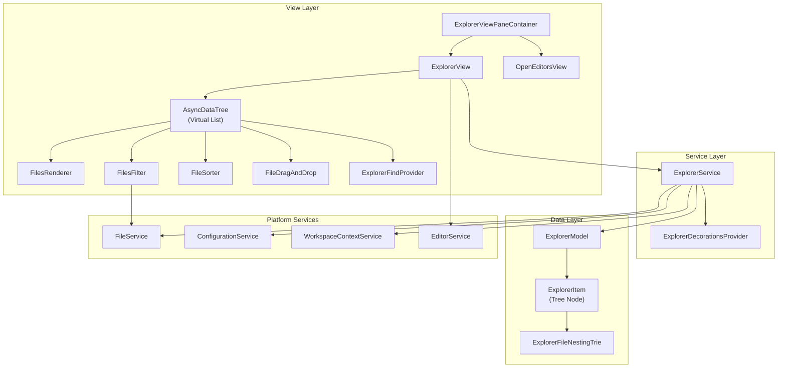

# تحليل معمارية File Explorer في VS Code

## نظرة عامة

نظام File Explorer هو المكون الرئيسي في الشريط الجانبي (Sidebar) لـ VS Code، ويُعرف داخلياً بـ **Explorer Viewlet**.
يقع كود المصدر في:

```text
src/vs/workbench/contrib/files/
├── common/           ← النماذج والواجهات المشتركة
├── browser/          ← التنفيذ الفعلي (عرض + خدمات)
│   ├── editors/      ← محررات الملفات
│   ├── views/        ← الواجهات المرئية (ExplorerView, OpenEditorsView)
│   └── media/        ← أنماط CSS
├── electron-browser/ ← أوامر خاصة بسطح المكتب
└── test/             ← اختبارات
```

---

## 1. البنية المعمارية الكلية (Architectural Overview)

### نمط التصميم: MVVM + Dependency Injection

```text
┌─────────────────────────────────────────────────────────────────┐
│                    Explorer Viewlet Container                    │
│  (ExplorerViewPaneContainer - explorerViewlet.ts)               │
├─────────────────────┬───────────────────────────────────────────┤
│  Explorer View      │  Open Editors View                        │
│  (explorerView.ts)  │  (openEditorsView.ts)                     │
│                     │                                           │
│  ┌───────────────┐  │  ┌─────────────────┐                     │
│  │ Async Tree    │  │  │ List Widget     │                     │
│  │ (Virtualized) │  │  │ (WorkbenchList) │                     │
│  └──────┬────────┘  │  └─────────────────┘                     │
│         │           │                                           │
├─────────┼───────────┼───────────────────────────────────────────┤
│   Service Layer     │                                           │
│  ┌──────────────────┴───────────────────┐                      │
│  │ ExplorerService (explorerService.ts) │                      │
│  │  ├── ExplorerModel                   │                      │
│  │  ├── File Change Handling            │                      │
│  │  └── Operation Management            │                      │
│  └──────────────────┬───────────────────┘                      │
│                     │                                           │
├─────────────────────┼───────────────────────────────────────────┤
│   Data Model        │                                           │
│  ┌──────────────────┴───────────────────┐                      │
│  │ ExplorerModel (explorerModel.ts)     │                      │
│  │  ├── ExplorerItem (شجرة الملفات)     │                      │
│  │  └── NewExplorerItem (عناصر جديدة)   │                      │
│  └──────────────────────────────────────┘                      │
└─────────────────────────────────────────────────────────────────┘
```

---

## 2. نموذج البيانات (Data Model)

### 2.1 ExplorerModel - النموذج الرئيسي

**الملف:** `common/explorerModel.ts`

```typescript
class ExplorerModel implements IDisposable {
    private _roots: ExplorerItem[];
    
    // يُنشئ الجذور من مجلدات Workspace
    constructor(contextService, uriIdentityService, fileService, configService, filesConfigService) {
        const setRoots = () => this._roots = this.contextService
            .getWorkspace().folders
            .map(folder => new ExplorerItem(folder.uri, ...));
    }
    
    // البحث في كل الجذور
    findAll(resource: URI): ExplorerItem[]
    findClosest(resource: URI): ExplorerItem | null
}
```

**النقاط المهمة:**

- كل مجلد Workspace يُمثَّل كـ `ExplorerItem` جذر
- يستمع لتغييرات `onDidChangeWorkspaceFolders` لإعادة بناء الجذور
- يدعم Multi-root Workspace (عدة مجلدات جذر)

### 2.2 ExplorerItem - عنصر الشجرة

```typescript
class ExplorerItem {
    resource: URI;              // مسار الملف/المجلد
    private _parent: ExplorerItem | undefined;
    private _isDirectory: boolean;
    private _isSymbolicLink: boolean;
    private _readonly: boolean;
    private _locked: boolean;
    private _name: string;
    private _mtime: number;     // وقت التعديل
    private _unknown: boolean;
    
    // أبناء المجلد - Map مُحسّنة
    @memoize get children(): Map<string, ExplorerItem>
    
    // File Nesting - تداخل الملفات
    nestedParent: ExplorerItem | undefined;
    nestedChildren: ExplorerItem[] | undefined;
    
    // تحميل الأبناء (كسول)
    fetchChildren(sortOrder: SortOrder): ExplorerItem[] | Promise<ExplorerItem[]>
    
    // البحث في الشجرة
    find(resource: URI): ExplorerItem | null
    
    // عمليات التعديل
    addChild(child: ExplorerItem): void
    removeChild(child: ExplorerItem): void
    move(newParent: ExplorerItem): void
    rename(renamedStat: { name: string; mtime?: number }): void
}
```

**خصائص مهمة:**

| الخاصية | الوصف |
| --------- | ------- |
| `isRoot` | هل العنصر مجلد جذر Workspace |
| `isDirectory` | هل العنصر مجلد |
| `isSymbolicLink` | هل هو رابط رمزي |
| `isReadonly` | هل هو للقراءة فقط |
| `isExcluded` | هل هو مخفي بسبب فلتر |
| `isUnknown` | نوع ملف غير معروف |
| `hasNests` | هل لديه ملفات متداخلة |
| `_isDirectoryResolved` | هل تم حل محتويات المجلد |

### 2.3 File Nesting (تداخل الملفات)

نظام متقدم يسمح بتجميع الملفات المرتبطة تحت ملف أب:

```typescript
// مثال: package.json يُظهر package-lock.json, tsconfig.json تحته
class ExplorerFileNestingTrie {
    // patterns مثل: { "*.ts": "${capture}.js, ${capture}.d.ts" }
    nest(fileNames: string[], parentName: string): Map<string, Map<string, void>>
}
```

**التداخل يعمل عبر:**

1. أنماط تُعرَّف في الإعدادات `explorer.fileNesting.patterns`
2. `ExplorerFileNestingTrie` يُحلل هذه الأنماط
3. عند `fetchChildren()` يُصنف الملفات إلى أبناء عادية وأبناء متداخلة

---

## 3. طبقة الخدمة (Service Layer)

### 3.1 ExplorerService

**الملف:** `browser/explorerService.ts`

```typescript
class ExplorerService implements IExplorerService {
    private model: ExplorerModel;
    private view: IExplorerView | undefined;
    private config: IFilesConfiguration['explorer'];
    
    // إدارة العمليات
    private onFileChangesScheduler: RunOnceScheduler;
    private fileChangeEvents: FileChangesEvent[];
    
    // إدارة عمليات النقل الجماعي
    private moveBatches: Map<number, IExplorerMoveBatch>;
}
```

**المسؤوليات الرئيسية:**

#### أ) مراقبة تغييرات الملفات

```text
FileService.onDidFilesChange ──→ جدولة RunOnceScheduler
                                      │
                                      ▼
                              تحليل التغييرات (ADDED/DELETED/UPDATED)
                                      │
                                      ▼
                              هل التغيير يؤثر على الشجرة؟
                                      │
                              نعم ←───┤───→ لا (تجاهل)
                                │
                                ▼
                          refresh(false)
```

#### ب) إدارة عمليات الملفات (CRUD)

```typescript
onDidRunOperation(e: FileOperationEvent):
    ├── CREATE/COPY → إضافة العنصر للأب + refresh الأب
    ├── MOVE/RENAME → تحديث المسار + refresh الأب القديم والجديد  
    └── DELETE → إزالة العنصر من الأب + focus التالي + refresh
```

#### ج) Batch Move Operations (نقل جماعي)

```typescript
// عند نقل عدة ملفات:
// 1. يُسجل batch مع correlationId
// 2. كل عملية MOVE تُضاف للـ batch
// 3. عند الانتهاء: يُنفذ refresh واحد بدل عدة refreshes
interface IExplorerMoveBatch {
    targets: ResourceMap<URI>;
    operations: Promise<void>[];
    refreshes: Map<ExplorerItem, boolean>;
    sourceParents: Set<ExplorerItem>;
    targetParents: Set<ExplorerItem>;
    movedItems: Set<ExplorerItem>;
}
```

#### د) Auto-Reveal

```typescript
// عند فتح ملف في المحرر → إظهاره في الشجرة تلقائياً
shouldAutoRevealItem(item, ignore): boolean {
    // يفحص explorer.autoRevealExclude patterns
    // يتحقق من أن العنصر وأبائه ليسوا مستبعدين
}
```

### 3.2 IExplorerService Interface

```typescript
interface IExplorerService {
    roots: ExplorerItem[];
    sortOrderConfiguration: ISortOrderConfiguration;
    
    getContext(respectMultiSelection): ExplorerItem[];
    hasViewFocus(): boolean;
    
    // التحرير (إعادة التسمية / إنشاء ملف جديد)
    setEditable(stat, data): Promise<void>;
    getEditable(): { stat, data } | undefined;
    isEditable(stat): boolean;
    
    // البحث
    findClosest(resource: URI): ExplorerItem | null;
    findClosestRoot(resource: URI): ExplorerItem | null;
    
    // العمليات
    refresh(): Promise<void>;
    setToCopy(stats, cut): Promise<void>;
    isCut(stat): boolean;
    applyBulkEdit(edit, options): Promise<void>;
    
    // الاختيار
    select(resource, reveal?): Promise<void>;
    registerView(contextAndRefreshProvider): void;
}
```

---

## 4. طبقة العرض (View Layer)

### 4.1 ExplorerViewPaneContainer - الحاوية الرئيسية

**الملف:** `browser/explorerViewlet.ts`

```typescript
class ExplorerViewPaneContainer extends ViewPaneContainer {
    // VIEWLET_ID = 'workbench.view.explorer'
    
    // يحتوي على:
    // 1. ExplorerView (شجرة الملفات)
    // 2. OpenEditorsView (المحررات المفتوحة)
    
    create(parent: HTMLElement) {
        parent.classList.add('explorer-viewlet');
    }
    
    createView(viewDescriptor, options) {
        if (viewDescriptor.id === VIEW_ID) {
            return new ExplorerView({
                delegate: {
                    willOpenElement: (e) => { /* تأخير 250ms للـ preview */ },
                    didOpenElement: (e) => { /* إزالة التأخير */ }
                }
            });
        }
    }
}
```

**التسجيل في النظام:**

```typescript
const VIEW_CONTAINER = viewContainerRegistry.registerViewContainer({
    id: VIEWLET_ID,
    title: "Explorer",
    icon: explorerViewIcon,
    alwaysUseContainerInfo: true,
    hideIfEmpty: true,
    order: 0,                    // أول عنصر في الشريط الجانبي
    openCommandActionDescriptor: {
        keybindings: { primary: Ctrl+Shift+E }
    }
}, ViewContainerLocation.Sidebar, { isDefault: true });
```

### 4.2 ExplorerView - عرض شجرة الملفات

**الملف:** `browser/views/explorerView.ts`

```typescript
class ExplorerView extends ViewPane implements IExplorerView {
    // الشجرة الرئيسية: WorkbenchCompressibleAsyncDataTree
    private tree: WorkbenchCompressibleAsyncDataTree<
        ExplorerItem | ExplorerItem[],  // Input
        ExplorerItem,                    // Element
        FuzzyScore                       // Filter Data
    >;
    
    private filter: FilesFilter;
    private findProvider: ExplorerFindProvider;
    private renderer: FilesRenderer;
}
```

**Context Keys (مفاتيح السياق):**

```typescript
// تُحدث تلقائياً عند تغيير التركيز/الاختيار
resourceContext           // نوع المورد المُركَّز عليه
folderContext            // هل المُركَّز عليه مجلد
readonlyContext          // هل للقراءة فقط
parentReadonlyContext    // هل الأب للقراءة فقط
rootContext              // هل هو مجلد جذر
compressedFocusContext   // هل المُركَّز عنصر مضغوط
```

#### بناء الشجرة

```typescript
renderBody(container: HTMLElement) {
    this.treeContainer = DOM.append(container, 
        DOM.$('.explorer-folders-view'));
    
    this.createTree(this.treeContainer);
}

createTree(container: HTMLElement) {
    // 1. إنشاء FilesFilter (الفلترة)
    this.filter = new FilesFilter(...);
    
    // 2. إنشاء ExplorerFindProvider (البحث)
    this.findProvider = new ExplorerFindProvider(...);
    
    // 3. إنشاء FilesRenderer (رسم العناصر)
    this.renderer = new FilesRenderer(container, labels, ...);
    
    // 4. إنشاء الشجرة
    this.tree = new WorkbenchCompressibleAsyncDataTree(
        'FileExplorer',
        container,
        new ExplorerDelegate(),        // الارتفاع: 22px ثابت
        new ExplorerCompressionDelegate(),
        [this.renderer],
        new ExplorerDataSource(...),   // مصدر البيانات
        {
            filter: this.filter,
            sorter: new FileSorter(...),
            dnd: new FileDragAndDrop(...),
            // ...
        }
    );
}
```

### 4.3 المكونات الفرعية للعرض

#### ExplorerDelegate - حساب الارتفاع

```typescript
class ExplorerDelegate implements IListVirtualDelegate<ExplorerItem> {
    static readonly ITEM_HEIGHT = 22;  // ارتفاع ثابت 22px
    
    getHeight(element): number {
        return ExplorerDelegate.ITEM_HEIGHT;
    }
    
    getTemplateId(element): string {
        return FilesRenderer.ID;  // "file"
    }
}
```

#### ExplorerDataSource - مصدر البيانات

```typescript
class ExplorerDataSource implements IAsyncDataSource<...> {
    hasChildren(element): boolean {
        return Array.isArray(element) || 
               element.hasChildren(stat => this.fileFilter.filter(stat, ...));
    }
    
    getChildren(element): ExplorerItem[] | Promise<ExplorerItem[]> {
        // 1. إذا كان مصفوفة (جذور) → إرجاع مباشر
        // 2. إذا كان في وضع البحث → إرجاع الأبناء مباشرة
        // 3. خلاف ذلك → fetchChildren() مع التحميل الكسول
        
        const children = element.fetchChildren(sortOrder);
        // يعرض مؤشر تحميل مع تأخير 800ms/1500ms
        this.progressService.withProgress({
            location: ProgressLocation.Explorer,
            delay: this.layoutService.isRestored() ? 800 : 1500
        }, _progress => promise);
    }
}
```

#### FilesRenderer - رسم العناصر

```typescript
class FilesRenderer implements ICompressibleTreeRenderer<ExplorerItem, ...> {
    static readonly ID = 'file';
    
    renderTemplate(container: HTMLElement): IFileTemplateData {
        // إنشاء ResourceLabel (أيقونة + اسم + وصف)
        const label = this.labels.create(container, { supportHighlights: true });
        // إضافة المساهمات (contributions)
        const contribs = explorerFileContribRegistry.create(...);
        return { label, container, contribs, ... };
    }
    
    renderElement(node, index, templateData) {
        const stat = node.element;
        const editableData = this.explorerService.getEditableData(stat);
        
        if (!editableData) {
            // عرض عادي: أيقونة + اسم
            this.renderStat(stat, stat.name, ...);
        } else {
            // وضع التحرير: مربع إدخال
            this.renderInputBox(container, stat, editableData);
        }
    }
    
    // رسم العناصر المضغوطة (Compressed)
    renderCompressedElements(node, index, templateData) {
        // عرض مسار مضغوط: "folder1/folder2/folder3"
        const labels = node.element.elements.map(e => e.name);
        this.renderStat(stat, labels, ...);
        
        // إنشاء CompressedNavigationController
        // يسمح بالتنقل بين أجزاء المسار المضغوط
    }
    
    private renderStat(stat, label, domId, filterData, templateData) {
        const extraClasses = ['explorer-item'];
        if (this.explorerService.isCut(stat)) {
            extraClasses.push('cut');  // شفافية 0.5 للعناصر المقصوصة
        }
        
        // ResourceLabel يتكفل بـ:
        // - أيقونة الملف/المجلد (من File Icon Theme)
        // - اسم الملف
        // - وصف المسار (إذا لزم)
        // - تمييز البحث (FuzzyScore highlights)
        // - badges و decorations
    }
}
```

#### FilesFilter - فلترة العناصر

```typescript
class FilesFilter implements ITreeFilter<ExplorerItem, FuzzyScore> {
    // يُخفي الملفات بناءً على:
    // 1. files.exclude patterns (glob)
    // 2. .gitignore (إذا explorer.excludeGitIgnore مُفعَّل)
    // 3. حالة التحرير (الملف المُحرَّر دائماً مرئي)
    // 4. الملفات المفتوحة في المحرر (تبقى مرئية حتى لو مطابقة لـ exclude)
    
    filter(stat: ExplorerItem, parentVisibility): boolean {
        // 1. فحص .gitignore
        if (stat.name === '.gitignore') {
            this.processIgnoreFile(stat.root.resource.toString(), stat.resource);
            return true;
        }
        
        // 2. فحص files.exclude
        const globMatch = cached.parsed(relativePath, stat.name, ...);
        
        // 3. فحص gitignore
        const isHiddenResource = globMatch ? true : this.isIgnored(...);
        
        // 4. استثناء: الملفات المفتوحة تبقى مرئية
        if (isHiddenResource) {
            const editor = editors.find(e => isEqualOrParent(e.resource, stat.resource));
            if (editor) return true;
            return false;
        }
        
        return true;
    }
}
```

#### FileSorter - ترتيب العناصر

```typescript
class FileSorter implements ITreeSorter<ExplorerItem> {
    compare(statA, statB): number {
        // 1. الجذور لا تُرتَّب (تتبع ترتيب Workspace)
        // 2. حسب sortOrder:
        //    - default: مجلدات أولاً ثم أبجدي
        //    - mixed: بدون فصل مجلدات/ملفات
        //    - filesFirst: ملفات أولاً ثم مجلدات
        //    - type: حسب نوع الملف (الامتداد)
        //    - modified: حسب وقت التعديل
        //    - foldersNestsFiles: مجلدات → متداخلات → ملفات
        //
        // 3. حسب lexicographicOptions:
        //    - default: ترتيب طبيعي
        //    - upper: الأحرف الكبيرة أولاً
        //    - lower: الأحرف الصغيرة أولاً
        //    - unicode: ترتيب Unicode
        //
        // 4. reverse: عكس الترتيب
    }
}
```

---

## 5. نظام السحب والإفلات (Drag & Drop)

### FileDragAndDrop

```typescript
class FileDragAndDrop implements ITreeDragAndDrop<ExplorerItem> {
    // دعم أنواع متعددة من المصادر:
    // 1. عناصر من داخل الشجرة (نقل/نسخ)
    // 2. ملفات من نظام الملفات الخارجي (رفع)
    // 3. عناصر من المحرر
    
    getDragURI(element: ExplorerItem): string | null {
        if (element.isDirectory || this.configurationService.getValue('explorer.enableDragAndDrop')) {
            return element.resource.toString();
        }
        return null;
    }
    
    onDragOver(data, target, targetIndex, targetSector, originalEvent) {
        // تحديد هل الإفلات مسموح
        // - لا يمكن إفلات على نفسه أو أبنائه
        // - فحص الأذونات (readonly)
        // - دعم الإفلات على مجلدات مضغوطة
    }
    
    drop(data, target, targetIndex, targetSector, originalEvent) {
        // حسب المصدر:
        
        // A) من Explorer → نقل أو نسخ
        doHandleExplorerDropOnMove(sources, target)    // نقل
        doHandleExplorerDropOnCopy(sources, target)    // نسخ (مع Ctrl)
        
        // B) جذور Workspace → إعادة ترتيب
        doHandleRootDrop(roots, target, targetSector)
        
        // C) من الخارج → رفع
        // يستخدم BrowserFileUpload أو ExternalFileImport
    }
}
```

### CompressedNavigationController - التنقل في المجلدات المضغوطة

```typescript
class CompressedNavigationController {
    // عندما تكون المجلدات مضغوطة: "src/vs/workbench"
    // يسمح بالتنقل بين أجزاء المسار
    
    items: ExplorerItem[];  // [src, vs, workbench]
    index: number;          // الفهرس الحالي
    
    next(): void     // التالي
    previous(): void // السابق
    first(): void    // الأول
    last(): void     // الأخير
    
    get current(): ExplorerItem  // العنصر الحالي
}
```

### ExplorerCompressionDelegate - تحديد القابلية للضغط

```typescript
class ExplorerCompressionDelegate {
    isIncompressible(stat: ExplorerItem): boolean {
        return stat.isRoot ||           // الجذور لا تُضغط
               !stat.isDirectory ||     // الملفات لا تُضغط
               stat instanceof NewExplorerItem ||  // العناصر الجديدة لا تُضغط
               (!stat.parent || stat.parent.isRoot); // أبناء الجذر لا تُضغط
    }
}
```

---

## 6. نظام البحث والفلترة (Find Provider)

### ExplorerFindProvider

```typescript
class ExplorerFindProvider {
    // وضعان للبحث:
    
    // 1. Filter Mode: يُخفي العناصر غير المطابقة
    async doFilterFind(pattern, matchType, token) {
        // - يبحث عبر ISearchService
        // - ينشئ PhantomExplorerItem لملفات غير مُحلَّلة
        // - يُعلّم العناصر المطابقة بـ markItemAndParentsAsFiltered()
        // - يُعيد بناء الشجرة
    }
    
    // 2. Highlight Mode: يُبرز العناصر المطابقة فقط
    async doHighlightFind(pattern, matchType, token) {
        // - يبحث عبر ISearchService
        // - يبني ExplorerFindHighlightTree
        // - يعرض عدد التطابقات في badges
    }
}
```

---

## 7. نظام التزيينات (Decorations)

### ExplorerDecorationsProvider

```typescript
class ExplorerDecorationsProvider implements IDecorationsProvider {
    provideDecorations(resource: URI): IDecorationData | undefined {
        const fileStat = this.explorerService.findClosest(resource);
        return provideDecorations(fileStat);
    }
}

function provideDecorations(fileStat: ExplorerItem): IDecorationData | undefined {
    // 1. جذر بخطأ → علامة "!" بلون أحمر
    if (fileStat.isRoot && fileStat.error) {
        return { tooltip: "Unable to resolve...", letter: '!', color: listInvalidItemForeground };
    }
    
    // 2. رابط رمزي → علامة "↷"
    if (fileStat.isSymbolicLink) {
        return { tooltip: "Symbolic Link", letter: '\u2937' };
    }
    
    // 3. نوع غير معروف → علامة "?"
    if (fileStat.isUnknown) {
        return { tooltip: "Unknown File Type", letter: '?' };
    }
    
    // 4. مستبعد → لون خافت
    if (fileStat.isExcluded) {
        return { color: listDeemphasizedForeground };
    }
}
```

---

## 8. Open Editors View - عرض المحررات المفتوحة

### OpenEditorsView

```typescript
class OpenEditorsView extends ViewPane {
    static readonly ID = 'workbench.explorer.openEditorsView';
    
    // يعرض قائمة بجميع الملفات المفتوحة
    // مُجمَّعة حسب Editor Groups
    
    private list: WorkbenchList<OpenEditor | IEditorGroup>;
    private sortOrder: 'editorOrder' | 'alphabetical' | 'fullPath';
    
    // يُحدَّث عند:
    // - فتح/إغلاق محررات
    // - تغيير الترتيب
    // - تغيير حالة dirty
    
    // الارتفاع المرئي الافتراضي: 9 عناصر
    static readonly DEFAULT_VISIBLE_OPEN_EDITORS = 9;
}
```

---

## 9. الإجراءات والأوامر (Actions & Commands)

### أزرار شريط العنوان (View Title Bar)

```typescript
// ملف جديد
registerAction2({
    id: 'workbench.files.action.createFileFromExplorer',
    icon: Codicon.newFile,        // أيقونة ملف جديد
    menu: { id: MenuId.ViewTitle, group: 'navigation', order: 10 }
});

// مجلد جديد
registerAction2({
    id: 'workbench.files.action.createFolderFromExplorer',
    icon: Codicon.newFolder,      // أيقونة مجلد جديد
    menu: { id: MenuId.ViewTitle, group: 'navigation', order: 20 }
});

// تحديث
registerAction2({
    id: 'workbench.files.action.refreshFilesExplorer',
    icon: Codicon.refresh,        // أيقونة تحديث
    menu: { id: MenuId.ViewTitle, group: 'navigation', order: 30 }
});

// طي الكل
registerAction2({
    id: 'workbench.files.action.collapseExplorerFolders',
    icon: Codicon.collapseAll,    // أيقونة طي
    menu: { id: MenuId.ViewTitle, group: 'navigation', order: 40 }
});
```

### شروط الإنشاء (Can Create Context)

```typescript
const CanCreateContext = ContextKeyExpr.or(
    // مجلد: يمكن الإنشاء إلا إذا كان readonly
    ContextKeyExpr.and(ExplorerFolderContext, ExplorerResourceWritableContext),
    // ملف: يمكن الإنشاء إلا إذا كان الأب readonly
    ContextKeyExpr.and(ExplorerFolderContext.toNegated(), 
                       ExplorerResourceParentReadOnlyContext.toNegated())
);
```

---

## 10. الإعدادات والتكوين (Configuration)

### IFilesConfiguration

```typescript
interface IFilesConfiguration {
    explorer: {
        // Open Editors
        openEditors: {
            visible: number;              // عدد العناصر المرئية
            sortOrder: 'editorOrder' | 'alphabetical' | 'fullPath';
        };
        
        // Auto Reveal
        autoReveal: boolean | 'focusNoScroll';
        autoRevealExclude: IExpression;   // أنماط glob للاستبعاد
        
        // Drag & Drop
        enableDragAndDrop: boolean;
        confirmDelete: boolean;
        
        // Undo
        enableUndo: boolean;
        confirmUndo: UndoConfirmLevel;     // 'verbose' | 'default' | 'light'
        
        // Sort
        sortOrder: SortOrder;              // 'default' | 'mixed' | 'filesFirst' | 'type' | 'modified' | 'foldersNestsFiles'
        sortOrderLexicographicOptions: LexicographicOptions;
        sortOrderReverse: boolean;
        
        // Decorations
        decorations: {
            colors: boolean;               // ألوان SCM
            badges: boolean;               // شارات (badges)
        };
        
        // Naming
        incrementalNaming: 'simple' | 'smart' | 'disabled';
        
        // GitIgnore
        excludeGitIgnore: boolean;
        
        // File Nesting
        fileNesting: {
            enabled: boolean;
            expand: boolean;
            patterns: { [parent: string]: string };
        };
        
        // Single Folder
        expandSingleFolderWorkspaces: boolean;
        
        // Dropped File
        autoOpenDroppedFile: boolean;
    };
}
```

---

## 11. التصميم البصري (Visual Design)

### 11.1 الهيكل HTML

```text
.explorer-viewlet                           ← الحاوية الرئيسية
├── .pane-header                            ← رأس القسم
│   ├── .title                              ← عنوان (اسم Workspace)
│   └── .actions                            ← أزرار (New File, New Folder, Refresh, Collapse)
└── .pane-body
    └── .explorer-folders-view              ← حاوية الشجرة
        └── .monaco-list                    ← قائمة افتراضية
            └── .monaco-list-rows
                └── .monaco-list-row        ← صف واحد
                    ├── .monaco-tl-indent   ← مسافة بادئة (indent guides)
                    ├── .monaco-tl-twistie  ← سهم التوسيع/الطي
                    └── .monaco-tl-contents ← المحتوى
                        └── .explorer-item  ← عنصر الملف
                            ├── .monaco-icon-label
                            │   ├── .icon   ← أيقونة الملف/المجلد
                            │   └── .label-name
                            │       └── .monaco-highlighted-label ← الاسم
                            └── .monaco-count-badge  ← شارة العدد (بحث)
```

### 11.2 أبعاد وقيم CSS الأساسية

```css
/* ارتفاع كل عنصر */
.explorer-item, .editor-group {
    height: 22px;
    line-height: 22px;
}

/* العرض والتدفق */
.explorer-item {
    display: flex;
    flex-wrap: nowrap;
    flex: 1;
}

/* اسم الملف: يُقطع بـ ellipsis عند الطول الزائد */
.explorer-item > a {
    text-overflow: ellipsis;
    overflow: hidden;
}

/* عنصر مقصوص (Cut) */
.explorer-item.cut {
    opacity: 0.5;
}

/* جذر غير موجود */
.explorer-item.nonexistent-root {
    opacity: 0.5;
}

/* مجلدات مضغوطة */
.explorer-item .monaco-icon-name-container.multiple > .label-name > .monaco-highlighted-label {
    border-radius: 3px;
}
.explorer-item .monaco-icon-name-container.multiple > .label-name:hover > .monaco-highlighted-label {
    text-decoration: underline;  /* تسطير عند المرور */
}

/* هدف الإفلات */
.explorer-item .label-name.drop-target > .monaco-highlighted-label {
    background-color: var(--vscode-list-dropBackground);
}

/* محاذاة الأيقونات المتداخلة */
.explorer-item.align-nest-icon-with-parent-icon {
    margin-left: var(--vscode-explorer-align-offset-margin-left);
}

/* وضع التحرير: مربع الإدخال */
.explorer-item .monaco-inputbox {
    width: 100%;
    line-height: normal;
}
.explorer-item .monaco-inputbox input[type="text"] {
    outline-width: 1px;
    outline-style: solid;
    outline-offset: -1px;
    outline-color: var(--vscode-focusBorder);
}
```

### 11.3 File Icon Theme Integration

```typescript
function createFileIconThemableTreeContainerScope(container, themeService) {
    container.classList.add('file-icon-themable-tree');
    container.classList.add('show-file-icons');
    
    const onDidChangeFileIconTheme = (theme: IFileIconTheme) => {
        // إذا كان هناك أيقونات ملفات بدون أيقونات مجلدات
        container.classList.toggle('align-icons-and-twisties', 
            theme.hasFileIcons && !theme.hasFolderIcons);
        
        // بعض الثيمات تُخفي أسهم التوسيع
        container.classList.toggle('hide-arrows', 
            theme.hidesExplorerArrows === true);
    };
}
```

### 11.4 وضع التباين العالي (High Contrast)

```css
.monaco-workbench.hc-black .explorer-item,
.monaco-workbench.hc-light .explorer-item {
    line-height: 20px;  /* أقل بـ 2px للتعويض عن حدود التباين */
}
```

### 11.5 Open Editors - التصميم

```css
.open-editors .monaco-list-row {
    padding-left: 8px;
    display: flex;
}

/* شريط الإجراءات مخفي حتى hover أو focus */
.open-editors .monaco-list-row > .monaco-action-bar {
    visibility: hidden;
}
.open-editors .monaco-list-row:hover > .monaco-action-bar,
.open-editors .monaco-list-row.focused > .monaco-action-bar,
.open-editors .monaco-list-row.dirty > .monaco-action-bar {
    visibility: visible;
}

/* Editor Group Header */
.open-editors .monaco-list-row .editor-group {
    font-size: 11px;
    font-weight: bold;
    text-transform: uppercase;
}

/* مؤشر dirty: نقطة بدل X */
.open-editors .monaco-list-row.dirty:not(:hover) .codicon-close::before {
    content: var(--vscode-icon-circle-filled-content);
}

/* عداد الملفات المعدلة */
.pane-header .dirty-count.monaco-count-badge {
    padding: 2px 4px;
    margin-left: 6px;
    cursor: pointer;
}
```

---

## 12. دورة الحياة (Lifecycle)

```text
                    VS Code Startup
                         │
                         ▼
            ┌─── ExplorerViewletViewsContribution ───┐
            │  (WorkbenchPhase.BlockStartup)          │
            │  تسجيل الـ Views في Registry             │
            └────────────────┬───────────────────────┘
                             │
                             ▼
            ┌─── ExplorerViewPaneContainer ──────────┐
            │  create() → إنشاء DOM                  │
            │  createView() → ExplorerView            │
            └────────────────┬───────────────────────┘
                             │
                             ▼
            ┌─── ExplorerView ──────────────────────┐
            │  constructor:                           │
            │    ← إعداد Context Keys                │
            │    ← تسجيل الـ View مع ExplorerService  │
            │                                         │
            │  renderBody():                          │
            │    ← إنشاء Tree Container               │
            │    ← createTree() → بناء الشجرة         │
            │                                         │
            │  setTreeInput():                        │
            │    ← تحميل الجذور → tree.setInput()     │
            │    ← استعادة حالة الشجرة (ViewState)    │
            └────────────────┬───────────────────────┘
                             │
                             ▼
            ┌─── تشغيل مستمر ─────────────────────┐
            │  • مراقبة FileService.onDidFilesChange │
            │  • مراقبة ConfigService.onDidChange    │
            │  • مراقبة EditorService (Auto-Reveal)  │
            │  • مراقبة HostService (Focus → Refresh)│
            │  • مراقبة WorkingCopyFileService       │
            └─────────────────────────────────────────┘
```

---

## 13. تحسينات الأداء (Performance Optimizations)

### 13.1 القائمة الافتراضية (Virtual List)

- **ارتفاع ثابت 22px**: يسمح بحساب فوري لمواقع العناصر
- **لا يُرسم إلا ما هو مرئي**: يُعيد استخدام عناصر DOM

### 13.2 التحميل الكسول (Lazy Loading)

```typescript
// المجلدات لا تُحل حتى التوسيع
fetchChildren(sortOrder): ExplorerItem[] | Promise<ExplorerItem[]> {
    if (!this._isDirectoryResolved) {
        // يحل المجلد فقط عند الحاجة
        const stat = await this.fileService.resolve(this.resource, {
            resolveSingleChildDescendants: true,  // حل الأبناء المفردة تلقائياً
            resolveMetadata: sortOrder === SortOrder.Modified
        });
    }
}
```

### 13.3 تجميع تغييرات الملفات

```typescript
// RunOnceScheduler: يُجمع التغييرات ويُعالجها دفعة واحدة
this.onFileChangesScheduler = new RunOnceScheduler(async () => {
    const events = this.fileChangeEvents;
    this.fileChangeEvents = [];
    // ... معالجة جماعية
}, ExplorerService.EXPLORER_FILE_CHANGES_REACT_DELAY);
```

### 13.4 ضغط المجلدات (Compression)

- المجلدات المفردة الأبناء تُدمج: `src/vs/workbench` بدل ثلاثة مستويات
- يُقلل عدد عناصر DOM وعمليات التوسيع

### 13.5 Batch Move Operations

```typescript
// عند نقل عدة ملفات: refresh واحد بدل عدة
interface IExplorerMoveBatch {
    refreshes: Map<ExplorerItem, boolean>;
    // يُجمع كل عمليات الـ refresh ويُنفذها مرة واحدة
}
```

### 13.6 Platform-Aware Name Comparison

```typescript
// يستخدم مقارنة حسب النظام
private getPlatformAwareName(name: string): string {
    return this.fileService.hasCapability(
        this.resource, 
        FileSystemProviderCapabilities.PathCaseSensitive
    ) ? name : name.toLowerCase();
}
```

---

## 14. ملخص العلاقات بين المكونات



---

## 15. الخلاصة: النقاط الجوهرية للتطبيق

| الجانب | التقنية المستخدمة |
| -------- | ------------------ |
| **هيكل البيانات** | شجرة `Map<string, ExplorerItem>` مع تحميل كسول |
| **العرض** | `AsyncDataTree` افتراضي بارتفاع ثابت 22px |
| **التحديث** | `RunOnceScheduler` لتجميع التغييرات |
| **الفلترة** | `glob` patterns + `.gitignore` parsing |
| **الترتيب** | 6 خوارزميات × 4 خيارات ليكسيكوغرافية |
| **السحب والإفلات** | `ITreeDragAndDrop` مع دعم داخلي/خارجي |
| **الأيقونات** | `File Icon Theme` قابل للتغيير |
| **التزيينات** | `IDecorationsProvider` لـ SCM + حالات خاصة |
| **الضغط** | دمج المجلدات المفردة الأبناء تلقائياً |
| **البحث** | وضعان: Filter (إخفاء) + Highlight (تمييز) |
| **الأداء** | قائمة افتراضية + تحميل كسول + تجميع عمليات |
