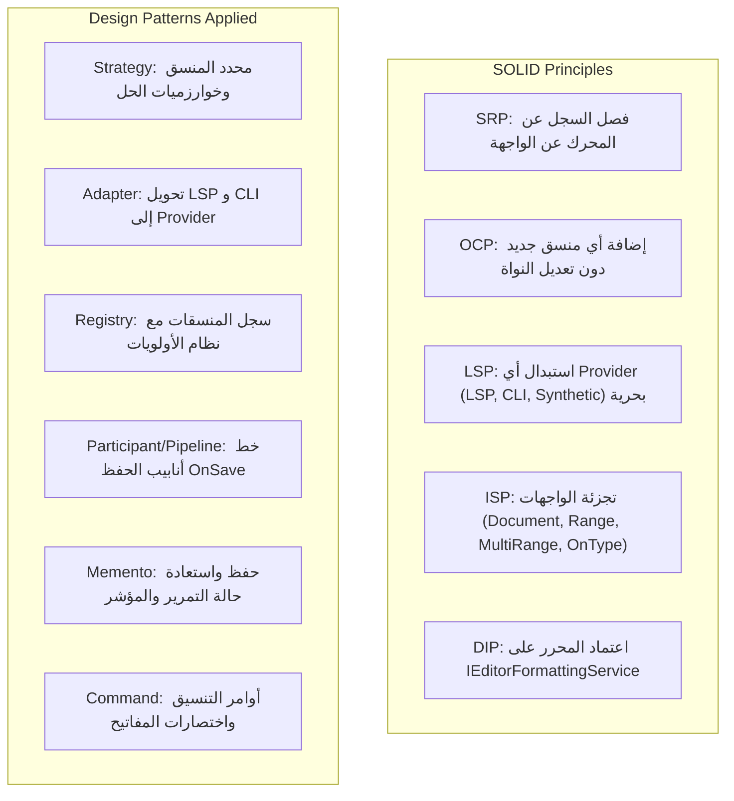
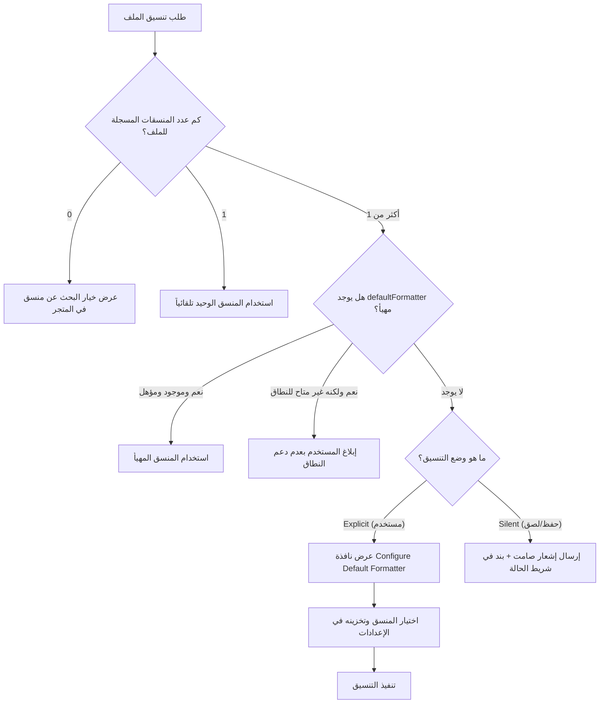

# الخطة التنفيذية المعمارية الشاملة لنظام تنسيق الأكواد (Code Formatting 99% VS Code Parity Plan)

## الفهرس العام

1. [الرؤية المعمارية والهدف الاستراتيجي](#1-الرؤية-المعمارية-والهدف-الاستراتيجي)
2. [تحليل الديون التقنية والملفات الحالية الخاضعة لإعادة الهيكلة](#2-تحليل-الديون-التقنية-والملفات-الحالية-الخاضعة-لإعادة-الهيكلة)
3. [مبادئ SOLID وأنماط التصميم (SOLID & Design Patterns Mapping)](#3-مبادئ-solid-وأنماط-التصميم-solid--design-patterns-mapping)
4. [الهيكلية المستهدفة للمجلدات والملفات (Target File Hierarchy)](#4-الهيكلية-المستهدفة-للمجلدات-والملفات-target-file-hierarchy)
5. [المراحل التنفيذية المتسلسلة (Phased Implementation Plan)](#5-المراحل-التنفيذية-المتسلسلة-phased-implementation-plan)
   - [المرحلة 1: عقود النواة ونموذج الإعدادات المتقدم (Core Contracts & Preferences)](#المرحلة-1-عقود-النواة-ونموذج-الإعدادات-المتقدم-core-contracts--preferences)
   - [المرحلة 2: سجل الميزات والمزودات الاصطناعية (Registry & Synthetic Fallback)](#المرحلة-2-سجل-الميزات-والمزودات-الاصطناعية-registry--synthetic-fallback)
   - [المرحلة 3: محرك فض النزاعات والمنسق الافتراضي (Conflict Resolution & Default Formatter)](#المرحلة-3-محرك-فض-النزاعات-والمنسق-الافتراضي-conflict-resolution--default-formatter)
   - [المرحلة 4: محرك حساب الفروقات المجهرية بالخلفية (Background Isolate Minimal Diff Engine)](#المرحلة-4-محرك-حساب-الفروقات-المجهرية-بالخلفية-background-isolate-minimal-diff-engine)
   - [المرحلة 5: محرك التنفيذ واستقرار الشاشة والتراجع الذري (Execution, Viewport Lock & Undo Stops)](#المرحلة-5-محرك-التنفيذ-واستقرار-الشاشة-والتراجع-الذري-execution-viewport-lock--undo-stops)
   - [المرحلة 6: محفزات التنسيق التلقائي وخط الحفظ وتغييرات Git (Triggers, Save Pipeline & SCM Diff)](#المرحلة-6-محفزات-التنسيق-التلقائي-وخط-الحفظ-وتغييرات-git-triggers-save-pipeline--scm-diff)
   - [المرحلة 7: إعادة هيكلة الملفات الحالية وربط المتحكمات (Refactoring Legacy Code & Wiring)](#المرحلة-7-إعادة-هيكلة-الملفات-الحالية-وربط-المتحكمات-refactoring-legacy-code--wiring)
   - [المرحلة 8: حزمة الاختبارات الشاملة (Unit, Integration & UI Widget Tests)](#المرحلة-8-حزمة-الاختبارات-الشاملة-unit-integration--ui-widget-tests)
6. [مصفوفة التحقق ومعايير القبول (Verification Matrix & Acceptance Criteria)](#6-مصفوفة-التحقق-ومعايير-القبول-verification-matrix--acceptance-criteria)

---

## 1. الرؤية المعمارية والهدف الاستراتيجي

الهدف من هذه الخطة هو ترقية محرر الأكواد الحالي ليصل إلى **توافق بنسبة 99% مع معمارية Visual Studio Code الرسمية** في التعامل مع تنسيق الأكواد البرمجية، محاكياً بدقة فائقة:

1. **جميع أنواع ونطاقات التنسيق**: تنسيق المستند كاملاً (Document)، تنسيق التحديد (Selection)، تنسيق النطاقات المتعددة غير المتصلة (Multi-Range)، التنسيق عند الكتابة (On Type)، التنسيق عند اللصق (On Paste)، التنسيق عند الحفظ (On Save)، وتنسيق الأسطر المعدلة فقط وفق Git (Format Modified Lines).
2. **المزودات المتعددة والاصطناعية**: القدرة على تسجيل مزودات مختلفة (LSP، CLI محلي، أدوات خارجية) مع تحويل تلقائي لمنسقات النطاق إلى منسق مستند اصطناعي (Synthetic Formatter).
3. **حل النزاعات والمنسق الافتراضي**: استراتيجية إدارة `editor.defaultFormatter` مع التخصيص بحسب اللغة، وعرض واجهات QuickPick وصناديق الحوار وشريط الحالة (Status Bar Integration).
4. **الأداء واستقرار المحرر**: تشغيل خوارزمية Diff مجهرية داخل عمال دارت الخلفيين (`Isolate.run`) لمنع تجميد واجهة المستخدم (60/120 FPS)، وحفظ ثبات التمرير الرأسي النسبي للمؤشر (`StableEditorScrollState`)، وحصر التنسيق ضمن خطوة تراجع ذرية واحدة (`pushUndoStop`).

---

## 2. تحليل الديون التقنية والملفات الحالية الخاضعة لإعادة الهيكلة

عند فحص شجرة المشروع الحالية في `lib/`، تبين وجود ديون تقنية وتداخل مسؤوليات يتعارض مع مبادئ SOLID:

### الملفات الخاضعة لإعادة الهيكلة والتحديث الجذري

| الملف الحالي | العيوب الحالية والتعارض المعماري | التعديل وإعادة الهيكلة المطلوبة |
| :--- | :--- | :--- |
| `lib/parts/editor/editor_area_widget.dart` | **انتهاك صارخ لـ SRP و DIP**: الـ Widget تحتوي على أكثر من 150 سطراً تدير مباشرة استدعاءات الـ LSP، المؤقتات الزمنية للحفظ واللصق، بناء كائنات النطاقات، ومعالجة أخطاء التنسيق. | تفريغ كامل لمنطق التنسيق من الـ Widget، ونقله إلى `EditorFormattingController` و `IEditorFormattingService`. يصبح دور الـ Widget مقتصراً على الاستماع والتصيير وإرسال أحداث المستخدم الصرفة. |
| `lib/core/editor/formatting/editor_formatting_preferences.dart` | **نقص وظيفي وتصميم بدائي**: يدعم فقط أعلام `bool` لـ save/type/paste. لا يدعم `formatOnSaveMode` (كامل الملف vs الأسطر المعدلة فقط)، ولا يدعم `defaultFormatter`، ولا التخصيص حسب اللغة (Per-language overrides). | إعادة كتابة وتوسيع النموذج ليدعم `EditorFormattingPreferences` متكامل يطابق معايير VS Code (`editor.defaultFormatter`، `editor.formatOnSaveMode: file | modifications | modificationsIfAvailable`، وخرائط التجاوز اللغوي). |
| `lib/core/editor/formatting/text_edit_applier.dart` | **تطبيق ساذج للتعديلات**: يقوم بتطبيق التعديلات النصية بترتيب عكسي مباشر دون دعم التنسيق المجهري (Micro-diffing)، مما يؤدي لقفز المؤشر ومسح التحديد وإتلاف استقرار التمرير وتدمير سجل التراجع. | تحويله إلى `FormattingExecutionPipeline` يدمج `StableEditorScrollState` و `IsolateDiffWorker` ويوفر ذرية التراجع (Atomic Undo). |
| `lib/parts/editor/controllers/editor_lsp_extension.dart` | **اقتران أحادي (Hard Coupling)**: التنسيق محصور في كائن LSP فقط، مما يمنع إضافة منسقات CLI (مثل `dart format` أو `prettier`) أو منسقات مخصصة. | تجريد واجهة LSP لتصبح مجرد تطبيق لـ `DocumentFormattingEditProvider` و `DocumentRangeFormattingEditProvider` مسجلة داخل `FormattingRegistry`. |
| `lib/core/editor/formatting/editor_text_change.dart` | **محدودية الاستخراج**: دالة `between` بسيطة وتعمل على الخيط الرئيسي فقط للنصوص الصغيرة ولا تدعم فواصل الأسطر EOL المختلفة. | تعزيزها لتصبح جزءاً من حزمة أدوات Diff المحسنة المدعومة بـ Isolates. |

---

## 3. مبادئ SOLID وأنماط التصميم (SOLID & Design Patterns Mapping)



### تطبيق مبادئ SOLID بالتفصيل

1. **Single Responsibility Principle (SRP)**:
   - `FormattingRegistry`: مسؤول حصراً عن تسجيل المزودات وترتيبها وتقييم ملاءمتها للمستند.
   - `FormattingConflictsResolver`: مسؤول حصراً عن تحديد المنسق الافتراضي ومعالجة التضارب.
   - `FormattingDiffEngine`: مسؤول حصراً عن حساب الفروقات المجهرية في الخلفية.
   - `FormattingExecutionService`: مسؤول حصراً عن تطبيق التعديلات واستعادة استقرار التمرير.
   - `EditorAreaWidget`: واجهة مستخدم فقط.
2. **Open/Closed Principle (OCP)**:
   - يمكن للمطورين تسجيل منسقات جديدة للغات مختلفة (مثل منسق محلي لـ Python عبر Black، أو منسق لـ JSON عبر Dart parser داخلي) بمجرد تسجيل فئة تطبق واجهة `DocumentFormattingEditProvider` دون تعديل سطر واحد في محرك التنسيق الأساسي.
3. **Liskov Substitution Principle (LSP)**:
   - أي كائن يطبق `DocumentFormattingEditProvider`، سواء كان منسقاً أصلياً أو مزوداً اصطناعياً مولداً من منسق نطاق (`SyntheticDocumentFormattingProvider`)، يمكن استخدامه بنفس الطريقة دون أي شروط استثنائية.
4. **Interface Segregation Principle (ISP)**:
   - تم تفكيك إمكانيات التنسيق إلى 4 واجهات منفصلة:
     - `DocumentFormattingEditProvider`
     - `DocumentRangeFormattingEditProvider`
     - `DocumentMultiRangeFormattingEditProvider`
     - `OnTypeFormattingEditProvider`
   - لا يُجبر أي منسق على تنفيذ دوال لا يدعمها.
5. **Dependency Inversion Principle (DIP)**:
   - يعتمد `CodeEditorController` على الواجهة المجردة `IEditorFormattingService` بدلاً من الاعتماد المباشر على خادم LSP أو مكاتب خارجية.

---

## 4. الهيكلية المستهدفة للمجلدات والملفات (Target File Hierarchy)

سيتم تنظيم نظام التنسيق داخل `lib/core/editor/formatting/` و `lib/parts/editor/formatting/` كما يلي:

```
lib/core/editor/formatting/
├── contracts/
│   ├── formatting_types.dart               # TextEdit, FormattingOptions, FormattingMode, FormattingKind
│   ├── document_formatting_provider.dart    # DocumentFormattingEditProvider
│   ├── range_formatting_provider.dart       # DocumentRangeFormattingEditProvider & MultiRange
│   └── on_type_formatting_provider.dart     # OnTypeFormattingEditProvider
├── models/
│   ├── editor_formatting_preferences.dart   # Enhanced: formatOnSaveMode, defaultFormatter, overrides
│   ├── formatting_cancellation_token.dart   # CancellationToken tied to editor value & position
│   └── stable_editor_scroll_state.dart      # Viewport relative scroll & cursor tracker
├── registry/
│   ├── language_feature_score.dart          # Match score calculation (language, glob, uri)
│   ├── formatting_provider_registry.dart    # Thread-safe registry for all formatting providers
│   └── synthetic_formatting_provider.dart   # Wraps RangeProvider to provide full document formatting
├── conflicts/
│   ├── formatting_conflicts_selector.dart   # Interface & Strategy for choosing between formatters
│   └── default_formatter_service.dart      # Resolves editor.defaultFormatter, language overrides & UI prompt
├── diff/
│   ├── formatting_diff_engine.dart          # Coordinates background minimal edits computation
│   └── isolate_diff_worker.dart             # Myers diff algorithm & EOL normalization in Isolate
├── execution/
│   ├── formatting_edit_executor.dart        # Applies edits, executes replaceMove, manages undo stops
│   └── range_overlap_merger.dart            # Merges overlapping/touching ranges & collision resolution
├── triggers/
│   ├── format_on_type_controller.dart       # Listens to trigger chars, checks single cursor, handles abort
│   ├── format_on_paste_controller.dart      # Handles silent range formatting on paste
│   └── format_on_save_participant.dart      # Save pipeline participant (file vs modifications)
└── services/
    ├── editor_formatting_service.dart       # Master facade orchestrating formatting operations
    └── scm_quick_diff_adapter.dart          # Computes modified line ranges via Git/SCM

lib/parts/editor/
├── formatting/
│   ├── editor_formatting_controller.dart    # Presentation-layer controller binding UI with Core
│   └── formatter_picker_dialog.dart         # QuickPick-style dialog for selecting default formatter
└── editor_area_widget.dart                  # Refactored: Free of formatting logic, pure event binder
```

---

## 5. المراحل التنفيذية المتسلسلة (Phased Implementation Plan)

### المرحلة 1: عقود النواة ونموذج الإعدادات المتقدم (Core Contracts & Preferences)

**الهدف**: بناء الأساس النظري والنماذج النمطية غير القابلة للكسر لتجريد عمليات التنسيق وفق أعلى معايير الأمان النوعي (Type Safety).

1. **إنشاء واجهات التنسيق الأساسية (`lib/core/editor/formatting/contracts/`)**:
   - `FormattingOptions`: يحوي `tabSize`، `insertSpaces`، وخصائص ديناميكية إضافية.
   - `FormattingMode`: تصنيف إلى `explicit` (طلب مستخدم مباشر) و `silent` (خلفي تلقائي عند الحفظ أو اللصق).
   - `FormattingKind`: تصنيف إلى `file` (المستند كاملاً) و `selection` (تحديد أو نطاق).
   - تعريف `DocumentFormattingEditProvider`، `DocumentRangeFormattingEditProvider`، و `OnTypeFormattingEditProvider`.
2. **تطوير نموذج الإعدادات `EditorFormattingPreferences`**:
   - إضافة خاصية `formatOnSaveMode` من النوع Enum: `file`, `modifications`, `modificationsIfAvailable`.
   - إضافة خاصية `defaultFormatter` (String? يمثل معرف الامتداد أو المزود).
   - إضافة خاصية `languageOverrides`: قاموس يتيح تخصيص الإعدادات بحسب لغة البرمجة (مثل `{"dart": {"editor.defaultFormatter": "dart-sdk-lsp"}}`).
   - تحديث مخازن التفضيلات `SharedPreferencesEditorFormattingPreferencesStore` و `InMemoryEditorFormattingPreferencesStore` مع الحفاظ على التوافق الخلفي.

---

### المرحلة 2: سجل الميزات والمزودات الاصطناعية (Registry & Synthetic Fallback)

**الهدف**: إدارة تسجيل المزودات بنظام الأولوية والتسجيل الديناميكي وإنتاج المزودات الاصطناعية لضمان التوافق التام بنسبة 100%.

1. **بناء `FormattingProviderRegistry`**:
   - توفير دوال تسجيل وإلغاء تسجيل للمزودات مع إرجاع `Disposable`.
   - دعم الترتيب بحسب جودة المطابقة (Matching Score):
     - مطابقة لغة ومسار ملف دقيق = أولوية قصوى.
     - مطابقة لغة المستند = أولوية قياسية.
     - مطابقة عامة (`*`) = أولوية دنيا.
2. **بناء `SyntheticFormattingProvider`**:
   - مطابقة خوارزمية VS Code `getRealAndSyntheticDocumentFormattersOrdered`:
     - عند طلب منسقات المستند لملف، يقوم السجل بفحص منسقات النطاق (`RangeFormatters`).
     - إذا وجد منسق نطاق لم يسجل منسق مستند أصلي، يتم تغليفه في `SyntheticFormattingProvider` يستدعي `provideDocumentRangeFormattingEdits` ممرراً كامل نطاق الملف `TextRange(0, text.length)`.

---

### المرحلة 3: محرك فض النزاعات والمنسق الافتراضي (Conflict Resolution & Default Formatter)

**الهدف**: مطابقة سلوك VS Code في تحديد المنسق الافتراضي وحل التعارضات بذكاء عند وجود أكثر من منسق.



1. **بناء `DefaultFormatterService`**:
   - قراءة الإعداد المناسب مع تطبيق التجاوزات اللغوية (Overrides).
   - تحليل المنسقات (`_analyzeFormatter`): التحقق من دعم نوع التنسيق (File vs Selection).
2. **التكامل مع واجهة المستخدم وشريط الحالة**:
   - في الوضع الصريح: إطلاق نافذة اختيار منسق افتراضي وحفظه تلقائياً في الإعدادات.
   - في الوضع الصامت: تجنب مقاطعة عمل المستخدم، وإرسال تنبيه صامت مع تحديث مؤشر شريط الحالة (`StatusBarEntry`).

---

### المرحلة 4: محرك حساب الفروقات المجهرية بالخلفية (Background Isolate Minimal Diff Engine)

**الهدف**: نقل حساب الفوارق الحرفية والسطرية إلى خيط مستقل (Worker Isolate) لمنع هبوط معدل الإطارات (UI Stutter).

1. **تطوير `IsolateDiffWorker`**:
   - استخدام `Isolate.run` لمعالجة النصوص المستلمة من المنسقات الخارجية.
   - تطبيع فواصل الأسطر (CRLF vs LF) لتتوافق مع نظام نهاية الأسطر الخاص بالمستند (`\n` أو `\r\n`).
   - استبعاد التعديلات الصفرية المطابقة للنص الأصلي.
   - تنفيذ خوارزمية Myers Diff لإنتاج أقل عدد ممكن من عمليات `TextEdit` الدقيقة بدلاً من استبدال النص كاملاً.
   - حماية الأداء بوضع سقف حوسبة (`diffLimit = 100,000` حرف) لتجاوز الفحص الدقيق واللجوء للاستبدال الجزئي عند تجاوز الحجم لتفادي استهلاك المعالج.

---

### المرحلة 5: محرك التنفيذ واستقرار الشاشة والتراجع الذري (Execution, Viewport Lock & Undo Stops)

**الهدف**: تطبيق التعديلات بسلاسة دون اهتزاز الشاشة أو تدمير موضع المؤشر وسجل التراجع.

1. **بناء `StableEditorScrollState` (نمط Memento)**:
   - التقاط موضع المؤشر ومقدار الإزاحة الرأسية النسبية في `ScrollController` بالنسبة لموضع المؤشر على الشاشة قبل التعديل.
   - بعد تطبيق التعديلات المجهرية، يتم تصحيح قيمة التمرير فوراً للحفاظ على استقرار موضع الكود في عين المطور.
2. **إدارة عمليات التراجع الذرية (Atomic Undo/Redo)**:
   - عزل عملية التنسيق بنقطتي توقف للتراجع (`pushUndoStop` قبل وبعد التنفيذ).
   - ضغطة واحدة على `Ctrl+Z` تلغي التنسيق بالكامل في خطوة ذرية واحدة.
3. **خوارزمية دمج النطاقات المتداخلة (`RangeOverlapMerger`)**:
   - مطابقة خوارزمية VS Code في ترتيب النطاقات المتعددة ودمج أي نطاقات متلامسة أو متقاطعة قبل إرسالها لمزود التنسيق.

---

### المرحلة 6: محفزات التنسيق التلقائي وخط الحفظ وتغييرات Git (Triggers, Save Pipeline & SCM Diff)

**الهدف**: أتمتة عمليات التنسيق الذكية مع حماية تامة من التعارض أثناء الكتابة.

1. **متحكم التنسيق أثناء الكتابة (`FormatOnTypeController`)**:
   - الاستماع لنقرات الكتابة `onDidType`.
   - الفحص السريع ضد مصفوفة `autoFormatTriggerCharacters`.
   - إلغاء العملية فوراً عبر `CancellationToken` إذا كتب المستخدم حرفاً جديداً قبل موضع التنسيق أو في حال مسح المستند.
2. **متحكم التنسيق عند اللصق (`FormatOnPasteController`)**:
   - استشعار اللصق وتحديد نطاق النص الملصوق واستدعاء التنسيق بوضع صامت (`FormattingMode.silent`).
3. **مشارك خط أنابيب الحفظ (`FormatOnSaveParticipant`)**:
   - التحقق من `formatOnSave`.
   - استثناء الحفظ التلقائي الزمني (`AutoSave afterDelay`).
   - تطبيق نمط الحفظ المختار:
     - `file`: تنسيق المستند بأكمله.
     - `modifications`: استدعاء `ScmQuickDiffAdapter` لتنسيق الأسطر المتسخة فقط وفق مستودع Git.
     - `modificationsIfAvailable`: التراجع لتنسيق الملف بالكامل إن لم يتوفر مستودع Git.

---

### المرحلة 7: إعادة هيكلة الملفات الحالية وربط المتحكمات (Refactoring Legacy Code & Wiring)

**الهدف**: تنظيف الكود القديم وفك الاقتران وجعل المحرر متوافقاً تماماً مع المعمارية الجديدة.

1. **إعادة هيكلة `lib/parts/editor/editor_area_widget.dart`**:
   - إزالة جميع دوال التنسيق الخاصة (`_formatDocument`، `_formatOnType`، كود اللصق، إلخ).
   - حقن `EditorFormattingController` عبر النطاق أو البناء.
   - تحويل أزرار وقوائم التنسيق لاستدعاء الأوامر عبر المتحكم المنفصل.
2. **تحديث `lib/parts/editor/controllers/editor_lsp_extension.dart`**:
   - فصل منطق التنسيق في محولين مستقلين: `LspDocumentFormattingAdapter` و `LspOnTypeFormattingAdapter`، وتسجيلهما داخل السجل الموحد للمحرر.
3. **تحديث شريط الحالة وقوائم الأوامر**:
   - إضافة أوامر: `Format Document` (`Shift+Alt+F`)، `Format Selection` (`Ctrl+K Ctrl+F`)، `Format Document With...`، و `Format Modified Lines`.

---

### المرحلة 8: حزمة الاختبارات الشاملة (Unit, Integration & UI Widget Tests)

**الهدف**: اختبار كل طبقة على حدة واختبار الواجهة التفاعلية بالكامل للتأكد من عدم وجود أي تراجع (Zero Regressions).

1. **اختبارات الوحدة (Unit Tests)**:
   - اختبار خوارزمية Myers Diff في `IsolateDiffWorker`.
   - اختبار دمج النطاقات المتلامسة وتصادمات التعديل في `RangeOverlapMerger`.
   - اختبار المزودات الاصطناعية وحساب درجات الملاءمة في `FormattingProviderRegistry`.
   - اختبار حل النزاعات وحفظ الإعدادات باللغة في `DefaultFormatterService`.
2. **اختبارات التكامل (Integration Tests)**:
   - اختبار خط أنابيب الحفظ `FormatOnSaveParticipant` مع أوضاع `file` و `modifications`.
   - اختبار إلغاء التنسيق أثناء الكتابة عند تغير موضع المؤشر أو تعديل النص.
3. **اختبارات واجهة المستخدم (UI Widget Tests - الخطوة النهائية)**:
   - اختبار تصيير قائمة خيارات التنسيق في واجهة المحرر.
   - اختبار تفاعل اختصارات لوحة المفاتيح (`Shift+Alt+F`).
   - اختبار ظهور صندوق حوار اختيار المنسق الافتراضي عند وجود تعارض وتأكيد حفظه في الإعدادات.
   - اختبار ظهور أيقونة تنبيه النزاع في شريط الحالة مع زر `Configure...`.
   - اختبار استقرار التمرير وعدم قفز واجهة العرض أثناء التنسيق الفعلي.

---

## 6. مصفوفة التحقق ومعايير القبول (Verification Matrix & Acceptance Criteria)

| الميزة والمعيار | السلوك المتوقع لمطابقة VS Code 99% | طريقة التحقق والاختبار |
| :--- | :--- | :--- |
| **Document Formatting** | تنسيق المستند كاملاً بضغطة زر أو اختصار لوحة المفاتيح دون قفز المؤشر. | اختبار وحدة + اختبار Widget باستخدام Mock Formatter. |
| **Synthetic Fallback** | تحويل منسق النطاق لمستند كامل عند غياب منسق المستند الأصلي. | اختبار تسجيل RangeProvider فقط والتأكد من إمكانية تنفيذ Document Formatting. |
| **Conflict Resolution** | ظهور قائمة لاختيار المنسق الافتراضي وحفظه في الإعدادات بحسب لغة الملف. | محاكاة وجود منسقين لنفس الملف واختبار فتح الحوار وحفظ التفضيل. |
| **Minimal Diff via Isolate** | عدم استبدال كامل النص، وتوليد تعديلات مجهرية في Isolate منفصل. | قياس زمن الاستجابة والتأكد من عدم تجميد الـ UI Thread وتطابق مصفوفة التعديلات. |
| **Format On Type** | تنسيق فوري للسطر عند كتابة محرف محفز، وإلغاء فوري إذا كتب المستخدم قبله. | اختبار تدفق الكتابة مع محرف `;` ومحاكاة الكتابة السريعة للتحقق من الـ Cancel Token. |
| **Format On Paste** | تنسيق النطاق الملصوق فقط بوضع صامت دون إزعاج المستخدم. | اختبار حدث `onDidPaste` والتحقق من أن النطاق المنسق يطابق بدقة حدود النص الملصوق. |
| **Format On Save Modes** | دعم الأوضاع الثلاثة (`file`، `modifications`، `modificationsIfAvailable`). | اختبار حفظ الملف في بيئة Git والتأكد من تنسيق الأسطر المعدلة فقط. |
| **Scroll & Undo Stability** | بقاء المسافة الرأسية للمؤشر ثابتة والتراجع عن التنسيق بخطوة واحدة. | قياس `scrollOffset` قبل وبعد التنسيق + استدعاء `undo` والتحقق من عودة النص القديم. |
| **SOLID Compliance** | عدم وجود أي استيرادات غير مصرح بها وعدم تجاوز حجم الملفات للحدود المعمارية. | تشغيل اختبار المعمارية `core_layer_imports_test.dart` و `flutter analyze`. |

---

## الخلاصة

توفر هذه الخطة التنفيذية مساراً هندسياً دقيقاً، لا يكتفي بإضافة ميزات سطحية، بل يعيد بناء البنية التحتية لتنسيق الأكواد من الجذور وفق أرقى الممارسات المتبعة في محرك VS Code العالمي، محققاً الالتزام الصارم بمبادئ SOLID وأنماط التصميم المؤسسية، ومتوجاً بحزمة اختبارات واجهة مستخدم شاملة تضمن أعلى درجات الموثوقية والاستقرار.
