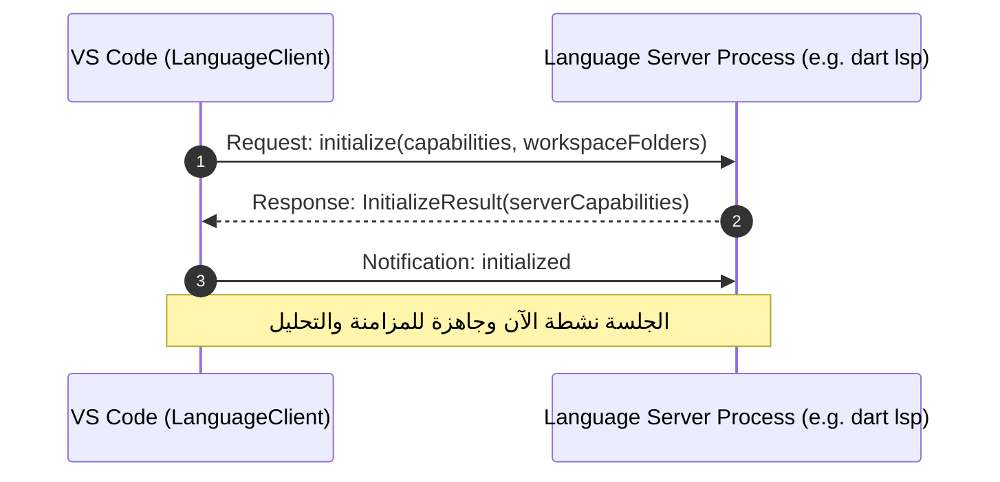

# تحليل معماري: كيف يعمل نظام خادم اللغة (LSP) ونظام تنفيذ الأكواد (Code Execution) في VS Code

> **مرجع تحليلي مستند إلى الكود المصدري الرسمي لـ VS Code:**  
> `/home/osm/Downloads/vscode-main/vscode-main`  
> أُعد هذا الملف كدليل مرجعي وهندسي شامل لتصميم ودمج خادم اللغة ونظام تشغيل الأكواد داخل محرر الأكواد المطور بلغة Flutter/Dart (`code_editor`).

---

## 1. التمييز المعماري الحاسم: هل ينفذ خادم LSP الأكواد؟

قبل الدخول في التفاصيل البرمجية، يجب حسم مبدأ معماري جوهري تفصل فيه أنظمة بيئات التطوير الاحترافية (مثل VS Code) بين مهمتين منفصلتين تماماً:

```text
+---------------------------------------------------------------------------------------+
|                                    VISUAL STUDIO CODE                                 |
+---------------------------------------------------+-----------------------------------+
|            1. ذكاء وفهم الكود (Intelligence)      |      2. تشغيل وتنفيذ الكود (Execution)     |
|         Language Server Protocol (LSP)            |        DAP / Tasks / Terminal / Pty       |
+---------------------------------------------------+-----------------------------------+
| • إكمال التلقائي (Autocomplete / Suggestions)     | • تشغيل البرامج وتمرير المعاملات (Run)    |
| • التحليل الثابت والتشخيصات (Diagnostics / Errors)| • التنقيح وفحص الذاكرة (Debugging)        |
| • الانتقال للتعريف والمراجع (Go to Definition)   | • إيقاف التنفيذ ونقاط التوقف (Breakpoints)|
| • إعادة التسمية وإعادة الهيكلة (Refactoring)      | • مهام البناء والترجمة (Build Tasks)      |
| • التوثيق الفوري وعرض الأنواع (Hover / Inlay Hints)| • موجهات الأوامر والطرفيات (Shell / REPL) |
+---------------------------------------------------+-----------------------------------+
```

- **بروتوكول خادم اللغة (LSP - Language Server Protocol):**  
  بروتوكول قياسي أطلقته Microsoft لتجريد **الذكاء البرمجي** (Language Intelligence). دوره قاصر على تحليل الكود ثنائياً وبنائياً (AST)، تدقيق الأنواع (Type-Checking)، توفير الاقتراحات، واكتشاف الأخطاء. **مواصفات LSP الرسمية لا تحتوي على محرك لتشغيل الأكواد أو تشغيل العمليات العادية**.
- **أنظمة تنفيذ الكود (Code Execution Subsystems):**  
  يعتمد VS Code لتنفيذ الأكواد على ثلاث ركائز بنيوية مستقلة كلياً عن LSP:
  1. **Debug Adapter Protocol (DAP):** لتشغيل الكود مع التنقيح (Debugging) أو بدونه (`noDebug: true`).
  2. **Task System:** لتشغيل مهام الترجمة والبناء والتشغيل عبر سكريبتات الشل والعمليات (`tasks.json`).
  3. **Terminal Process Subsystem (node-pty):** لتشغيل الأكواد تفاعلياً داخل طرفيات حقيقية مدمجة.

---

## 2. معمارية نظام خادم اللغة (LSP Architecture) في VS Code

في الكود المصدري لـ VS Code، لا يتحدث المحرر الرئيسي (Monaco Editor) مع خادم اللغة مباشرة، بل يمر الاتصال عبر طبقات عزل صارمة لضمان بقاء الواجهة سلسة (60+ FPS) حتى لو استغرق خادم اللغة وقتاً في حساب العمليات المعقدة.

### المخطط الهيكلي لتدفق بيانات LSP

```text
┌────────────────────────────────────────────────────────────────────────┐
│ 1. MAIN THREAD / RENDERER PROCESS (واجهة المحرر - UI)                  │
│                                                                        │
│   [ Monaco Editor ] ──> [ ILanguageFeaturesService ]                   │
│                                │                                       │
│                                ▼                                       │
│                   [ MainThreadLanguageFeatures ]                       │
│    (vs/workbench/api/browser/mainThreadLanguageFeatures.ts)            │
└────────────────────────────────┬───────────────────────────────────────┘
                                 │
                         IPC / JSON-RPC
                   (VS Code Internal Protocol)
                                 │
┌────────────────────────────────▼───────────────────────────────────────┐
│ 2. EXTENSION HOST PROCESS (بيئة عزل الإضافات)                           │
│                                                                        │
│                   [ ExtHostLanguageFeatures ]                          │
│     (vs/workbench/api/common/extHostLanguageFeatures.ts)               │
│                                │                                       │
│                                ▼                                       │
│                       [ Language Extension ]                           │
│                (مثل Dart, Python, أو json-language-features)           │
│                                │                                       │
│                                ▼                                       │
│                     [ vscode-languageclient ]                          │
│             (BaseLanguageClient / LanguageClient class)                │
└────────────────────────────────┬───────────────────────────────────────┘
                                 │
                      LSP (JSON-RPC 2.0 over)
                    [stdio / IPC / Socket / Pipes]
                                 │
┌────────────────────────────────▼───────────────────────────────────────┐
│ 3. LANGUAGE SERVER PROCESS (خادم اللغة المستقل)                         │
│                                                                        │
│    • dart language-server (للغة Dart)                                  │
│    • gopls (للغة Go)                                                   │
│    • rust-analyzer (للغة Rust)                                         │
│    • pyright / jedi (للغة Python)                                      │
│    • vscode-json-languageserver (للغة JSON)                            │
└────────────────────────────────────────────────────────────────────────┘
```

---

### تفكيك الطبقات الثلاث في الكود المصدري

#### أ) الطبقة الأولى: الواجهة ومزود الميزات (`MainThreadLanguageFeatures.ts`)

- **الملف:** `src/vs/workbench/api/browser/mainThreadLanguageFeatures.ts`
- **الوظيفة:** عندما يكتب المستخدم كوداً في المحرر، يطلب محرك التحرير Monaco اقتراحات الإكمال من خدمة ميزات اللغة المركزية (`ILanguageFeaturesService`):

  ```typescript
  //a استدعاء تسجيل المزودات عبر IPC داخل MainThreadLanguageFeatures
  @extHostNamedCustomer(MainContext.MainThreadLanguageFeatures)
  export class MainThreadLanguageFeatures extends Disposable implements MainThreadLanguageFeaturesShape {
      // تسجل المزودات القادمة من Extension Host في سجل Monaco Editor
      $registerCompletionSupport(handle: number, selector: IDocumentFilterDto[], ...);
      $registerDefinitionSupport(handle: number, selector: IDocumentFilterDto[]);
      $registerHoverProvider(handle: number, selector: IDocumentFilterDto[]);
  }
  ```

#### ب) الطبقة الثانية: وسيط الإضافات (`ExtHostLanguageFeatures.ts`)

- **الملف:** `src/vs/workbench/api/common/extHostLanguageFeatures.ts`
- **الوظيفة:** يعمل كجسر يترجم طلبات Monaco القادمة من الواجهة إلى استدعاءات لواجهات الـ API المعيارية للإضافات (`vscode.languages.registerCompletionItemProvider`):

  ```typescript
  export class ExtHostLanguageFeatures implements ExtHostLanguageFeaturesShape {
      // توفير عناصر الإكمال بناءً على طلب القادم من الـ MainThread
      async $provideCompletionItems(handle: number, resource: UriComponents, position: IPosition, context: languages.CompletionContext): Promise<ISuggestResultDtoField | undefined> {
          const doc = this._documents.getDocument(URI.revive(resource));
          const provider = this._adapter.get(handle);
          return await provider.provideCompletionItems(doc, typeConvert.Position.to(position), context, token);
      }
  }
  ```

#### ج) الطبقة الثالثة: عميل وخادم اللغة (`vscode-languageclient` & Servers)

- **المثال الواقعي في الكود المصدري:** `extensions/json-language-features/client/src/node/jsonClientMain.ts`
- تقوم الإضافة بإنشاء مثيل لعميل اللغة وتحدد مسار الخادم وطريقة الاتصال:

  ```typescript
  // ضبط خيارات تشغيل الخادم
  const serverOptions: ServerOptions = {
      run: { module: serverModule, transport: TransportKind.ipc },
      debug: { module: serverModule, transport: TransportKind.ipc, options: debugOptions }
  };

  // بالنسبة للخوادم الخارجية كـ Dart أو Go يُستخدم عادة stdio:
  // const serverOptions: ServerOptions = {
  //     command: 'dart',
  //     args: ['language-server', '--protocol=lsp'],
  //     transport: TransportKind.stdio
  // };

  // خيارات العميل والمستندات المدعومة
  const clientOptions: LanguageClientOptions = {
      documentSelector: [{ language: 'json' }, { language: 'jsonc' }],
      synchronize: { configurationSection: 'json' }
  };

  client = new LanguageClient('json', 'JSON Language Server', serverOptions, clientOptions);
  await client.start();
  ```

---

## 3. دورة حياة وميكانيكية عمل بروتوكول LSP (The LSP Lifecycle & Protocols)

### 1. بروتوكول النقل والتأطير (Transport & Framing)

الاتصال عبر `stdio` أو السوكيت يتم باستخدام بروتوكول **JSON-RPC 2.0** مع ترويسات شبيهة بـ HTTP (Header + Content):

```http
Content-Length: 142\r\n
Content-Type: application/json; charset=utf-8\r\n
\r\n
{
  "jsonrpc": "2.0",
  "id": 1,
  "method": "textDocument/completion",
  "params": {
    "textDocument": { "uri": "file:///workspace/main.dart" },
    "position": { "line": 15, "character": 8 }
  }
}
```

### 2. دورة المصافحة والتهيئة (Initialization Handshake)

لا يبدأ تبادل البيانات إلا بعد مصافحة معيارية:

1. يرسل العميل `initialize` يحتوي على قدرات العميل (`ClientCapabilities`: هل يدعم الـ Snippets، هل يدعم الـ Markdown في الـ Hover، إلخ).
2. يرد الخادم بـ `InitializeResult` متضمناً قدراته (`ServerCapabilities`: يدعم `completionProvider`, `definitionProvider`, نمط المزامنة `textDocumentSync` وغيرها).
3. يرسل العميل إشعار `initialized` لتأكيد بدء الجلسة الفعلية.



### 3. استراتيجية مزامنة المستندات (Document Synchronization)

عند فتح ملف وتعديله، يرسل العميل الإشعارات التالية:

- `textDocument/didOpen`: إشعار بمحتوى الملف الكامل عند الفتح لأول مرة.
- `textDocument/didChange`:
  - **مزامنة كاملة (Full Sync):** إرسال النص كاملاً عند كل تعديل (باهظة التكلفة للملفات الكبيرة).
  - **مزامنة تزايدية (Incremental Sync):** إرسال النطاق المعدل فقط (`Range`) مع النص الجديد، مما يوفر استهلاك الذاكرة والمعالج.
- `textDocument/didClose`: إشعار بإغلاق الملف للتخلص من شجرة الـ AST المحفوظة في الذاكرة.

### 4. التقرير عن الأخطاء والتشخيصات (Publish Diagnostics)

لا ينتظر الخادم أن تطلب الواجهة الأخطاء؛ بل يقوم بإرسال إشعار أحادي الاتجاه فور انتهاء التحليل:

```json
{
  "jsonrpc": "2.0",
  "method": "textDocument/publishDiagnostics",
  "params": {
    "uri": "file:///workspace/main.dart",
    "diagnostics": [
      {
        "range": { "start": { "line": 4, "character": 2 }, "end": { "line": 4, "character": 10 } },
        "severity": 1,
        "message": "Undefined name 'foo'.",
        "source": "dart"
      }
    ]
  }
}
```

يقوم `LanguageClient` باستقبال هذا الإشعار واستدعاء `vscode.languages.createDiagnosticCollection().set(uri, diagnostics)`، فتقوم Monaco بوضع خطوط حمراء متعرجة (Squiggles) وتحديث لوحة الـ Problems.

---

## 4. كيف ينفذ VS Code الكود فعلياً؟ (Execution Subsystems)

بما أن خادم LSP لا يقوم بتنفيذ أي كود برمجي، فكيف تعمل أزرار التشغيل "Run"، أو مفتاح `F5`، أو أوامر الطرفية؟  
يعتمد VS Code على أربعة أنظمة تنفيذية رئيسية:

```text
                               ┌────────────────────────────────┐
                               │     طلب تنفيذ الكود بالمحرر      │
                               │   (User hits Run / Debug / F5) │
                               └──────────────┬─────────────────┘
                                              │
             ┌────────────────────────────────┼────────────────────────────────┐
             ▼                                ▼                                ▼
   [ 1. Debugging & Run ]           [ 2. Build Tasks ]              [ 3. Terminal Run ]
     DebugService (DAP)             TaskService (Tasks)            TerminalProcess (Pty)
 (vs/workbench/contrib/debug)   (vs/workbench/contrib/tasks)   (vs/platform/terminal/node)
             │                                │                                │
             ▼                                ▼                                ▼
  [ Debug Adapter Process ]          [ Shell / Command ]            [ Native Shell Process ]
   (e.g., dart_debug_adapter)      (e.g., flutter build/run)         (bash, zsh, powershell)
             │                                │                                │
             ▼                                ▼                                ▼
     [ Target Binary / VM ]           [ Target Output ]              [ Interactive Process ]
```

---

### النظام الأول: بروتوكول مهايئ التنقيح (Debug Adapter Protocol - DAP)

- **الملف المصدري الأساسي:** `src/vs/workbench/contrib/debug/browser/debugService.ts`
- **كيف يتم تشغيل الكود في وضعية "Run Without Debugging"؟**
  عندما يضغط المستخدم على "Run Without Debugging" (`Ctrl+F5`)، يستدعي VS Code الدالة المركزية `startDebugging` مع تمرير خيار `noDebug: true`:

  ```typescript
  //a من ملف vs/workbench/contrib/debug/browser/debugService.ts (السطر 354):
  async startDebugging(launch: ILaunch | undefined, configOrName?: IConfig | string, options?: IDebugSessionOptions): Promise<boolean> {
      const message = options && options.noDebug 
          ? nls.localize('runTrust', "Running executes build tasks and program code from your workspace.") 
          : nls.localize('debugTrust', "Debugging executes build tasks and program code from your workspace.");
      ...
  }
  ```

- **آلية العمل:**
  1. يطلق VS Code عملية مستقلة تُسمى **مهايئ التنقيح (Debug Adapter)** (مثل `dart debug-adapter` أو `debugpy`).
  2. يرسل VS Code طلب تهيئة DAP `initialize` متبوعاً بطلب `launch`:

     ```json
     {
       "command": "launch",
       "arguments": {
         "type": "dart",
         "request": "launch",
         "program": "lib/main.dart",
         "noDebug": true
       }
     }
     ```

  3. يقوم مهايئ التنقيح بتشغيل المحرك الحقيقي (مثلاً تشغيل `dart run lib/main.dart`) وإعادة توجيه المخرجات (`stdout` و `stderr`) إلى المحرر كأحداث إخراج `output` لتظهر في شاشة الـ **Debug Console**.

---

### النظام الثاني: نظام المهام (Tasks System)

- **الملفات المصدرية:**  
  `src/vs/workbench/contrib/tasks/browser/taskService.ts`  
  `src/vs/workbench/contrib/tasks/browser/terminalTaskSystem.ts`
- **الوظيفة:** تشغيل سكريبتات ومترجمات سطر الأوامر المعرفة في `tasks.json` أو المنشأة برمجياً عبر الإضافات (`vscode.tasks.registerTaskProvider`).
- **الميكانيكية الداخلية في الكود:**
  تقوم دالة `_executeTask` في `terminalTaskSystem.ts` بفحص الاعتماديات (`dependsOn`)، ثم تستدعي خدمة الطرفية لإنشاء طرفية مخصصة لتشغيل الأمر:

  ```typescript
  //a من vs/workbench/contrib/tasks/browser/terminalTaskSystem.ts:
  [terminal, error] = await this._createTerminal(task, resolver, workspaceFolder);
  this._terminalService.setActiveInstance(terminal);
  await this._terminalService.revealTerminal(terminal);
  ```

  يقوم هذا النظام بالتقاط مخرجات الترجمة عبر ما يُعرف بـ **Problem Matchers**، ليحلل الأخطاء التي تطبعها أدوات مثل `gcc` أو `flutter build` ويحولها إلى علامات تشخيصية على الكود.

---

### النظام الثالث: الطرفية الحقيقية والمشغل منخفض المستوى (`node-pty`)

- **الملف المصدري:** `src/vs/platform/terminal/node/terminalProcess.ts`
- **الوظيفة:** عندما يتم تشغيل كود عبر موجه الأوامر المدمج (Terminal)، يستخدم VS Code مكتبة C++ مجمعة تسمى **`node-pty`** (Pseudo-Terminal):

  ```typescript
  //a من vs/platform/terminal/node/terminalProcess.ts:
  import { IPty, spawn } from 'node-pty';

  // إنشاء عملية طرفية حقيقية تتصل بنواة النظام:
  this._ptyProcess = spawn(shellLaunchConfig.executable, args, options);

  // الاستماع للبيانات وتمريرها لمكتبة الواجهة xterm.js:
  this._ptyProcess.onData((data: string) => {
      this._onProcessData.fire(data);
  });
  ```

  هذا ما يتيح دعم التحكم الكامل بالطرفية: الألوان (ANSI Colors)، إدخال المفاتيح الخاصة (`Ctrl+C`, الأسهم)، ودعم البرامج التفاعلية مثل `vim` أو البرامج التي تطلب مدخلات نصية حية (`stdin`).

---

### النظام الرابع: تنفيذ الأوامر من خلال الإضافات المباشرة (Extension Process Execution)

تستطيع الإضافات تشغيل الأكواد بإحدى طريقتين:

1. **إرسال نص إلى الطرفية المفتوحة:**

   ```typescript
   const terminal = vscode.window.activeTerminal || vscode.window.createTerminal('Runner');
   terminal.show();
   terminal.sendText(`dart run ${vscode.window.activeTextEditor.document.fileName}`);
   ```

2. **استخدام مكتبة `child_process` داخل الـ Extension Host:**

   ```typescript
   import { spawn } from 'child_process';
   const child = spawn('dart', ['run', filePath]);
   child.stdout.on('data', (data) => outputChannel.append(data.toString()));
   ```

---

## 5. نقطة التلاقي: كيف يربط المحرر بين خادم LSP وأنظمة التنفيذ؟

على الرغم من الانفصال التام بين النظامين، إلا أن تجربة المستخدم في بيئات مثل VS Code تبدو متكاملة بسلاسة بفضل تقنيتين رئيسيتين يوفرهما بروتوكول LSP:

```text
                       ┌──────────────────────────────────────────────┐
                       │             كود المستخدم في المحرر            │
                       │   void main() { ... }                        │
                       └──────────────────────┬───────────────────────┘
                                              │
                         LSP: textDocument/codeLens
                                              │
                                              ▼
                       ┌──────────────────────────────────────────────┐
                       │              زر CodeLens في الواجهة          │
                       │         ▶ Run   |   🐞 Debug                 │
                       └──────────────────────┬───────────────────────┘
                                              │
                                     نقر المستخدم على [Run]
                                              │
                                              ▼
                       ┌──────────────────────────────────────────────┐
                       │             LSP Command Dispatcher           │
                       │    workspace/executeCommand أو أمر داخلي      │
                       └──────────────────────┬───────────────────────┘
                                              │
                                              ▼
                       ┌──────────────────────────────────────────────┐
                       │        تحويل الطلب لمحرك التنفيذ الفعلي       │
                       │   vscode.commands.executeCommand(            │
                       │     'vscode.startDebugging', { noDebug: true }│
                       │   )                                          │
                       │   أو تشغيل الأمر في Terminal                 │
                       └──────────────────────────────────────────────┘
```

### 1. الـ CodeLens والـ CodeActions

- يقوم خادم LSP بتحليل الكود. عندما يجد دالة اختبار `test("...", () {})` أو دالة `main()`، يرسل إشعار `textDocument/codeLens`.
- يتضمن الـ CodeLens عنواناً مثل `"Run"` أو `"Debug"`، بالإضافة إلى **أمر معرّف (`Command`)**.
- عند نقر المستخدم على الرابط فوق الدالة، لا يقوم خادم LSP بالتشغيل بنفسه؛ بل يستقبل العميل نقرة الزر، ويستدعي أمر VS Code المسجل:
  `vscode.debug.startDebugging(undefined, { type: 'dart', request: 'launch', program: doc.fileName, noDebug: true })`.

### 2. أمر تنفيذ الأوامر بالخادم (`workspace/executeCommand`)

- يتيح للعميل أن يطلب من الخادم تنفيذ أمر تحليلي أو تنظيمي (مثل `dart.package.get` أو تنظيم الاستيرادات `organizeImports`).
- يقوم الخادم بمعالجة الطلب ويمكنه الرد بـ `workspace/applyEdit` لتطبيق تعديلات على الملفات في المحرر.

---

## 6. خارطة طريق لتطبيق المعمارية في مشروعك (`code_editor` في Flutter)

بناءً على المعمارية المستخلصة من VS Code، إليك كيفية تنظيم وبناء نظامي LSP وتنفيذ الكود داخل تطبيق محرر الأكواد الذي تبنيه:

### 1. هيكل المجلدات المقترح في `lib/`

```text
lib/
├── core/
│   ├── lsp/                          # 1. نظام خادم اللغة (LSP Subsystem)
│   │   ├── connection/               # إدارة تدفق الـ stdio والـ Framing
│   │   │   ├── lsp_framing.dart      # قراءة وكتابة Content-Length و JSON-RPC
│   │   │   └── lsp_process.dart      # إطلاق خادم اللغة عبر Process.start
│   │   ├── protocol/                 # نماذج رسائل LSP (Request, Response, Notification)
│   │   │   ├── lsp_messages.dart
│   │   │   └── lsp_capabilities.dart
│   │   ├── sync/                     # إدارة مزامنة الملفات
│   │   │   └── document_sync.dart    # إرسال didOpen, didChange, didClose
│   │   └── client/
│   │       └── lsp_client.dart       # واجهة استدعاء completions, hover, definition
│   │
│   └── execution/                    # 2. نظام تنفيذ الأكواد (Execution Subsystem)
│       ├── process_runner.dart       # تشغيل البرامج وتمرير المدخلات والمخرجات
│       ├── execution_session.dart    # إدارة حالة الجلسة الجارية (Running, Terminated)
│       └── terminal_controller.dart  # ربط المخرجات باللوحة السفلية
│
└── parts/
    ├── editor/                       # ويدجت المحرر وتكامله مع LSP Client
    └── panel/                        # اللوحة السفلية (المخرجات والتشخيصات)
        ├── panel_widget.dart         # الويدجت الحالي المفتوح لديك
        ├── output_console_view.dart  # عرض نصوص المخرجات stdout/stderr
        └── problems_view.dart        # عرض مصفوفة التشخيصات القادمة من publishDiagnostics
```

---

### 2. المكون الأول: تطبيق تأطير رسائل LSP في Dart (`LspFraming`)

```dart
// lib/core/lsp/connection/lsp_framing.dart
import 'dart:convert';
import 'dart:typed_data';

class LspFraming {
  /// تغليف حمولة JSON داخل ترويسة LSP القياسية
  static Uint8List encode(Map<String, dynamic> jsonPayload) {
    final body = jsonEncode(jsonPayload);
    final bytes = utf8.encode(body);
    final header = 'Content-Length: ${bytes.length}\r\n\r\n';
    final headerBytes = ascii.encode(header);

    final builder = BytesBuilder();
    builder.add(headerBytes);
    builder.add(bytes);
    return builder.toBytes();
  }

  /// فك تأطير تيار البايتات واستخراج رسائل الـ JSON
  static List<Map<String, dynamic>> decodeChunk(List<int> chunk, StringBuffer buffer) {
    buffer.write(utf8.decode(chunk, allowMalformed: true));
    final messages = <Map<String, dynamic>>[];

    while (true) {
      final text = buffer.toString();
      final headerEnd = text.indexOf('\r\n\r\n');
      if (headerEnd == -1) break;

      final header = text.substring(0, headerEnd);
      final match = RegExp(r'Content-Length:\s*(\d+)').firstMatch(header);
      if (match == null) {
        throw FormatException('Invalid LSP header: $header');
      }

      final contentLength = int.parse(match.group(1)!);
      final totalExpectedLength = headerEnd + 4 + contentLength;

      if (text.length < totalExpectedLength) {
        // لم تكتمل الحمولة في الـ buffer بعد، ننتظر الدفعة التالية
        break;
      }

      final body = text.substring(headerEnd + 4, totalExpectedLength);
      messages.add(jsonDecode(body) as Map<String, dynamic>);

      // تفريغ ما تمت قراءته من الـ buffer
      final remaining = text.substring(totalExpectedLength);
      buffer.clear();
      buffer.write(remaining);
    }

    return messages;
  }
}
```

---

### 3. المكون الثاني: إطلاق خادم اللغة عبر `Process.start`

```dart
// lib/core/lsp/connection/lsp_process.dart
import 'dart:async';
import 'dart:io';
import 'lsp_framing.dart';

class LspServerProcess {
  Process? _process;
  final StringBuffer _buffer = StringBuffer();
  final StreamController<Map<String, dynamic>> _messagesController = StreamController.broadcast();

  Stream<Map<String, dynamic>> get onMessage => _messagesController.stream;

  Future<void> start({required String executable, required List<String> args}) async {
    _process = await Process.start(executable, args);

    // الاستماع إلى مخرجات الخادم (stdout) وفك تشفير الـ JSON-RPC
    _process!.stdout.listen((bytes) {
      final messages = LspFraming.decodeChunk(bytes, _buffer);
      for (final msg in messages) {
        _messagesController.add(msg);
      }
    });

    _process!.stderr.listen((bytes) {
      final err = String.fromCharCodes(bytes);
      print('[LSP Server stderr]: $err');
    });
  }

  void sendMessage(Map<String, dynamic> message) {
    if (_process == null) return;
    final encoded = LspFraming.encode(message);
    _process!.stdin.add(encoded);
  }

  Future<void> stop() async {
    await _process?.kill();
    await _messagesController.close();
  }
}
```

---

### 4. المكون الثالث: محرك تشغيل الكود المستقل في Flutter (`ProcessRunner`)

لا تربط تنفيذ الكود بالـ LSP؛ بل اجعل تنفيذ الكود خدمة مخصصة تستمع إليها لوحة `PanelWidget` أو نافذة `OutputConsole`:

```dart
// lib/core/execution/process_runner.dart
import 'dart:async';
import 'dart:convert';
import 'dart:io';

class ExecutionResult {
  final int exitCode;
  ExecutionResult(this.exitCode);
}

class CodeExecutionService {
  Process? _activeProcess;
  final StreamController<String> _outputController = StreamController<String>.broadcast();

  Stream<String> get onOutput => _outputController.stream;
  bool get isRunning => _activeProcess != null;

  /// تشغيل أي ملف أو كود كعملية نظام مستقلة
  Future<int> execute({
    required String command,
    required List<String> args,
    String? workingDirectory,
  }) async {
    if (_activeProcess != null) {
      _outputController.add('\n⚠️ هناك عملية قيد التشغيل بالفعل.\n');
      return -1;
    }

    _outputController.add('▶ تشغيل الأمر: $command ${args.join(" ")}\n\n');

    try {
      _activeProcess = await Process.start(
        command,
        args,
        workingDirectory: workingDirectory,
        runInShell: Platform.isWindows,
      );

      // الاستماع للخرج المعتاد (stdout)
      _activeProcess!.stdout.transform(utf8.decoder).listen((data) {
        _outputController.add(data);
      });

      // الاستماع لأخطاء التشغيل (stderr)
      _activeProcess!.stderr.transform(utf8.decoder).listen((data) {
        _outputController.add('❌ $data');
      });

      final exitCode = await _activeProcess!.exitCode;
      _outputController.add('\n⏹ انتهت العملية برمز الخروج: $exitCode\n');
      _activeProcess = null;
      return exitCode;
    } catch (e) {
      _outputController.add('\n❌ فشل إطلاق العملية: $e\n');
      _activeProcess = null;
      return -1;
    }
  }

  /// إيقاف العملية قسراً (مماثل لـ Terminate / Stop في المحرر)
  void stop() {
    _activeProcess?.kill(ProcessSignal.sigterm);
    _activeProcess = null;
  }
}
```

---

## 7. مقارنة موجزة بين المكونات والمسارات في VS Code

| الخاصية | خادم اللغة (LSP) | نظام مهايئ التنقيح (DAP) | نظام المهام (Tasks) | نظام الطرفية (Terminal) |
| :--- | :--- | :--- | :--- | :--- |
| **الهدف الأساسي** | الفحص والتحليل الذكي للكود | تشغيل الكود وفحصه خطوة بخطوة | أتمتة مهام الترجمة والبناء | واجهة تفاعلية حرة لأوامر الشل |
| **هل ينفذ كود البرنامج؟** | ❌ **لا** | ✔️ **نعم** (عبر إطلاق الـ Runtime) | ✔️ **نعم** (عبر إطلاق أوامر النظام) | ✔️ **نعم** (عبر الشل و node-pty) |
| **البروتوكول المستخدم** | JSON-RPC 2.0 (LSP) | JSON-RPC-like (DAP) | أوامر الشل وتعبيرات الأنماط | تيار بايتات خام ومحاكاة VT100 |
| **المسار في VS Code** | `vs/workbench/api/browser/mainThreadLanguageFeatures.ts` | `vs/workbench/contrib/debug/browser/debugService.ts` | `vs/workbench/contrib/tasks/browser/terminalTaskSystem.ts` | `vs/platform/terminal/node/terminalProcess.ts` |
| **واجهة العرض للمستخدم** | Monaco Editor (Squiggles, Completions, Hover) | Debug Console, Variables, Breakpoints | Panel -> Output / Terminal | Panel -> Integrated Terminal |

---

## 8. الخلاصة للمطور المعماري

1. **لا تخلط بين LSP وتشغيل الكود:** أبقِ طبقة `LspClient` معزولة تماماً في مجلد خاص بها ومسؤولة فقط عن التواصل مع خوادم اللغات لجلب الميزات التحليلية.
2. **شغّل الأكواد كنظام عمليات مستقل:** ابنِ طبقة `CodeExecutionService` باستخدام `Process.start`، واربط تدفق المخرجات (`stdout`/`stderr`) مع لوحة الـ `PanelWidget` القائمة في مشروعك لعرض المخرجات للمستخدم.
3. **اربط بينهما عبر مشغل الأحداث (Action / Command Dispatcher):** عندما يوفر الـ LSP ميزة مثل CodeLens لزر "Run"، اجعل الضغط على الزر يستدعي مشغل الأوامر الداخلي لتوجيه الأمر إلى `CodeExecutionService`، تماماً كما يفعل VS Code بين Monaco و DebugService.
