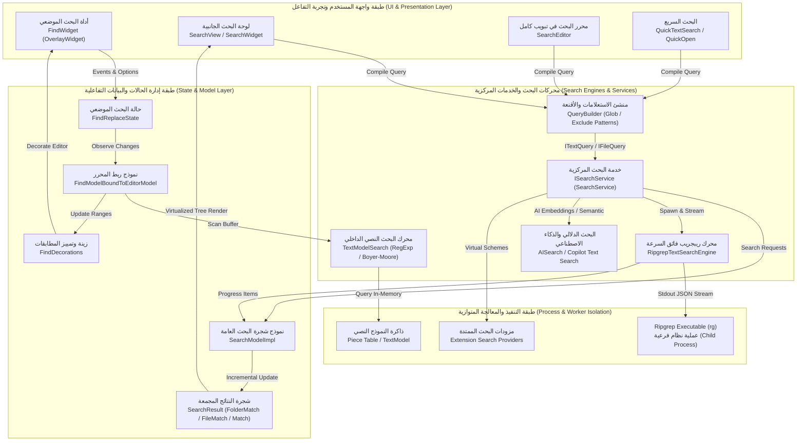
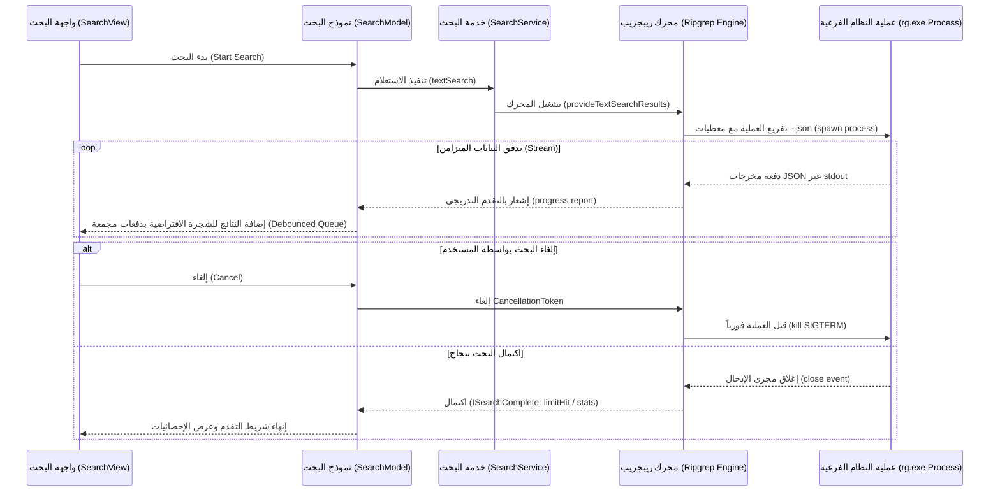
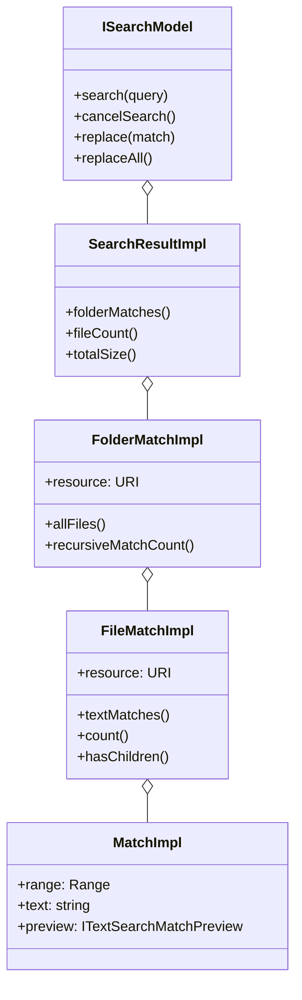
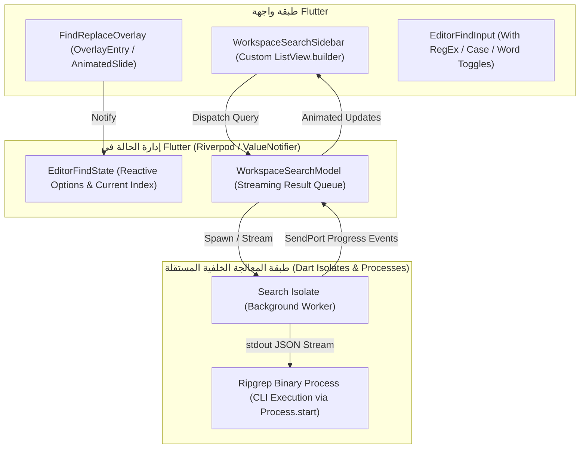

# التحليل المعماري والبصري الشامل لنظام البحث في VS Code (VS Code Search System Architecture & Visual Analysis)

## 1. الغرض ونطاق الوثيقة

تهدف هذه الوثيقة إلى تقديم **تشريح معماري وبصري متعمق وشامل** لنظام البحث والاستبدال في محرر Visual Studio Code (المستودع المصدري `code-oss-dev` الموجود في المسار `/home/osm/Downloads/vscode-main/vscode-main`).

يقوم نظام البحث في VS Code على ركيزتين أساسيتين متكاملتين:

1. **البحث الموضعي داخل الملف المفتوح (In-Editor Find & Replace)**: المدمج داخل محرك التحرير Monaco Editor عبر المسارات `src/vs/editor/contrib/find/` و `src/vs/base/browser/ui/findinput/`.
2. **البحث الشامل على مستوى مساحة العمل (Workspace-Wide Global Search)**: المنفذ عبر الخدمات الأساسية `src/vs/workbench/services/search/` وواجهات العرض `src/vs/workbench/contrib/search/` ومحرر نتائج البحث `src/vs/workbench/contrib/searchEditor/`.

يركز هذا التحليل على:

- **المعمارية البرمجية (Software Architecture)**: دورة حياة الاستعلامات، فصل المهام (Separation of Concerns)، تدفق البيانات المتدفق (Streaming Data Flow)، وإدارة الحالات المشتركة.
- **التصميم البصري وتجربة المستخدم (Visual & Interaction Design)**: تفكيك واجهات المستخدم (Widgets)، والطبقات العائمة (Overlay Widgets)، وتأثيرات الحركة والانتقال، والشجرة الافتراضية فائقة السرعة (Virtualized Async Data Tree)، والعارضات المخصصة (Custom Renderers).
- **محركات المطابقة والأداء (Engines & Performance)**: خوارزميات البحث في الذاكرة (TextModelSearch)، وتكامل Ripgrep عبر العمليات المعزولة (Subprocess Workers)، ومؤشرات الخطوط المجدولة (LineFeed Indexing).
- **خريطة تطبيق عملية لمشروع Flutter (`code_editor`)**: استخلاص الأنماط التصميمية وإعادة صياغتها برمجياً باستخدام بيئة عمل Flutter (عبر Isolates و CustomPainter و Virtualized Lists).

---

## 2. الملخص التنفيذي ومخطط المعمارية الشاملة

يعتمد نجاح نظام البحث في VS Code على مبدأ **"عدم تجميد واجهة المستخدم مطلقاً (Zero UI Freezing)"** مهما بلغ حجم قاعدة الكود أو عدد أسطر الملف المفتوح. ويتحقق ذلك من خلال عزل العمليات الشاقة إما في خيوط معالجة فرعية (Web Workers)، أو عمليات نظام مستقلة (Node Subprocesses) عبر محرك `ripgrep`، وبث النتائج تدريجياً (Streaming) إلى واجهة افتراضية تتولى عرض الأجزاء الظاهرة فقط في شاشة المستخدم.



---

## 3. التحليل المعماري للبحث الموضعي داخل المحرر (In-Editor Find & Replace)

يقع نظام البحث والاستبدال داخل محرر الأكواد Monaco في المسار:
`/src/vs/editor/contrib/find/`

### 3.1. وحدة التحكم وتوجيه الأوامر (`FindController.ts`)

تعتبر فئة `CommonFindController` و `FindController` بمثابة نقطة الدخول (Entry Point) التي يتم تسجيلها كمساهمة محرر (`EditorContribution`).

- **المسؤوليات الرئيسية**:
  1. الاستماع لاختصارات لوحة المفاتيح مثل `Ctrl+F` (Find) و `Ctrl+H` (Replace) و `F3` / `Shift+F3` (Next/Previous Match).
  2. استخلاص النص المحدد حالياً في المحرر تلقائياً (`getSelectionSearchString`) لملء حقل البحث فور الفتح.
  3. إدارة دورة حياة الأداة العائمة `FindWidget` وتنسيقها مع حالة التحرير (مثل غلق الأداة عند الضغط على `Escape`).
  4. تنسيق البحث المتعدد (`Multi-Cursor`) من خلال تحويل جميع مطابقات البحث إلى مؤشرات تحرير نشطة عبر `SelectAllMatchesAction`.

### 3.2. حافلة الحالة التفاعلية (`FindReplaceState.ts`)

تعتمد VS Code على كائن حالة مركزي من فئة `FindReplaceState` يرث من `Disposable`. لا تحتفظ واجهة العرض `FindWidget` بحالتها الخاصة داخلياً، بل تُفصل الحالة تماماً في هذا الكائن:

```typescript
export interface FindReplaceStateChangedEvent {
    moveCursor: boolean;
    updateHistory: boolean;
    searchString: boolean;
    replaceString: boolean;
    isRevealed: boolean;
    isReplaceRevealed: boolean;
    isRegex: boolean;
    wholeWord: boolean;
    matchCase: boolean;
    preserveCase: boolean;
    searchScope: boolean;
    matchesPosition: boolean;
    matchesCount: boolean;
    currentMatch: boolean;
    loop: boolean;
    isSearching: boolean;
    filters: boolean;
}
```

- **آلية التحديث الدقيق**: يستخدم الكائن `Emitter<FindReplaceStateChangedEvent>`، فعند تعديل أي خاصية (مثل تشغيل خيار Regular Expression)، يتم إطلاق حدث يحمل أعلاماً منطقية (`boolean flags`) تحدد بدقة ما تغير، مما يمنع إعادة بناء أو إعادة حساب الأجزاء غير المتأثرة في الواجهة.
- **دعم التجاوز المؤقت (Option Override)**: يدعم الكائن حالات `FindOptionOverride.True` و `FindOptionOverride.False` للسماح لملحقات المحرر أو الأوامر بفرض البحث بحساسية الأحرف مؤقتاً دون إفساد إعدادات المستخدم الافتراضية.

### 3.3. مزامنة النموذج مع المحرر (`FindModelBoundToEditorModel.ts`)

ترتبط كل نافذة محرر نشطة بنموذج يسمى `FindModelBoundToEditorModel`، وهو العقل المدبر للبحث في الذاكرة الحية:

- **حد أقصى للمطابقات (`MATCHES_LIMIT = 19999`)**: لحماية المحرر من استنزاف الذاكرة وانهيار الأداء عند وجود ملايين المطابقات في ملفات ضخمة، يضع المحرك حداً أقصى دقيقاً هو `19999` نتيجة معروضة في آن واحد، مع إشعار المستخدم بذلك.
- **تأخير إعادة البحث الذكي (`RESEARCH_DELAY = 240ms`)**: عند كتابة المستخدم داخل المحرر أثناء وجود نتائج بحث نشطة، يتم تأخير تحديث المطابقات بمقدار `240ms` عبر `RunOnceScheduler` لمنع التقطيع (Stuttering).
- **التفاعل مع عمليات المحرر الأساسية**: يتكامل مع مكدس التراجع والإعادة (`Undo/Redo`) عبر `ReplaceCommand` و `ReplaceAllCommand`، مما يسمح بالتراجع عن استبدال 500 كلمة بضغطة زر واحدة وكأنه إجراء ذري واحد (`Atomic Transaction`).

### 3.4. محرك البحث النصي في الذاكرة (`TextModelSearch.ts`)

يمثل هذا المكون القلب الحسابي للبحث داخل نموذج المحرر النصي `TextModel`:

- **تحليل الطلب وتجهيز الخوارزمية (`SearchParams.parseSearchRequest`)**:
  - إذا كان الاستعلام نصاً بسيطاً مكوناً من سطر واحد وبدون أحرف خاصة، يستخدم المحرك مساراً سريعاً منخفض التعقيد مستنداً إلى البحث النصي المباشر.
  - إذا تضمن البحث تعبيراً نمطياً (`Regex`)، يتم فحص ما إذا كان التعبير النمطي متعدد الأسطر عبر فحص الشفرات المحرفية (`CharCode.LineFeed` ورموز الهروب `\n` و `\r`).
  - يتم تجميع التعبير النمطي باستخدام فئة `strings.createRegExp` مع أعلام الفئات الموحدة (`unicode: true` و `global: true`).
- **حساب الأسطر السريع باستخدام عداد فواصل الأسطر (`LineFeedCounter`)**:
  لتحويل الإزاحات الرقمية المطلقة (`character offsets`) الناتجة عن التعبيرات النمطية إلى أرقام أسطر وأعمدة (`LineNumber`, `Column`) بأقصى سرعة ممكنة، يقوم `LineFeedCounter` بتسجيل مصفوفة إزاحات جميع أحرف `\n` في الملف، ثم يطبق **البحث الثنائي (Binary Search)** ذو التعقيد $O(\log N)$ لمعرفة السطر المقابل لأي إزاحة فورياً دون الحاجة إلى مسح النص حرفاً بحرف.

### 3.5. إدارة الزينة والإبراز المرئي (`FindDecorations.ts`)

تتحكم هذه الفئة في كيفية ظهور نتائج البحث للمستخدم داخل مساحة الكود والمسطرة الجانبية ومصغر الكود (Minimap):

- **أنواع الزينة المطبقة في Monaco Editor**:
  1. `_FIND_MATCH_DECORATION`: إبراز خلفية جميع المطابقات (`overviewRulerFindMatchForeground`)، مع رسم علامة برتقالية/صفراء في المسطرة الجانبية ومربعات متناهية الصغر في الـ Minimap.
  2. `_CURRENT_FIND_MATCH_DECORATION`: تمييز النتيجة النشطة حالياً بلون ساطع مع حدود مميزة (`editorFindMatchHighlightBorder`).
  3. `_RANGE_HIGHLIGHT_DECORATION`: إبراز نطاق البحث في حال تم تقييد البحث بالنص المحدد (`Find in Selection`).
- **ثبات النطاقات مع التحرير (`TrackedRangeStickiness`)**: تستخدم الزينات نمط `NeverGrowsWhenTypingAtEdges` لضمان أن الكتابة بجانب كلمة مطابقة لا تؤدي إلى تشويه حدود التحديد.

### 3.6. محرك توليد الاستبدال والحفاظ على حالة الأحرف (`ReplacePattern.ts`)

- **استبدال ثابت مقابل ديناميكي (`StaticValue` vs `DynamicPieces`)**:
  إذا كانت جملة الاستبدال تحتوي على متغيرات مجموعات مثل `$1` و `$2` و `$&`، يتم تجزئة جملة الاستبدال إلى قطع ديناميكية تُعاد صياغتها عند كل مطابقة.
- **الحفاظ على حالة الأحرف المتقدمة (`Preserve Case`)**:
  من الميزات الفريدة في VS Code؛ فإذا استبدلت `foo_bar` بـ `hello_world` مع تفعيل خيار `Preserve Case`:
  - `foo_bar` تتحول إلى `hello_world` (lowercase)
  - `FOO_BAR` تتحول إلى `HELLO_WORLD` (UPPERCASE)
  - `FooBar` تتحول إلى `HelloWorld` (PascalCase)
  - `fooBar` تتحول إلى `helloWorld` (camelCase)

---

## 4. التحليل البصري والتفاعلي لأداة البحث (`FindWidget`)

تعد `FindWidget` مثالاً يحتذى به في هندسة الواجهات التفاعلية الدقيقة؛ فهي أداة عائمة فوق المحرر (`IOverlayWidget`) وليست جزءاً من تدفق DOM التقليدي، مما يمنع إعادة تصيير أسطر الكود عند ظهورها.

```
+-------------------------------------------------------------------------------------------------------+
|  >  [ Find in document...       ] [Aa] [|W|] [.*]  |  1 of 42  |  [^]  [v]  [=*=]  [X]                 |
+-------------------------------------------------------------------------------------------------------+
|     [ Replace with...           ]            [AB]  |           |  [->] [->|]                          |
+-------------------------------------------------------------------------------------------------------+
  ^                 ^                  ^       ^            ^       ^    ^     ^     ^
  1                 2                  3       4            5       6    7     8     9
```

### 4.1. تشريح عناصر الواجهة (Widget Anatomy)

1. **زر تبديل الاستبدال (`Toggle Replace Button - chevronRight / chevronDown`)**: عند النقر عليه، يتسع ارتفاع الأداة عبر انزلاق سلس لتظهر مساحة الاستبدال.
2. **صندوق إدخال البحث (`ContextScopedFindInput`)**: صندوق إدخال نصي عالي الأداء يدعم سجل البحث (`Search History`) عبر السهمين لأعلى وأسفل، ويتضمن أزرار التبديل الثلاثة في طرفه الأيمن الداخلي:
   - `[Aa]` Match Case (`Alt+C`).
   - `[|W|]` Match Whole Word (`Alt+W`).
   - `[.*]` Use Regular Expression (`Alt+R`).
3. **عداد المطابقات (`Matches Count Label`)**:
   - يعرض مؤشر الموضع الحالي وإجمالي النتائج: مثل `1 of 24` أو `No results`.
   - في حال تجاوز الحد الأقصى يظهر نص تنبيهي: `>20,000`.
4. **أزرار التنقل السريع**:
   - `[^]` الانتقال للمطابقة السابقة (`Shift+Enter` أو `F3` معكوس).
   - `[v]` الانتقال للمطابقة التالية (`Enter` أو `F3`).
   - `[=*=]` قصر البحث على التحديد الحالي (`Find in Selection - Alt+L`).
   - `[X]` إغلاق الأداة وإعادة التركيز لموضع المؤشر الأصلي في المحرر (`Escape`).
5. **شريط تغيير العرض الرأسي (`Vertical Sash`)**: مقبض سحب دقيق على الحافة اليسرى للأداة يسمح للمستخدم بتكبير وتصغير عرض أداة البحث بالسحب بالفأرة بما يناسب شاشته، مع حفظ العرض في الـ `StorageService`.

### 4.2. فيزياء الحركة وتنسيقات CSS (`findWidget.css`)

```css
.monaco-editor .find-widget {
    position: absolute;
    z-index: 35;
    height: 34px;
    overflow: hidden;
    line-height: 19px;
    transition: transform 200ms linear;
    padding: 0 4px 0 9px;
    margin-top: 4px;
    box-sizing: border-box;
    transform: translateY(calc(-100% - 10px)); /* إخفاء الأداة للأعلى مع الظل */
    box-shadow: var(--vscode-shadow-lg);
    border: 1px solid var(--vscode-widget-border);
    border-radius: var(--vscode-cornerRadius-large);
    background-color: var(--vscode-editorWidget-background);
}

.monaco-editor .find-widget.visible {
    transform: translateY(0); /* انزلاق سلس للأسفل */
}

.monaco-editor .find-widget.replaceToggled {
    height: 68px; /* تمدد الأداة لاستيعاب سطر الاستبدال */
}
```

- **تفضيلات تقليل الحركة (`prefers-reduced-motion`)**: عند تفعيل فئة `.monaco-reduce-motion`، يتم إلغاء زمن الانتقال (`transition: transform 0ms linear`) مراعاةً لسهولة الوصول.
- **التركيز الصوري (`Synthetic Focus`)**: لإبقاء التركيز داخل حقل الإدخال مع توفير إمكانية النقر على أزرار المحرر دون فقدان سياق الاختصارات، تستخدم VS Code مفهوماً مبتكراً يُدعى `synthetic-focus` يرسم حدود التركيز باللون `var(--vscode-focusBorder)` اصطناعياً.

---

## 5. المعمارية الفائقة للبحث على مستوى مساحة العمل (Workspace Search Architecture)

تتولى حزمة `src/vs/workbench/services/search/` تنظيم وإدارة عمليات البحث الضخمة التي تجري عبر آلاف الملفات والمجلدات.

### 5.1. واجهة خدمة البحث المركزية (`ISearchService`)

```typescript
export interface ISearchService {
    readonly _serviceBrand: undefined;
    textSearch(query: ITextQuery, token?: CancellationToken, onProgress?: (result: ISearchProgressItem) => void): Promise<ISearchComplete>;
    fileSearch(query: IFileQuery, token?: CancellationToken): Promise<ISearchComplete>;
    aiTextSearch(query: IAITextQuery, token?: CancellationToken, onProgress?: (result: ISearchProgressItem) => void): Promise<ISearchComplete>;
    registerSearchResultProvider(scheme: string, type: SearchProviderType, provider: ISearchResultProvider): IDisposable;
}
```

- **تعدد المخططات والامتداد (Scheme Agnostic)**: لا تفترض خدمة البحث أن الملفات موجودة على القرص الصلب المحلي فقط؛ فمن خلال `registerSearchResultProvider`، يمكن لملحقات VS Code تسجيل مزودي بحث لمخططات افتراضية مخصصة مثل `vscode-vfs://` (مستودعات GitHub السحابية) أو `vscode-remote://` (عبر SSH وحاويات Docker و WSL).

### 5.2. معالج الاستعلامات والأقنعة (`QueryBuilder.ts`)

يقوم `QueryBuilder` بتحويل مدخلات المستخدم الرسومية من لوحة البحث إلى كائن استعلام معقد `ITextQuery`:

- **دمج ملفات الاستبعاد والإهمال**:
  1. قراءة قواعد `.gitignore` المحلية وقواعد المستودع الأب.
  2. قراءة إعدادات المحرر `files.exclude` و `search.exclude`.
  3. قراءة حقول المستخدم المخصصة `files to include` و `files to exclude` المكتوبة بصيغة Glob (مثل `src/**/*.ts,!**/*.test.ts`).
  4. استخراج المجلدات الجذرية لمساحات العمل متعددة الجذور (`Multi-root Workspaces`) وتطبيق استثناءات خاصة بكل مجلد جذر على حدة (`IFolderQuery`).

### 5.3. محرك Ripgrep والتكامل المعزول (`RipgrepTextSearchEngine.ts`)

يمثل محرك `Ripgrep (rg)` المكتوب بلغة Rust العمود الفقري للسرعة الأسطورية في VS Code.



- **التواصل عبر نمط JSON المتدفق (`--json`)**:
  يقوم VS Code بتشغيل محرك Ripgrep كعملية نظام مستقلة (`child_process.spawn`) ممرراً له المعامل `--json`. يخرج Ripgrep النتائج في هيئة أسطر JSON فور عثوره عليها:
  - كائنات `begin`: تشير لبدء نتائج ملف معين.
  - كائنات `match`: تحوي رقم السطر، والنص، وإزاحات المطابقة الدقيقة.
  - كائنات `context`: توفر الأسطر السابقة واللاحقة لسياق الكود (`surroundingContext`).
  - كائنات `end`: إحصائيات المطابقة للملف.
- **معالجة الحلقات المفرغة للروابط الرمزية (`Symlink Loops Detection`)**:
  إذا احتوى المشروع على روابط رمزية تدور في حلقات مفرغة (`Symlink Loops`)، يقوم `RipgrepSymlinkLoopDetector` باكتشاف رسائل تحذير stderr وإعادة تشغيل البحث فورياً تلقائياً مع تعطيل خاصية تتبع الروابط الرمزية (`followSymlinks: false`) منعاً لانهيار الذاكرة.

---

## 6. التحليل البصري والمعماري للوحة البحث الجانبية (`SearchView` & `SearchResultsView`)

تقع لوحة البحث الجانبية في الحزمة `src/vs/workbench/contrib/search/browser/`.

### 6.1. الشجرة الافتراضية غير المتزامنة (`WorkbenchCompressibleAsyncDataTree`)

لعرض مئات الآلاف من النتائج بسلاسة 60 إطاراً في الثانية، تعتمد VS Code على شجرة افتراضية ذكية:

- **العرض الافتراضي الصارم (Strict Virtualization)**: لا يتم إنشاء عناصر HTML في صفحة الويب إلا للأسطر الظاهرة فقط داخل مساحة الرؤية الحالية (Viewport) بالإضافة لهامش تخزين مؤقت علوي وسفلي، بارتفاع ثابت محدد بدقة:

  ```typescript
  export class SearchDelegate implements IListVirtualDelegate<RenderableMatch> {
      public static ITEM_HEIGHT = 22; // ارتفاع كل عنصر في الشجرة 22 بكسل
      getHeight(element: RenderableMatch): number {
          return SearchDelegate.ITEM_HEIGHT;
      }
  }
  ```

- **ضغط المجلدات الفارغة (`Compressed Tree Nodes`)**: إذا كان المسار عبارة عن مجلدات متتالية لا تحوي ملفات أخرى مثل `src/core/utils/`، تقوم الشجرة بضغطها في عقدة واحدة مدمجة لتوفير مساحة العرض الرأسية.

### 6.2. الهيكل الهرمي لبيانات البحث (`SearchTreeModel`)

تتبع نتائج البحث هيكلية بيانات ثلاثية المستويات:

1. **عقدة المجلد الجذري (`FolderMatch`)**: يمثل مجلد مساحة العمل ويحتوي على شارة العدد الإجمالي لمطابقات هذا المجلد.
2. **عقدة الملف (`FileMatch`)**: يمثل الملف الفردي ويحتوي على مسار الملف وأيقونته وشارة عدد المطابقات بداخله.
3. **عقدة السطر المطابق (`Match`)**: يمثل السطر الفعلي الذي ظهرت فيه الكلمة، مع إمكانية عرض أسطر السياق المحيطة به.



### 6.3. التزامن الحي مع الملفات المفتوحة في المحرر (`Dynamic Model Sync`)

واحدة من أذكى الخدع المعمارية في VS Code:
عندما يقوم المستخدم بالبحث الشامل، ثم يفتح ملفاً من النتائج في المحرر ويقوم بكتابة أسطر جديدة أو حذف كلمات:

- تستمع فئة `FileMatchImpl` لأحداث المحرر النصي `ITextModel.onDidChangeContent`.
- يتم تعديل أرقام أسطر المطابقات ونطاقاتها فورياً في شجرة نتائج البحث الجانبية أثناء الكتابة دون الحاجة لإعادة تشغيل البحث الشامل في كامل المشروع!
- إذا تم حذف النص المطابق من الملف أثناء التحرير، تختفي النتيجة فورياً من الشجرة الجانبية.

### 6.4. التشريح البصري لسطر النتيجة (`MatchRenderer`)

يتم بناء سطر النتيجة (`linematch`) من خلال تقسيم هندسي مجهري يتيح إبراز الكلمة وتقديم معاينة الاستبدال:

```
[42:]  const user = await fetchUserData(userId);     [Dismiss (X)] [Replace (->)]
  ^    ^^^^^^^^^^^^       ^^^^^^^^^^^^^ ^^^^^^^       ^^^^^^^^^^^^^^^^^^^^^^^^^^^^
  1         2                   3          4                       5
```

1. **رقم السطر (`span.matchLineNum`)**: لون باهت يعرض رقم السطر متبوعاً بنقطتين (`42:`).
2. **النص السابق للمطابقة (`before span`)**: النص الأصلي كما هو بدون تغيير.
3. **الكلمة المطابقة (`span.findInFileMatch`)**: خلفية برتقالية مميزة. وإذا كان خيار الاستبدال مفتوحاً، يوضع خط في المنتصف (Strikethrough) على الكلمة القديمة.
4. **معاينة الاستبدال (`span.replaceMatch`)**: تظهر بجوارها الكلمة الجديدة بلون أخضر مع إبراز الفارق.
5. **شريط الأزرار التفاعلي عند التمرير (`inline actionBarContainer`)**: يظهر زرين فقط عند تحويم الفأرة فوق السطر (`Hover`):
   - **Dismiss Match (`Codicon.close`)**: حذف هذه النتيجة الفردية من القائمة.
   - **Replace Match (`Codicon.replace`)**: تنفيذ الاستبدال على هذا السطر فقط وحفظ الملف.

---

## 7. محرر نتائج البحث المتقدم كوثيقة (`SearchEditor`)

يقدم VS Code ميزة متقدمة جداً تسمى **محرر البحث (Search Editor)** في المسار:
`src/vs/workbench/contrib/searchEditor/`

### 7.1. الفلسفة المعمارية

بدلاً من حصر النتائج في شريط جانبي ضيق، يُفتح البحث في **تبويب تحرير رئيسي كامل (Full Editor Tab)**.

- يتم إنشاء نموذج نصي كامل بلغة مخصصة مسجلة باسم `search-result`.
- يتم تسطيح نتائج البحث إلى نص برمجي مهيكل:

  ```
  # Query: getUser
  # Flags: CaseSensitive, WholeWord
  # Including: *.ts
  
  /src/services/auth.ts:
    14: export async function getUser(id: string): Promise<User> {
    89: const cachedUser = await this.getUser(session.userId);

  /src/controllers/user.ts:
    22: router.get('/user', (req, res) => getUser(req.params.id));
  ```

- **التفاعل المزدوج**: يستطيع المستخدم النقر المزدوج على أي سطر للانتقال الفوري إلى موضع الكود في الملف الأصلي، مع إمكانية تعديل أسطر الكود مباشرة من داخل محرر البحث وحفظها لتقوم بتحديث الملفات الأصلية.
- **حفظ نتائج البحث كملف مرجعي**: يمكن للمطورين حفظ التبويب كملف على القرص بامتداد `.code-search` لمشاركته مع الفريق أو استخدامه كقائمة مهام مراجعة برمجية.

---

## 8. البحث الذكي المعتمد على الذكاء الاصطناعي (`AISearch`)

أضافت VS Code مؤخراً تكاملاً عميقاً بين محرك البحث والذكاء الاصطناعي في المسار `src/vs/workbench/contrib/search/browser/AISearch/`:

- **البحث بالمعنى الدلالي (Semantic Search)**: يتيح للمطورين كتابة أسئلة طبيعية مثل: *"أين يتم التحقق من صحة جلسة المستخدم؟"*
- يتم إرسال الاستعلام عبر `ISearchService.aiTextSearch` إلى خادم النماذج اللغوية (GitHub Copilot / Gemini)، حيث يُحول الاستعلام إلى متجهات دلالية (Embeddings).
- يتم دمج النتائج الذكية في الشجرة جنباً إلى جنب مع نتائج البحث الحرفي التقليدي تحت تصنيف مميز `AI Results`، مع تمييز الدقة والتطابق السياقي.

---

## 9. خريطة الطريق والتطبيق العملي لمحرر الأكواد بـ Flutter (`code_editor`)

بناءً على هذا التحليل الشامل لمعمارية VS Code، نقترح المخطط المعماري التالي لتطبيق نظام بحث احترافي فائق السرعة في مشروع محرر Flutter الخاص بنا:



### 9.1. المكونات المعمارية المقترح إنشاؤها في Flutter

| المكون المقترح في Flutter | المكون المناظر في VS Code | الوظيفة والمسؤولية في المشروع |
| :--- | :--- | :--- |
| `FindReplaceOverlayWidget` | `FindWidget` | طبقة عائمة (`OverlayEntry`) في الزاوية العلوية اليمنى للمحرر مع حركات انزلاق ناعمة. |
| `FindReplaceStateController` | `FindReplaceState` | إدارة حالات البحث والاستبدال وحفظ السجل والخيارات النشطة. |
| `EditorSearchDecorationsPainter` | `FindDecorations` | فئة `CustomPainter` لرسم مستطيلات الإبراز على الكلمات المطابقة ومسارات شريط التمرير (Minimap). |
| `TextBufferSearchEngine` | `TextModelSearch` | خوارزمية بحث نصية سريعة مع فهرسة فواصل الأسطر عبر `Uint32List` وبحث ثنائي سريع. |
| `WorkspaceSearchService` | `ISearchService` | إدارة عمليات البحث العامة وتفريع العمليات والتواصل عبر الـ Streams. |
| `RipgrepProcessHandler` | `RipgrepTextSearchEngine` | تشغيل ملف `rg` الثنائي، وتحليل تدفقات JSON المتدفقة عبر `Process.start`. |
| `WorkspaceSearchTreeView` | `WorkbenchCompressibleAsyncDataTree` | قائمة افتراضية (`ListView.builder`) بارتفاع عناصر ثابت 24 بكسل لضمان سرعة 60fps. |

### 9.2. تفاصيل المعالجة الخلفية عبر Dart Isolate و Ripgrep

لضمان عدم حدوث أي تجميد في إطارات واجهة Flutter (UI Drops):

1. **تشغيل المحرك في Isolate مستقل**:
   يتم إنشاء `Isolate.spawn` يستقبل معطيات الاستعلام ومسار المشروع.
2. **استدعاء ثنائية Ripgrep**:
   يقوم الـ Isolate بتشغيل `Process.start('rg', ['--json', '-e', query, ...])`.
3. **البث اللحظي عبر SendPort**:
   يقوم الـ Isolate بتحليل أسطر الـ JSON وإرسال كائنات `SearchMatchItem` عبر `SendPort` كل `50ms` (Throttled Batching) لتحديث واجهة Flutter بنعومة فائقة ودون استهلاك مفرط لدورات تصيير الشاشة.
4. **دعم الإلغاء الفوري**:
   عندما يكتب المستخدم حرفاً جديداً، يرسل المحرر إشارة إلغاء للـ Isolate الذي يقوم فوراً بقتل عملية `Process.kill(ProcessSignal.sigterm)` لتوفير موارد المعالج.

---

## 10. جدول المقارنة والدروس المستفادة (Key Architectural Takeaways)

| وجه المقارنة | المعمارية التقليدية الضعيفة | معمارية VS Code المتطورة | التطبيق المعتمد لمشروع Flutter |
| :--- | :--- | :--- | :--- |
| **مكان معالجة البحث** | في الخيط الرئيسي لواجهة المستخدم (UI Thread). | في عمليات منفصلة (`ripgrep` Subprocess / Workers). | تشغيل Ripgrep في `Dart Isolate` مع بث `Stream`. |
| **استهلاك الذاكرة** | تحميل محتوى جميع الملفات في مصفوفات الذاكرة. | فحص الملفات المتدفق عبر القرص دون تحميل الملف بالكامل. | قراءة التدفق (Byte Streaming) عبر العمليات المحلية. |
| **عرض النتائج** | توليد عناصر واجهة لكل النتائج دفعة واحدة. | شجرة افتراضية صارمة (`ITEM_HEIGHT = 22px`). | استخدام `ListView.builder` بارتفاع ثابت ومحسوب مسبقاً. |
| **تحديث النتائج أثناء التحرير** | إعادة تشغيل البحث الشامل بعد كل تعديل. | ربط النتائج الحية بنموذج المحرر عبر الـ Decorations. | ربط أسطر المطابقات بـ `TextEditingController` و Delta Changes. |
| **دعم الاستبدال الذكي** | استبدال نصوص بسيط وحرفي فقط. | الحفاظ على حالة الأحرف (Camel/Pascal/Snake) + Regex Groups. | دمج مكتبة فك وتحليل المجموعات مع خوارزمية `PreserveCase`. |

---

## 11. الخلاصة

يمثل نظام البحث في Visual Studio Code تحفة معمارية تجمع بين:

- **الأداء الفائق على مستوى العتاد**: من خلال استغلال لغة Rust عبر محرك Ripgrep المستقل والعمليات المتوازية متعددة الأنوية.
- **التفاعل اللحظي على مستوى الواجهة**: بفضل الشجرة الافتراضية الصارمة وتقنيات تقليل إعادة التصيير وفصل الحالات عبر كائنات تفاعلية خفيفة الوزن.
- **التجربة البصرية الراقية**: المتمثلة في سلاسة حركة الأداة العائمة، وإبراز المطابقات في مسطرة التمرير والـ Minimap، وتقسيم أسطر النتائج إلى سياق قبل وبعد واستبدال مرئي تفاعلي.

يقدم هذا الملف الدليل الكامل لفريق تطوير محرر الأكواد في مشروع Flutter (`code_editor`) لبناء نظام بحث يضاهي محرر VS Code العالمي في دقته وأناقته وسرعته الاستثنائية.
