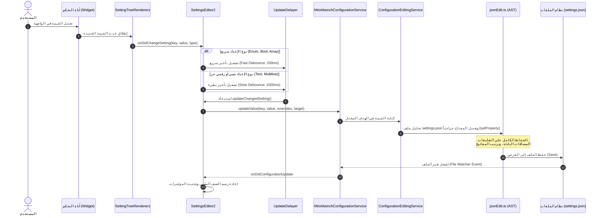
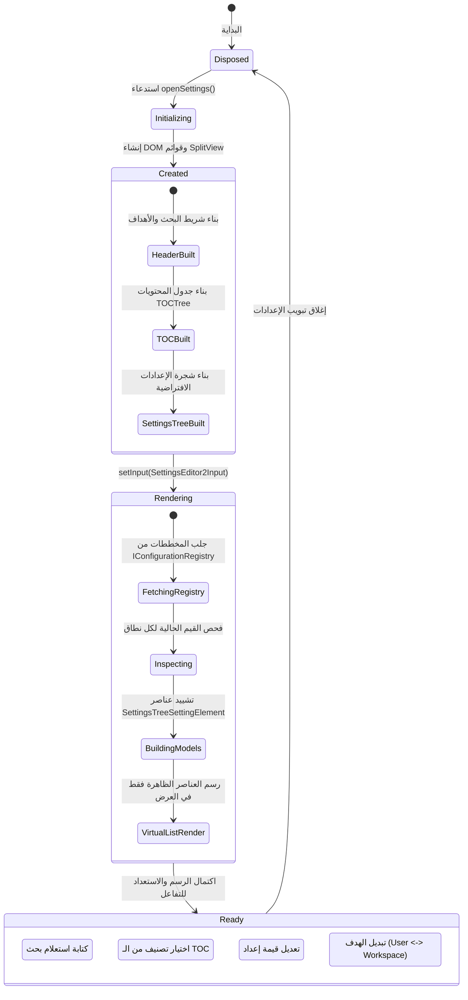

# التحليل المعماري الشامل لواجهة إعدادات VS Code (Settings UI Architecture Analysis)

## 1. الغرض ونطاق الوثيقة

تهدف هذه الوثيقة إلى تقديم تحليل معماري دقيق ومفصل لبنية **واجهة التفضيلات والإعدادات (Settings UI / Preferences System)** في مشروع Visual Studio Code (المستودع مفتوح المصدر `code-oss-dev` الموجود في المسار `/home/osm/Downloads/vscode-main/vscode-main`).

يركز التحليل على:

1. الفلسفة المعمارية العامة ومبدأ الفصل بين واجهة العرض المرئية والملفات التخزينية.
2. تفكيك المكونات البرمجية والمسارات الحقيقية داخل الكود (`src/vs/workbench/contrib/preferences` و`src/vs/workbench/services/preferences` و`src/vs/workbench/services/configuration`).
3. هيكل دورة حياة الإعداد: من التسجيل في الـ Registry، ثم التحويل إلى عناصر شجرة (Tree Elements)، إلى العرض عبر الـ Renderers المخصصة.
4. آليات البحث الفائق (Preferences Search Engine) بنوعيه: المحلي (Fuzzy & TF-IDF) والمدعوم بالذكاء الاصطناعي (AI/Remote Search)، والتصفية المتقدمة بالوسوم (`@modified`، `@tag:`، إلخ).
5. تدفق تعديل القيم وحفظها الجراحي داخل ملفات `settings.json` مع الحفاظ على التعليقات والتنسيق.
6. استخلاص الدروس المستفادة ونقاط الإلهام المعمارية لتطبيقها في مشروع محرر الأكواد المبني بـ Flutter (`code_editor`).

---

## 2. الملخص التنفيذي والفلسفة المعمارية

تعد واجهة الإعدادات في VS Code واحدة من أكثر الواجهات تعقيداً وكفاءة في بيئات التطوير الحديثة؛ فهي ليست مجرد استمارة إدخال (Form)، بل هي **نظام عرض افتراضي موجه بالبيانات (Data-Driven Virtualized View)** مبني على الأسس التالية:

```mermaid
graph TD
    subgraph Storage ["مصادر التخزين الفيزيائية (Storage Layers)"]
        D[القيم الافتراضية Default]
        UL[User Local settings.json]
        UR[User Remote settings.json]
        W[Workspace .code-workspace]
        WF[Folder .vscode/settings.json]
        P[سياسات المؤسسة Enterprise Policies]
    end

    subgraph CoreEngine ["محرك التكوين الأساسي (Configuration Engine)"]
        CR[Configuration Registry\nسجل الخصائص والمخططات]
        CS[IWorkbenchConfigurationService\nحساب القيمة الفعالة والدمج]
        CES[ConfigurationEditingService\nالتعديل الجراحي وحفظ التعليقات]
    end

    subgraph SettingsUI ["واجهة الإعدادات المرئية (Settings UI - SettingsEditor2)"]
        SE2[SettingsEditor2\nمحرر الواجهة التفاعلي]
        TOC[TOCTree\nجدول المحتويات والتصنيفات]
        ST[SettingsTree\nالشجرة الافتراضية للقوائم]
        SR[SettingTreeRenderers\nالعارضات المخصصة لأنواع الإدخال]
        SW[Search & Filter Engine\nمحرك التصفية والبحث الذكي]
    end

    CR --> CS
    D & UL & UR & W & WF & P --> CS
    CS -->|Inspect & State| SE2
    SE2 --> TOC & ST & SW
    ST --> SR
    SR -->|onDidChangeSetting (Debounced)| CES
    CES -->|setProperty AST Update| UL & UR & W & WF
    CES -->|Reload Event| CS
```

### المبادئ المعمارية الجوهرية

1. **مصدر الحقيقة الموحد (Single Source of Truth)**: لا تحتفظ واجهة المستخدم بأي نسخة خاصة من قيم الإعدادات، بل تسأل دائماً خدمة التكوين `IWorkbenchConfigurationService.inspect(key)` لحساب القيمة الفعالة ومصادرها.
2. **تدفق البيانات أحادي الاتجاه (Unidirectional Data Flow)**: التعديل يبدأ من الأداة البصرية (Control Widget) في الواجهة، ويُرسل عبر حدث مؤخر زمنياً (Debounced Event) إلى خدمة التكوين التي تكتب التعديل جراحياً في ملف JSON، ثم يرتد حدث التغيير العام من نظام الملفات لتحديث شجرة الواجهة تلقائياً.
3. **العرض الافتراضي فائق الأداء (List/Tree Virtualization)**: نظراً لأن VS Code يحتوي على آلاف الإعدادات من المحرر الأساسي والإضافات (Extensions)، لا يتم بناء عناصر DOM لكل إعداد دفعة واحدة، بل تعتمد الواجهة على `SettingsTree` المشتقة من `WorkbenchObjectTree` مع حساب وحفظ الارتفاعات ديناميكياً (`SettingsTreeDelegate`).
4. **التكافؤ الكامل بين الـ GUI والـ JSON**: كل إعداد يظهر في الـ GUI يملك مقابلاً نصياً مباشراً، مع إمكانية التبديل اللحظي بين الواجهتين من دون فقدان أي حالة.

---

## 3. خريطة الطبقات والمجلدات المسؤولة

تتوزع منظومة الإعدادات على ثلاث طبقات رئيسية في معمارية VS Code:

| الطبقة | المسار في المشروع | الدور والمسؤولية |
| :--- | :--- | :--- |
| **Platform Layer** | `src/vs/platform/configuration` | العقود الأساسية لمخططات الإعدادات (`IConfigurationRegistry`)، تعريف النطاقات (`ConfigurationScope`)، ونماذج التكوين المجردة (`ConfigurationModels`). |
| **Workbench Services** | `src/vs/workbench/services/configuration`<br>`src/vs/workbench/services/preferences` | خدمات التكوين الشاملة في بيئة العمل، دمج مصادر الإعدادات (User/Workspace/Remote/Folder)، وخدمة التعديل الجراحي `ConfigurationEditingService`، ونماذج محرري التفضيلات (`PreferencesModels`). |
| **Preferences Contrib** | `src/vs/workbench/contrib/preferences/browser` | التنفيذ الفعلي لواجهة الإعدادات المرئية (`SettingsEditor2`)، جدول المحتويات (`TOCTree`)، شجرة الإعدادات والعارضات (`SettingsTree` و`SettingTreeRenderers`)، محرك البحث والتصفية (`PreferencesSearch`)، وعناصر التحكم المخصصة (`SettingsWidgets`). |

---

## 4. تفكيك المكونات المعمارية لواجهة الإعدادات

### 4.1 نافذة المحرر ودورة الحياة (`SettingsEditor2` و`SettingsEditor2Input`)

المسار الرئيسي:

- [src/vs/workbench/contrib/preferences/browser/settingsEditor2.ts](file:///home/osm/Downloads/vscode-main/vscode-main/src/vs/workbench/contrib/preferences/browser/settingsEditor2.ts)
- [src/vs/workbench/services/preferences/common/preferencesEditorInput.ts](file:///home/osm/Downloads/vscode-main/vscode-main/src/vs/workbench/services/preferences/common/preferencesEditorInput.ts)

تُعامل واجهة الإعدادات داخل VS Code كـ **محرر متكامل (EditorPane)** ينحدر من `EditorPane`، ويدار بواسطة مجموعة المحررات (`IEditorGroupsService`):

- **`SettingsEditor2Input`**: يمثل مدخل المحرر غير المرتبط بملف مادي واحد، بل يولد نموذج الإعدادات الافتراضية عبر `input.resolve() -> Settings2EditorModel`.
- **دورة حياة الـ Pane**:
  - `createEditor(parent: HTMLElement)`: يتم بناء الهيكل العام المكون من رأس الصفحة (`Header`) وحاوية الجسم (`Body`).
  - `setInput(input, options, context, token)`: يستمع المحرر لتغيرات مخططات الإعدادات ومجموعاتها (`model.onDidChangeGroups`) ويقوم باستعادة حالة العرض السابقة (`viewState` مثل موضع التمرير وعبارة البحث السابقة والهدف المحدد).
  - `layout(dimension: Dimension)`: يتم ضبط توزيع الشاشة؛ إذا قل عرض النافذة الإجمالي عن `NARROW_TOTAL_WIDTH` (المحدد بـ 700 بكسل: 200 للـ TOC و500 للمحرر)، يتم تفعيل النمط الضيق تلقائياً وإخفاء جدول المحتويات.
  - `clearInput()` و`dispose()`: إلغاء اشتراكات الأحداث وتنظيف الـ Disposables.

---

### 4.2 رأس الصفحة ومحدد أهداف التكوين (`Header` و`SettingsTargetsWidget`)

يتكون رأس الصفحة من جزأين محوريين:

1. **شريط البحث والاقتراحات (`SuggestEnabledInputWithHistory`)**:
   - حقل إدخال ذكي يوفر اقتراحات فورية للوسوم (`@modified`، `@tag:`، `@lang:`، `@ext:`)، مع دعم كامل لسجل البحث والتنقل فيه عبر أزرار الأسهم (`Up/Down`).
2. **عنصر اختيار الهدف (`SettingsTargetsWidget`)**:
   - يسمح للمطور بالتبديل بين سياقات التخزين المختلفة:
     - **User (المستخدم المحلي)**: يُحفظ في `User/settings.json`.
     - **Remote (البيئة البعيدة)**: يظهر فقط عند الاتصال عبر SSH أو Dev Containers أو WSL.
     - **Workspace (مساحة العمل)**: يُحفظ في ملف `.code-workspace`.
     - **Folder (مجلد ضمن مساحة عمل متعددة الجذور)**: يُحفظ في `.vscode/settings.json`.
   - عند تغيير الهدف (`onDidSettingsTargetChange`)، يتم تحديث `viewState.settingsTarget` وإعادة فحص حالة جميع الإعدادات المعروضة فوراً.

---

### 4.3 جدول المحتويات والتزامن (`TOCTree` و`settingsLayout.ts`)

المسار الرئيسي:

- [src/vs/workbench/contrib/preferences/browser/tocTree.ts](file:///home/osm/Downloads/vscode-main/vscode-main/src/vs/workbench/contrib/preferences/browser/tocTree.ts)
- [src/vs/workbench/contrib/preferences/browser/settingsLayout.ts](file:///home/osm/Downloads/vscode-main/vscode-main/src/vs/workbench/contrib/preferences/browser/settingsLayout.ts)

يعرض الجانب الأيسر شجرة جدول المحتويات (TOC)، وتتميز بما يلي:

- **التصنيفات الثابتة والمشتقة**:
  - `Commonly Used`: قائمة مختارة من الإعدادات الأكثر شيوعاً مثل حجم الخط والحفظ التلقائي ومحرر التنسيق.
  - `Text Editor`: يتفرع إلى (`Cursor`, `Find`, `Font`, `Formatting`, `Minimap`, `Suggestions`, `Files`...).
  - `Workbench` و`Window` و`Features` و`Application`.
  - `Extensions`: يتم تجميع جميع الإعدادات التي تساهم بها الإضافات المثبتة ديناميكياً تحت كل إضافة بحسب معرّفها واسمها.
- **التزامن الثنائي (Bi-directional Synchronization)**:
  - عند النقر على قسم في الـ TOC، يتم تطبيق تصفية فورية (`categoryFilter`) في شجرة الإعدادات لتظهر إعدادات ذلك القسم فقط مع تصفير موضع التمرير (`scrollTop = 0`).
  - عند البحث الحر، يتغير الـ TOC ليعرض شجرة أعداد النتائج المكتشفة في كل تصنيف لمساعدة المستخدم على حصر النطاق.

---

### 4.4 شجرة الإعدادات ونماذج البيانات (`SettingsTreeModels`)

المسار الرئيسي:

- [src/vs/workbench/contrib/preferences/browser/settingsTreeModels.ts](file:///home/osm/Downloads/vscode-main/vscode-main/src/vs/workbench/contrib/preferences/browser/settingsTreeModels.ts)

تتحول البيانات الخام إلى شجرة من العناصر المتخصصة المشتقة من الفئة الأساسية `SettingsTreeElement`:

```
SettingsTreeElement (قاعدة مجردة)
├── SettingsTreeGroupElement (يمثل عنوان مجموعة أو تصنيف)
├── SettingsTreeNewExtensionsElement (يمثل اقتراحات سوق الإضافات)
└── SettingsTreeSettingElement (يمثل الإعداد الفردي)
```

#### فحص الإعداد وحساب قيمته (`inspectSetting`)

لكل عنصر `SettingsTreeSettingElement`، يتم استدعاء دالة `inspectSetting` التي تفحص حالة الإعداد عبر استعلام خدمة التكوين:

```typescript
const inspected = configurationService.inspect(key, inspectOverrides);
```

تستخلص هذه الدالة:

- `value`: القيمة الفعالة حالياً والمطبقة في المحرر.
- `scopeValue`: القيمة المحفوظة في النطاق المختار حالياً (User, Workspace, Folder).
- `defaultValue`: القيمة الافتراضية المحددة في المخطط (Schema) أو الناتجة عن امتداد ما.
- `isConfigured`: هل الإعداد معدل صراحة في النطاق الحالي؟
- `hasPolicyValue`: هل الإعداد محكوم بسياسة مؤسسية مدارة تمنع المستخدم من تغييره؟
- `isUntrusted`: هل الإعداد يتطلب بيئة عمل موثوقة (`Workspace Trust`) لمنع تشغيل شفرات غير آمنة؟
- `languageOverrideValues`: تجاوزات الإعداد الخاصة بلغات برمجية معينة (مثل `[typescript]` أو `[python]`).

---

### 4.5 منظومة العارضات وأدوات التحكم (`SettingTreeRenderers` و`SettingsWidgets`)

المسار الرئيسي:

- [src/vs/workbench/contrib/preferences/browser/settingsTree.ts](file:///home/osm/Downloads/vscode-main/vscode-main/src/vs/workbench/contrib/preferences/browser/settingsTree.ts)
- [src/vs/workbench/contrib/preferences/browser/settingsWidgets.ts](file:///home/osm/Downloads/vscode-main/vscode-main/src/vs/workbench/contrib/preferences/browser/settingsWidgets.ts)

```mermaid
classDiagram
    class AbstractSettingRenderer {
        +renderCommon()
        +renderSettingElement()
        +renderIndicators()
    }
    class SettingBoolRenderer {
        +renderValue() Toggle Switch
    }
    class SettingTextRenderer {
        +renderValue() InputBox
    }
    class SettingNumberRenderer {
        +renderValue() InputBox with numeric step/validation
    }
    class SettingEnumRenderer {
        +renderValue() SelectBox with localized options
    }
    class SettingArrayRenderer {
        +renderValue() ListSettingWidget
    }
    class AbstractSettingObjectRenderer {
        +renderValue() Dictionary Key-Value
    }
    class SettingIncludeExcludeRenderer {
        +renderValue() ExcludeSettingWidget with glob patterns
    }
    class SettingComplexRenderer {
        +renderValue() Edit in settings.json Button
    }

    AbstractSettingRenderer <|-- SettingBoolRenderer
    AbstractSettingRenderer <|-- SettingTextRenderer
    AbstractSettingRenderer <|-- SettingNumberRenderer
    AbstractSettingRenderer <|-- SettingEnumRenderer
    AbstractSettingRenderer <|-- SettingArrayRenderer
    AbstractSettingRenderer <|-- AbstractSettingObjectRenderer
    AbstractSettingRenderer <|-- SettingIncludeExcludeRenderer
    AbstractSettingRenderer <|-- SettingComplexRenderer
```

تستخدم الواجهة نمط **العارضات المتخصصة (Specialized Renderers)** حيث يطبق كل عارض واجهة `ITreeRenderer<SettingsTreeSettingElement, never, ITemplate>`:



#### تفاصيل العارضات المتخصصة

1. **`SettingBoolRenderer`**: ينشئ مفتاح تبديل (`Toggle Switch`) عالي التباين، ويدعم حالة عدم التعيين (Inherited/Default).
2. **`SettingTextRenderer` و`SettingMultilineTextRenderer`**: حقول نصوص عادية ومتعددة الأسطر مع خيارات التحقق والتأخير الزمني.
3. **`SettingNumberRenderer`**: حقل رقمي يتحقق من القيم الدنيا والقصوى (`min`, `max`) وخطوات الزيادة (`step`) والتأكد من صحة القيم الصحيحة أو العشرية.
4. **`SettingEnumRenderer`**: قائمة منسدلة مبنية بواسطة `SelectBox` تظهر التسميات وخيارات الوصف التفصيلية لكل خيار مترجمة عبر نظام الـ NLS.
5. **`SettingArrayRenderer`**: أداة `ListSettingWidget` لإدارة المصفوفات النصية (مثل مسارات الاستبعاد أو خطوط التراجع البديلة)، وتتيح إضافة العناصر وتعديلها وسحبها وحذفها.
6. **`SettingObjectRenderer` و`SettingBoolObjectRenderer`**: واجهات لتحرير كائنات القواميس (Key-Value) التي تقبل قيماً نصية أو مفاتيح تفعيل/تعطيل.
7. **`SettingIncludeExcludeRenderer` (`ExcludeSettingWidget`)**: أداة خاصة بأنماط الـ Glob (مثل `files.exclude`) تدعم تفعيل وتعطيل النمط دون حذفه، وربط الشرط بنمط آخر (`sibling matching`).
8. **`SettingComplexRenderer`**: إذا كان الإعداد من نوع معقد لا يمكن تمثيله بأداة واجهة بسيطة، يعرض العارض زراً مباشراً يحمل نص: *"Edit in settings.json"*.
9. **مؤشرات الحالة `SettingsTreeIndicatorsLabel`**: شريط علامات صغير أسفل كل إعداد يوضح:
   - هل تم تعديل الإعداد في النطاق الحالي؟
   - هل هو متجاوز في نطاق آخر؟ (مثال: *"Modified in Workspace"* أو *"Modified for [json]"*).
   - زر استعادة القيمة الأصلية (Reset Setting / Gear Menu).

---

### 4.6 محرك البحث والتصفية المتقدم (`PreferencesSearchService`)

المسار الرئيسي:

- [src/vs/workbench/contrib/preferences/browser/preferencesSearch.ts](file:///home/osm/Downloads/vscode-main/vscode-main/src/vs/workbench/contrib/preferences/browser/preferencesSearch.ts)

يعتبر محرك البحث في إعدادات VS Code من أذكى المحركات المدمجة في بيئات التطوير، حيث يعتمد على بنية هجينة:

```mermaid
flowchart TD
    UserInput[إدخال المستخدم في شريط البحث] --> Debounce{تأخير 200ms\nDelayer}
    Debounce --> QueryParser[محلل الاستعلام parseQuery]
    
    QueryParser --> TagCheck{هل يحتوي وسوماً محددة؟}
    TagCheck -->|@modified| FilterModified[تصفية الإعدادات المعدلة فقط]
    TagCheck -->|@tag:sync / @tag:telemetry| FilterTag[تصفية بحسب وسوم المخطط]
    TagCheck -->|@ext:id| FilterExt[تصفية بحسب معرّف الإضافة]
    TagCheck -->|@lang:id| FilterLang[تصفية بحسب لغة البرمجة]
    
    QueryParser --> SearchProviders[مزودات البحث الموازية]
    
    subgraph Providers [مزودات البحث]
        LSP[LocalSearchProvider\nمطابقة الكلمات والمفاتيح والأوصاف]
        TFIDF[TfIdfCalculator\nحساب أهمية المصطلحات الإحصائية]
        AISearch[AiSearchProvider / RemoteSearch\nالبحث الدلالي وتضمينات اللغة الطبيعية]
    end
    
    SearchProviders --> LSP & TFIDF & AISearch
    LSP & TFIDF & AISearch --> MatchScorer[SettingMatches\nتقييم التطابق وترتيب الأولويات]
    MatchScorer --> RenderFilter[تحديث SearchResultModel وعرض النتائج]
```

#### تقنيات التصفية والترتيب

- **`LocalSearchProvider`**: يبحث في مفتاح الإعداد أولاً، ثم في عنوان القسم، ثم في وصف الإعداد والخيارات المتاحة.
- **`SettingMatches`**: يعطي أوزاناً تفاضلية دقيقة؛ فالمطابقة التامة في المفتاح (`ExactMatch`) تأتي في الصدارة، تليها مطابقة بادئة المفتاح، ثم الأوصاف.
- **التأخير الزمني وحماية حداثة النتائج (`isSettingsSearchUpToDate`)**:
  - يتم استخدام `Delayer` بمدة 200ms لتجنب البحث مع كل ضغطة زر.
  - دالة `isSettingsSearchUpToDate` تمنع انتقال مؤشر التركيز إلى نتائج قديمة أثناء سريان بحث جديد قيد المعالجة.

---

### 4.7 خط معالجة التعديل والحفظ الجراحي (`Setting Mutation Pipeline`)

المسار الرئيسي:

- [src/vs/workbench/services/configuration/common/configurationEditing.ts](file:///home/osm/Downloads/vscode-main/vscode-main/src/vs/workbench/services/configuration/common/configurationEditing.ts)
- [src/vs/base/common/jsonEdit.ts](file:///home/osm/Downloads/vscode-main/vscode-main/src/vs/base/common/jsonEdit.ts)

عندما يغير المستخدم قيمة في الواجهة (مثال: تغيير مربع اختيار أو كتابة رقم):



#### ملاحظات معمارية دقيقة في الحفظ

1. **التمييز في التأخير الزمني (Fast vs Slow Debounce)**:
   - العناصر القطعية (`Boolean`, `Enum`, `Array`) تحفظ بعد `200ms` فقط ليشعر المستخدم بالاستجابة اللحظية.
   - حقول النصوص والأرقام تحفظ بعد `1000ms` حتى لا يتكرر استهلاك القرص والكتابة مع كل حرف يكتبه المستخدم.
2. **استعادة القيمة الافتراضية (Automatic Reset Optimization)**:
   - إذا كتب المستخدم في حقل إعداد قيمة تطابق القيمة الافتراضية تماماً، يتعامل VS Code مع هذه العملية كـ `Reset` ويمرر `undefined`، مما يؤدي إلى حذف المفتاح نهائياً من ملف `settings.json` لتقليص حجم الملفات ومنع تشويش الإعدادات المشتركة.
3. **التعديل الجراحي لشجرة الـ JSON**:
   - لا يُستخدم `JSON.stringify` لكتابة الملف أبداً؛ لأن ذلك يمحو كل التعليقات والتنسيقات اليدوية التي يضعها المطورون. بدلاً من ذلك، تعتمد مكتبة `jsonEdit.ts` على تعديل الـ AST الموضعي فقط عبر عمليات إزاحة موضعية (`Edit Operations`).

---

### 4.8 إمكانية الوصول والتنقل بلوحة المفاتيح (`Accessibility & Keyboard Navigation`)

تراعي معمارية واجهة الإعدادات معايير الوصول الفائقة:

- **`SettingsFocusContext`**: تعداد داخلي يحدد موضع التركيز بدقة (`Search`, `TableOfContents`, `SettingTree`, `SettingControl`).
- **التنقل الرأسي المنظم**:
  - الضغط على `Down Arrow` داخل شريط البحث يتنقل أولاً في سجل البحث السابق، ثم ينقل التركيز بسلاسة إلى أول صف في شجرة الإعدادات بمجرد اكتمال السجل.
  - الضغط على `Enter` أو `Space` داخل صف إعداد يركز مباشرة على أداة الإدخال (`AbstractSettingRenderer.CONTROL_SELECTOR`).
- **شاشات المساعدة (Screen Readers / ARIA)**:
  - ربط شريط البحث بـ ARIA Live Announcements للإعلان عن عدد النتائج التي تم العثور عليها وحالة آخر مزامنة.
  - قراءة ملصقات المؤشرات (`getIndicatorsLabelAriaLabel`) لتنبيه فاقدي البصر إلى ما إذا كان الإعداد معدلاً أو موروثاً أو معطلاً بسبب سياسة مؤسسية.

---

## 5. مخطط شامل لتدفق دورة حياة شاشة الإعدادات



---

## 6. الدروس المعمارية المستفادة لتطبيقها في محرر الأكواد (`code_editor` Flutter)

يوفر هذا التحليل العميق لـ VS Code خارطة طريق واضحة وقابلة للتطبيق المباشر في مشروع محرر الأكواد المبني بـ Flutter (`/home/osm/flutter_projects/code_editor`):

### 1. فصل السجل (Registry) عن التخزين وعن الواجهة

- **في VS Code**: السجل `IConfigurationRegistry` يعرف المخطط والأنواع والقيم الافتراضية، بينما التخزين يتم في ملفات JSON مختلفة، وواجهة `SettingsEditor2` مجرد مستهلك يقرأ ويعرض.
- **في Flutter**: يجب ألا ترتبط ويدجت الإعدادات بمفاتيح `SharedPreferences` مباشرة؛ بل يجب بناء `SettingsRegistry` مركزي يحدد كل إعداد عبر كائن `SettingDefinition<T>` يحتوي:
  - `key`: المفتاح الثابت.
  - `type`: نوع البيانات (`bool`, `int`, `double`, `String`, `enum`, `list`).
  - `defaultValue`: القيمة الافتراضية.
  - `title` و`description`: العناوين والشروح المترجمة.
  - `category`: التصنيف العام (مثل `editor`, `theme`, `terminal`).

### 2. اعتماد نموذج الفحص متقدم النطاقات (`Inspect Pattern`)

- عند عرض إعداد في Flutter، يجب ألا يُكتفى بقراءة القيمة الفعالة، بل يُبنى نموذج يحاكي دالة `inspectSetting` يوضح للمستخدم:
  - هل القيمة الحالية هي الافتراضية؟
  - هل هي معدلة على مستوى المستخدم (تطبيق سطح المكتب العام)؟
  - هل هي مخصصة على مستوى المشروع/المجلد الحالي (`Workspace Settings`)؟
  - توفير زر استعادة الافتراضي (Reset) لإزالة التخصيص فوراً.

### 3. استخدام قائمة افتراضية فائقة الأداء مع عارضات متخصصة

- بناء نمط `SettingWidgetBuilder` في Flutter يتعرف على نوع `SettingDefinition<T>` ويعيد الويدجت المناسبة:
  - `bool` -> `SwitchListTile`.
  - `enum` -> `DropdownButtonFormField` أو `SegmentedButton`.
  - `String` / `int` -> `TextFormField` مع `Debouncer`.
  - `List<String>` -> ويدجت قائمة شرائح أو عناصر قابلة للإضافة والحذف.
- استخدام `ListView.builder` لضمان عدم بناء بطاقات الإعدادات البعيدة عن الشاشة، مما يضمن أداء 60/120 إطاراً في الثانية بغض النظر عن عدد الإعدادات.

### 4. تطبيق نمط التأخير الزمني الذكي (Smart Debouncing)

- عند بناء حقول النصوص في Flutter، يجب تضمين مؤقت تأخير (200ms للخيارات و800ms للحقول النصية) لضمان عدم حفظ التعديل في القرص أو إطلاق إشعارات التحديث مع كل محرف يدخله المستخدم، مما يحمي التطبيق من مشاكل الـ UI Thrashing وتجميد الشاشة.

### 5. تصميم واجهة مستجيبة (Master-Detail / SplitView)

- في الشاشات العريضة لسطح المكتب، يتم عرض شريط تصنيفات جانبي (TOC) مع قائمة الإعدادات على اليمين.
- في الشاشات الصغيرة، يتم التبديل تلقائياً إلى واجهة قائمة واحدة تدعم التنقل الهرمي، تماماً كما يفعل VS Code عبر معيار `NARROW_TOTAL_WIDTH`.

---

## 7. الخاتمة

أثبتت معمارية واجهة إعدادات VS Code أن النجاح في إدارة الإعدادات المعقدة يكمن في **الانضباط المعماري**:

- عزل التخزين عن العرض.
- بناء شجرة بيانات مستقلة عن الـ DOM.
- الاستثمار في محرك بحث ذكي وتصفية متعددة المستويات.
- التعديل الحذر والجراحي لملفات التكوين.

يشكل هذا التوثيق مرجعاً معمارياً أساسياً لمشروع `code_editor`، ويرسم مساراً واضحاً لبناء واجهة إعدادات ممتعة، قابلة للتوسع، وعالية الأداء.
