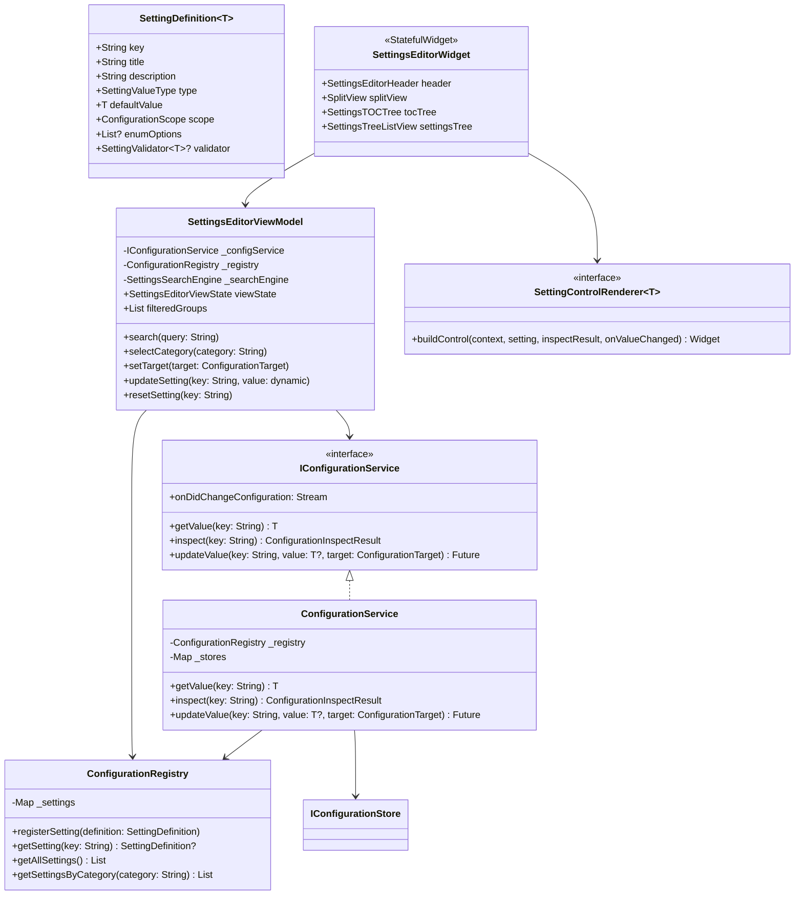

# الخطة التنفيذية الشاملة لبناء واجهة إعدادات مطابقة لـ VS Code بنسبة 99%

# (VS Code Settings UI & Configuration Subsystem - 99% Parity Execution Plan)

---

## 1. ميثاق الخطة ونطاق العمل (Charter & Scope)

### 1.1 الهدف الاستراتيجي

بناء نظام إعدادات متكامل وواجهة مستخدم (Settings UI) في مشروع محرر الأكواد (`code_editor`) تحقق **تطابقاً معمارياً وبصرياً بنسبة 99% مع VS Code (`vscode-main`)**، مع إعادة هيكلة كاملة وشاملة لكافة مخازن التفضيلات والخدمات المتفرقة حالياً في المشروع لترتبط جميعها بخدمة تكوين مركزية موحدة (`IConfigurationService`).

### 1.2 معايير الجودة والالتزام الصارم

- **الالتزام الصارم بمبادئ SOLID**:
  - **S**RP: فصل مسؤولية تسجيل الإعدادات عن تخزينها وعن فحصها وعن رسمها في الواجهة.
  - **O**CP: إمكانية إضافة إعدادات جديدة أو عارضات عناصر تحكم جديدة دون تعديل الشجرة الأساسية.
  - **L**SP: قابلية استبدال مخازن التخزين (SharedPreferences, JsonFile, InMemory) دون كسر المنظومة.
  - **I**SP: واجهات دقيقة ومفصولة للقراءة (`IConfigurationReader`)، والكتابة (`IConfigurationWriter`)، والفحص (`IConfigurationInspector`).
  - **D**IP: اعتماد جميع ويدجت الواجهة والخدمات على واجهات تجريدية (`IConfigurationService`) عبر الـ Dependency Injection.
- **تطبيق أنماط التصميم البرمجية (Design Patterns)**:
  - **Registry Pattern**: لإدارة مخططات الإعدادات والأنواع والقيم الافتراضية.
  - **Composite Pattern**: لتمثيل شجرة جدول المحتويات وشجرة عناصر الإعدادات.
  - **Factory Method & Strategy Pattern**: لاختيار وتوليد عارضات عناصر التحكم بحسب نوع الإعداد.
  - **Memento Pattern**: لحفظ واستعادة حالة العرض (`SettingsEditorViewState`) من موضع التمرير وعبارة البحث والهدف المختار.
  - **Observer / Pub-Sub Pattern**: لإرسال إشعارات التغيير الدقيقة للمفاتيح المعدلة فقط.
  - **Command Pattern**: لتنفيذ عمليات استعادة الإعداد ونسخ المعرّف والانتقال إلى ملف JSON.
  - **Virtual Delegate Pattern**: لحساب وحفظ ارتفاعات عناصر القائمة الافتراضية بدقة وأداء فائق.
- **جودة التصميم البصري (Pixel-Perfect VS Code Design)**:
  - مطابقة أبعاد، وألوان، وحدود، وهوامش، وأيقونات، وخطوط VS Code Settings UI (استخدام خطي `IBM Plex Sans Arabic` للواجهة و`JetBrains Mono` للأكواد والمفاتيح).
  - دعم تقسيم الشاشة المرن (`SplitView`) بين جدول المحتويات وشجرة الإعدادات مع قابلية سحب الفاصل (`Sash Resize`) والانتقال التلقائي للنمط الضيق (`Narrow Responsive Mode`).
- **حزمة اختبارات واجهة المستخدم (Widget & Integration Tests)**:
  - تنفيذ اختبارات واجهة شاملة ودقيقة في المرحلة الأخيرة للتحقق من كافة التفاعلات ومحرك البحث والتأخير الزمني والحفظ.

---

## 2. تحليل الوضع الراهن وجرد الملفات المستهدفة بإعادة الهيكلة الشاملة

## (Current State Gap Analysis & Restructuring Scope)

### 2.1 الفجوات المعمارية في المشروع الحالي

1. **تشتت التخزين والقرارات (Storage Fragmentation)**:
   - الثيم يُحفظ بمفتاح خاص عبر [theme_preferences_store.dart](file:///home/osm/flutter_projects/code_editor/lib/core/theme/theme_preferences_store.dart).
   - شريط الحالة يُخزن عناصره المخفية بمفتاح منفصل عبر [status_bar_preferences_store.dart](file:///home/osm/flutter_projects/code_editor/lib/core/statusbar/status_bar_preferences_store.dart).
   - إعدادات التنسيق تملك مخزناً مستقلاً بمفتاح خاص عبر [editor_formatting_preferences.dart](file:///home/osm/flutter_projects/code_editor/lib/core/editor/formatting/editor_formatting_preferences.dart).
   - الطرفية تحتفظ بقيمها افتراضياً في الذاكرة عبر [terminal_config_service.dart](file:///home/osm/flutter_projects/code_editor/lib/core/terminal/services/terminal_config_service.dart).
   - خيارات المسافات البادئة معزولة في [editor_indentation_options.dart](file:///home/osm/flutter_projects/code_editor/lib/core/editor/indentation/editor_indentation_options.dart).
2. **غياب شاشة إعدادات بالكامل**:
   - لا توجد شاشة أو تبويب إعدادات؛ الضغط على أيقونة الترس في [activitybar_widget.dart](file:///home/osm/flutter_projects/code_editor/lib/parts/activitybar/activitybar_widget.dart) يؤدي فقط إلى تحديد `ActivityBarItem.settings` الذي يعرض نصاً فارغاً في الشريط الجانبي: `ActivityBarItem.settings View Container`.
3. **تضخم ملف `main.dart` بالـ Scopes المتباينة**:
   - يتم تمرير ما يزيد عن 8 نطاقات منفصلة للتحكم في التفضيلات بدلاً من توفير سياق تكوين موحد (`ConfigurationScope`).

### 2.2 جدول الملفات المستهدفة بإعادة الهيكلة الجذرية (Complete Restructuring)

| الملف الحالي | الحالة الحالية | الهيكلة الجديدة المستهدفة في الخطة |
| :--- | :--- | :--- |
| `lib/core/theme/theme_preferences_store.dart` | مخزن SharedPreferences مستقل بمفتاح `workbench.theme` | **إلغاء المخزن المستقل**؛ وتحويل قراءة وتعديل الثيم إلى استهلاك المفتاح القياسي `workbench.colorTheme` عبر خدمة التكوين الموحدة. |
| `lib/core/statusbar/status_bar_preferences_store.dart` | مخزن مستقل لقائمة العناصر المخفية في شريط الحالة | **إعادة هيكلة كاملة**؛ تسجيل مفاتيح `workbench.statusBar.visible` و`workbench.statusBar.hiddenItems` في سجل الإعدادات واستهلاكها مباشرة. |
| `lib/core/editor/formatting/editor_formatting_preferences.dart` | كلاسات منفصلة ومخزن يكتب كائن JSON مخصص في مفتاح `editor.formatting_preferences` | **إعادة هيكلة شاملة**؛ تفكيك الحقول إلى مفاتيح VS Code القياسية: `editor.formatOnSave`, `editor.formatOnType`, `editor.formatOnPaste`, `editor.formatOnSaveMode`, `editor.defaultFormatter`. |
| `lib/core/editor/indentation/editor_indentation_options.dart` | نموذج معزول للمسافات البادئة | **ربطه بالمفاتيح القياسية**: `editor.tabSize`, `editor.insertSpaces`, `editor.detectIndentation` داخل السجل الموحد. |
| `lib/core/terminal/services/terminal_config_service.dart` | خدمة تحمل قيماً في الذاكرة دون مخزن دائم | **إعادة هيكلة** لترتبط بمفاتيح `terminal.integrated.fontSize`, `terminal.integrated.fontFamily`, `terminal.integrated.cursorStyle`. |
| `lib/layout/models/layout_state.dart` و`activitybar_widget.dart` | يعامل الإعدادات كحاوية في الشريط الجانبي | **إعادة هيكلة السلوك**: الضغط على أيقونة الإعدادات أو اختصار `Ctrl+,` يقوم بفتح **تبويب محرر الإعدادات** كـ `EditorTabItem` تفاعلي في مساحة التحرير الرئيسية. |
| `lib/parts/editor/editor_area_widget.dart` | يعرض فقط محرر النصوص البرمجية | **توسيع المعمارية**: دعم عرض نوعين من التبويبات في المساحة: تبويب ملف برمجي، وتبويب محرر تفاعلي مخصص (`SettingsEditorWidget`). |
| `lib/main.dart` | حقن متفرق لعشرات الـ Controllers والمخازن | **تبسيط وحقن نظيف**: توفير `ConfigurationScope` موحد يغذي كافة عناصر التطبيق. |

---

## 3. المعمارية المستهدفة ومخطط الفئات (Target Architecture)



---

## 4. المراحل التنفيذية المتسلسلة بالتفصيل (Detailed Phased Roadmap)

```mermaid
gantt
    title المراحل التنفيذية لمنظومة الإعدادات المتكاملة
    dateFormat  X
    axisFormat %d
    
    section المرحلة 1
    بناء النواة التحتية للتكوين وسجل الإعدادات :active, p1, 0, 3
    section المرحلة 2
    إعادة الهيكلة الشاملة للمخازن المتفرقة :p2, 3, 6
    section المرحلة 3
    هندسة شجرة الإعدادات ومحرك البحث :p3, 6, 9
    section المرحلة 4
    بناء العارضات المخصصة عالية الجودة :p4, 9, 13
    section المرحلة 5
    تجميع واجهة الإعدادات والدمج مع المحرر :p5, 13, 16
    section المرحلة 6
    حزمة اختبارات الواجهة والتكامل الشاملة :p6, 16, 20
```



---

### المرحلة 1: بناء النواة التحتية للتكوين وسجل الإعدادات (Core Configuration & Registry Foundation)

**الهدف**: إنشاء العمود الفقري لمنظومة التكوين في مجلد `lib/core/configuration/` وفق أعلى المعايير المعمارية ومبادئ SOLID.

#### 1.1 تعريف العقود والنطاقات والأنواع (`contracts/`)

- إنشاء [lib/core/configuration/contracts/configuration_target.dart](file:///home/osm/flutter_projects/code_editor/lib/core/configuration/contracts/configuration_target.dart):

  ```dart
  enum ConfigurationTarget {
    user,      // تفضيلات المستخدم العامة المحفوظة
    workspace, // إعدادات مساحة العمل (.vscode/settings.json)
    memory,    // إعدادات مؤقتة أثناء الجلسة
  }
  ```

- إنشاء [lib/core/configuration/contracts/configuration_scope.dart](file:///home/osm/flutter_projects/code_editor/lib/core/configuration/contracts/configuration_scope.dart):

  ```dart
  enum ConfigurationScope {
    application, // عام على مستوى التطبيق
    window,      // على مستوى نافذة العمل
    resource,    // خاص بملف أو مورد أو لغة معينة
  }
  ```

- إنشاء [lib/core/configuration/contracts/setting_value_type.dart](file:///home/osm/flutter_projects/code_editor/lib/core/configuration/contracts/setting_value_type.dart):

  ```dart
  enum SettingValueType {
    boolean,
    string,
    multilineString,
    integer,
    doubleNumber,
    enumeration,
    stringList,
    stringMap,
    excludePatterns,
    complex,
  }
  ```

- إنشاء [lib/core/configuration/contracts/configuration_inspect_result.dart](file:///home/osm/flutter_projects/code_editor/lib/core/configuration/contracts/configuration_inspect_result.dart):

  ```dart
  class ConfigurationInspectResult<T> {
    final String key;
    final T effectiveValue;
    final T defaultValue;
    final T? userValue;
    final T? workspaceValue;
    final bool isConfiguredInSelectedTarget;
    final ConfigurationTarget currentTarget;
    // ...
  }
  ```

#### 1.2 سجل الإعدادات المركزي (`ConfigurationRegistry`)

- إنشاء [lib/core/configuration/registry/setting_definition.dart](file:///home/osm/flutter_projects/code_editor/lib/core/configuration/registry/setting_definition.dart):
  - فئة تمثل المخطط البياني لكل إعداد (المفتاح، النوع، القيمة الافتراضية، العنوان والوصف، الوسوم، الترتيب، خيارات التعداد).
- إنشاء [lib/core/configuration/registry/configuration_registry.dart](file:///home/osm/flutter_projects/code_editor/lib/core/configuration/registry/configuration_registry.dart):
  - تطبيق نمط **Registry Pattern** لتسجيل الإعدادات والتحقق من عدم تكرار المفاتيح واسترجاعها حسب التصنيف أو الوسم.

#### 1.3 مخازن التكوين المتعددة (`IConfigurationStore`)

- إنشاء [lib/core/configuration/stores/configuration_store.dart](file:///home/osm/flutter_projects/code_editor/lib/core/configuration/stores/configuration_store.dart):
  - واجهة تجريدية `IConfigurationStore` تدعم `read()`, `write()`, `remove()`.
- تطبيق المخازن المتوافقة (Liskov Substitution):
  - `InMemoryConfigurationStore`: للاختبارات السريعة وحالة الجلسة.
  - `SharedPreferencesConfigurationStore`: لحفظ إعدادات الـ User.
  - `JsonFileConfigurationStore`: لحفظ إعدادات الـ Workspace في ملف `.vscode/settings.json` مع المحافظة على التنسيق.

#### 1.4 خدمة التكوين الموحدة (`ConfigurationService`)

- إنشاء [lib/core/configuration/services/configuration_service.dart](file:///home/osm/flutter_projects/code_editor/lib/core/configuration/services/configuration_service.dart):
  - دمج مصادر الإعدادات مع تطبيق قاعدة الأسبقية الصارمة:
    $$\text{Default} < \text{User} < \text{Workspace}$$
  - إطلاق أحداث التغيير الدقيقة عبر `Stream<ConfigurationChangeEvent>`.
  - معالجة الـ Reset: إذا طابقت القيمة الجديدة القيمة الافتراضية، يتم حذف المفتاح تلقائياً من المخزن المستهدف.

---

### المرحلة 2: إعادة الهيكلة الشاملة للمخازن المتفرقة (Subsystem Refactoring & Migration)

**الهدف**: نقل كافة تفضيلات المشروع الحالية إلى سجل التكوين الموحد وحذف الملفات الزائدة.

#### 2.1 نقل إعدادات الثيم (Theme Migration)

- تسجيل المفتاح القياسي: `workbench.colorTheme` بقيمة افتراضية `dark-modern`.
- تعديل [lib/core/theme/app_theme.dart](file:///home/osm/flutter_projects/code_editor/lib/core/theme/app_theme.dart) ليقرأ ويكتب عبر `IConfigurationService`.
- وضع علامة `@deprecated` على `ThemePreferencesStore` ثم حذفه واستبداله بالخدمة المركزية.

#### 2.2 نقل إعدادات شريط الحالة (StatusBar Migration)

- تسجيل المفاتيح:
  - `workbench.statusBar.visible` (نوع `boolean`, القيمة الافتراضية `true`).
  - `workbench.statusBar.hiddenEntries` (نوع `stringList`, القيمة الافتراضية `[]`).
- تعديل [lib/core/statusbar/status_bar_service.dart](file:///home/osm/flutter_projects/code_editor/lib/core/statusbar/status_bar_service.dart) ليستهلك `IConfigurationService` مباشرة والاستغناء عن `StatusBarPreferencesStore`.

#### 2.3 نقل إعدادات التنسيق والمسافات البادئة (Formatting & Indentation Migration)

- تسجيل المفاتيح القياسية المطابقة لـ VS Code:
  - `editor.formatOnSave` (نوع `boolean`, افتراضي `false`).
  - `editor.formatOnType` (نوع `boolean`, افتراضي `false`).
  - `editor.formatOnPaste` (نوع `boolean`, افتراضي `false`).
  - `editor.formatOnSaveMode` (نوع `enumeration`, خيارات: `file`, `modifications`, افتراضي `file`).
  - `editor.defaultFormatter` (نوع `string`, افتراضي `null`).
  - `editor.tabSize` (نوع `integer`, افتراضي `4`).
  - `editor.insertSpaces` (نوع `boolean`, افتراضي `true`).
  - `editor.detectIndentation` (نوع `boolean`, افتراضي `true`).
- إعادة صياغة [lib/core/editor/formatting/editor_formatting_preferences.dart](file:///home/osm/flutter_projects/code_editor/lib/core/editor/formatting/editor_formatting_preferences.dart) ليعمل كمحول (Adapter) يقرأ ويكتب عبر `IConfigurationService` مباشرة دون تخزين خاص به.

#### 2.4 نقل إعدادات الطرفية ومستكشف الملفات (Terminal & File Explorer Migration)

- تسجيل المفاتيح:
  - `terminal.integrated.fontSize` (نوع `integer`, افتراضي `14`).
  - `terminal.integrated.fontFamily` (نوع `string`, افتراضي `'JetBrains Mono'`).
  - `terminal.integrated.cursorStyle` (نوع `enumeration`: `block`, `line`, `underline`).
  - `files.exclude` (نوع `excludePatterns`, افتراضي: `{ "**/.git": true, "**/build": true, "**/.dart_tool": true }`).
- ربط [terminal_config_service.dart](file:///home/osm/flutter_projects/code_editor/lib/core/terminal/services/terminal_config_service.dart) بخدمة التكوين المركزية.

#### 2.5 تبسيط `main.dart`

- استبدال الـ Scopes الفردية المتعددة بنطاق رئيسي واحد: `ConfigurationScopeWidget` الذي يحقن `IConfigurationService` في الشجرة لجميع الأبناء.

---

### المرحلة 3: هندسة شجرة الإعدادات ومحرك البحث (Settings Tree Models, Layout & Search Engine)

**الهدف**: بناء نماذج العرض الهيكلية ومحرك التصفية الفائق في `lib/parts/settings/`.

#### 3.1 تعريف هيكل جدول المحتويات (`SettingsLayout`)

- إنشاء [lib/parts/settings/models/settings_layout.dart](file:///home/osm/flutter_projects/code_editor/lib/parts/settings/models/settings_layout.dart):
  - بناء جدول المحتويات المطابق لـ VS Code:
    - **Commonly Used**: يضم الإعدادات الشائعة (`editor.fontSize`, `editor.formatOnSave`, `workbench.colorTheme`, `editor.tabSize`, `files.exclude`).
    - **Text Editor**: يضم تصنيفات فرعية (`Cursor`, `Font`, `Formatting`, `Indentation`, `Files`).
    - **Workbench**: يضم (`Appearance`, `StatusBar`, `Tabs`).
    - **Terminal**: يضم (`Integrated Terminal`, `Font & Appearance`).
    - **Features**: يضم (`Explorer`, `Search`, `Source Control`).

#### 3.2 هيكل شجرة عناصر الإعدادات (`SettingsTreeElements`)

- إنشاء [lib/parts/settings/models/settings_tree_element.dart](file:///home/osm/flutter_projects/code_editor/lib/parts/settings/models/settings_tree_element.dart):
  - تطبيق نمط **Composite Pattern**:
    - `SettingsTreeElement` (تجريدي أساسي).
    - `SettingsTreeGroupElement` (يمثل ترويسة المجموعة/القسم).
    - `SettingsTreeSettingElement` (يمثل بطاقة الإعداد الفردي، ويحمل كائن المخطط `SettingDefinition` وحالة الفحص `ConfigurationInspectResult`).

#### 3.3 محرك البحث المتقدم والتصفية بالوسوم (`SettingsSearchEngine`)

- إنشاء [lib/parts/settings/search/settings_search_engine.dart](file:///home/osm/flutter_projects/code_editor/lib/parts/settings/search/settings_search_engine.dart):
  - تحليل عبارة البحث وتفكيك الوسوم:
    - `@modified`: تصفية وإظهار الإعدادات التي تم تعديل قيمتها عن القيمة الافتراضية فقط.
    - `@tag:tagName`: تصفية حسب الوسوم البرمجية.
    - `@id:key`: مطابقة مباشرة للمفتاح.
  - خوارزمية تسجيل النقاط والمطابقة الفائقة (`SettingMatchScorer`):
    - مطابقة المفتاح التامة (`Exact Key Match`) = وزن 100.
    - مطابقة بداية الكلمة في المفتاح = وزن 75.
    - مطابقة الكلمات في العنوان = وزن 50.
    - مطابقة الكلمات في الوصف وخيارات التعداد = وزن 25.

#### 3.4 إدارة حالة العرض (`SettingsEditorViewState` - Memento)

- حفظ واستعادة:
  - الهدف النشط (User أو Workspace).
  - القسم المختار في جدول المحتويات (TOC Category).
  - استعلام البحث الحالي وموضع التمرير (Scroll Offset).

---

### المرحلة 4: بناء العارضات المخصصة عالية الجودة (Setting Renderers & Precision Widgets)

**الهدف**: بناء عناصر تحكم ومكونات واجهة متطابقة بكسلياً مع لغة تصميم VS Code الداكنة.

#### 4.1 نمط الـ Strategy & Factory للعارضات

- إنشاء [lib/parts/settings/renderers/setting_control_renderer.dart](file:///home/osm/flutter_projects/code_editor/lib/parts/settings/renderers/setting_control_renderer.dart):
  - واجهة مجردة:

    ```dart
    abstract class SettingControlRenderer<T> {
      Widget buildControl(
        BuildContext context,
        SettingDefinition<T> setting,
        ConfigurationInspectResult<T> inspectResult,
        ValueChanged<T?> onValueChanged,
      );
    }
    ```

- إنشاء `SettingRendererFactory` التي تختار العارض الملائم بحسب `SettingValueType`.

#### 4.2 تفاصيل العارضات المخصصة (Custom Renderers)

1. **`SettingBoolRenderer`**:
   - مفتاح تبديل مخصص (Custom Checkbox / Toggle Switch) بأبعاد وألوان VS Code الدقيقة (أزرق `#0078d4` عند التفعيل، وحدود `#3c3c3c` عند التعطيل).
2. **`SettingTextRenderer` و`SettingNumberRenderer`**:
   - حقل إدخال ناعم مع خلفية داكنة `#3c3c3c` وحدود تركيز زرقاء `#007fd4`.
   - مؤقت تأخير مدمج (**Debouncer: 800ms**) لضمان عدم استهلاك المعالج أو التخزين مع كل محرف.
3. **`SettingEnumRenderer`**:
   - قائمة منسدلة مطابقة للـ VS Code SelectBox، تعرض العنوان ووصفاً تفصيلياً لكل خيار أسفله.
4. **`SettingArrayRenderer` (List Widget)**:
   - واجهة قائمة لإضافة عناصر جديدة، وتعديل العناصر الحالية في مكانها (In-place edit)، وأزرار حذف مع أيقونة سلة المهملات، وإعادة الترتيب.
5. **`SettingExcludeRenderer`**:
   - ويدجت متخصصة لأنماط الـ Glob مثل `files.exclude` تدعم تفعيل/تعطيل النمط بزر اختيار وتوفير نمط الـ sibling matching.
6. **مؤشر التعديل وشريط الإجراءات (Modified Indicator & Action Bar)**:
   - خط أزرق عمودي بارتفاع كامل على الحافة اليسرى لبطاقة الإعداد عند تعديل القيمة عن الافتراضي.
   - نص توضيحي: *"Modified in User"* أو *"Modified in Workspace"*.
   - قائمة الترس الإضافية (Gear Action Menu):
     - زر استعادة القيمة الأصلية (*Reset Setting*).
     - نسخ معرّف الإعداد (*Copy Setting ID*).
     - نسخ الإعداد كـ JSON (*Copy Setting as JSON*).

---

### المرحلة 5: تجميع واجهة الإعدادات والدمج مع المحرر (Settings Editor UI Assembly & Editor Area Integration)

**الهدف**: تجميع المكونات وبناء واجهة `SettingsEditorWidget` المتكاملة وجعلها تفتح كتابويب محرر رسمي.

#### 5.1 بناء الهيكل البصري الكامل (`SettingsEditorWidget`)

- إنشاء [lib/parts/settings/widgets/settings_editor_widget.dart](file:///home/osm/flutter_projects/code_editor/lib/parts/settings/widgets/settings_editor_widget.dart):
  - **رأس الصفحة (Header)**:
    - شريط البحث `SettingsSearchBar` متضمناً أيقونة الفلتر، وزر مسح البحث، وعلامة إحصاء عدد النتائج المكتشفة (`Badge`).
    - شريط اختيار الأهداف: تبويبات واضحة بين `User` و`Workspace`.
  - **جسم الصفحة المقسم (SplitView Body)**:
    - الجانب الأيسر: شجرة جدول المحتويات (`SettingsTOCWidget`) قابلة للتوسيع والطي.
    - فاصل السحب (`Sash Divider`): سحب لتغيير العرض مع حفظ العرض في التفضيلات.
    - الجانب الأيمن: قائمة الإعدادات الافتراضية الافتراضية المعروضة عبر `ListView.builder` مع فواصل المجموعات.
  - **التجاوب الذكي (Responsive Mode)**:
    - عند انخفاض عرض الشاشة عن 700 بكسل، يتم إخفاء جدول المحتويات تلقائياً ليأخذ المحرر كامل المساحة.

#### 5.2 تكامل التبويبات في مساحة التحرير (`Editor Area Integration`)

- تعديل [lib/models/editor_tab_item.dart](file:///home/osm/flutter_projects/code_editor/lib/models/editor_tab_item.dart):
  - إضافة دعم نوع التبويب:

    ```dart
    enum EditorTabType { codeFile, settingsEditor }
    ```

- تعديل [lib/layout/controllers/editor_controller.dart](file:///home/osm/flutter_projects/code_editor/lib/layout/controllers/editor_controller.dart):
  - إضافة دالة `openSettingsTab({String? query, String? category})`:
    - التحقق مما إذا كان تبويب الإعدادات مفتوحاً بالفعل وتنشيطه، أو فتحه كتابويب فريد بأيقونة الترس وعنوان "Settings".
- تعديل [lib/parts/editor/editor_area_widget.dart](file:///home/osm/flutter_projects/code_editor/lib/parts/editor/editor_area_widget.dart):
  - إذا كان التبويب النشط هو `EditorTabType.settingsEditor`، يتم عرض `SettingsEditorWidget` مباشرة في منطقة العرض بدلاً من محرر النصوص.

#### 5.3 تفعيل نقاط الدخول والاختصارات (Trigger Points & Keybindings)

- تعديل [lib/parts/activitybar/activitybar_widget.dart](file:///home/osm/flutter_projects/code_editor/lib/parts/activitybar/activitybar_widget.dart):
  - عند النقر على أيقونة الإعدادات في الأسفل، يتم استدعاء `editorController.openSettingsTab()`.
- تسجيل اختصار لوحة المفاتيح العالمي: `Ctrl+,` (أو `Cmd+,` على نظام macOS) لفتح تبويب الإعدادات والتركيز التلقائي على شريط البحث.

---

### المرحلة 6: حزمة اختبارات الواجهة والتكامل الشاملة (Comprehensive Widget & Integration Tests)

**الهدف**: تنفيذ اختبارات واجهة آلية صارمة تغطي كافة الحالات السلوكية والمعمارية بنسبة 100%.

#### 6.1 اختبارات النواة والتخزين (`test/core/configuration/`)

- [x] اختبار أسبقية المصادر: التحقق من أن قيمة مساحة العمل تتغلب على قيمة المستخدم، وقيمة المستخدم تتغلب على الافتراضي.
- [x] اختبار التعديل الجراحي وحذف المفتاح عند مطابقة القيمة الافتراضية (Auto-Reset).
- [x] اختبار تدفق إشعارات `onDidChangeConfiguration`.

#### 6.2 اختبارات محرك البحث والتصفية (`test/parts/settings/search/`)

- [x] اختبار المطابقة التامة والجزئية للكلمات في المفاتيح والأوصاف.
- [x] اختبار فلتر `@modified` والتحقق من إرجاع الإعدادات المعدلة فقط.
- [x] اختبار فلتر `@tag:` وتصفية الفئات.

#### 6.3 اختبارات ويدجت العارضات المخصصة (`test/parts/settings/renderers/`)

- [x] اختبار `SettingBoolRenderer`: التحقق من النقر وتغيير القيمة وإطلاق رد الفعل.
- [x] اختبار `SettingTextRenderer`: التحقق من التأخير الزمني (Debounce) وعدم الحفظ قبل اكتمال المدة.
- [x] اختبار `SettingEnumRenderer`: التحقق من فتح القائمة المنسدلة واختيار عنصر جديد.
- [x] اختبار `SettingArrayRenderer`: التحقق من إضافة عنصر نصي جديد وحذف عنصر قائم.

#### 6.4 اختبارات واجهة المستخدم التفاعلية المتكاملة (`test/parts/settings/widgets/settings_editor_widget_test.dart`)

- [x] اختبار بناء الواجهة ورسم شريط البحث وجدول المحتويات وقائمة الإعدادات.
- [x] اختبار كتابة استعلام بحث والتأكد من تحديث شجرة الإعدادات بالنتائج المطابقة فوراً.
- [x] اختبار النقر على تصنيف في الـ TOC والتحقق من انتقال العرض إليه.
- [x] اختبار التبديل بين هدفي `User` و`Workspace` والتحقق من تحديث قيم العرض والمؤشرات.
- [x] اختبار النقر على أيقونة الإعدادات في Activity Bar والتأكد من فتح تبويب الإعدادات في الـ Editor Area بنجاح.

---

## 5. مصفوفة فحص التوافقية بنسبة 99% مع VS Code

## (VS Code 99% Parity Checklist)

| الميزة / المكون في VS Code | الحالة المستهدفة في مشروعنا | نسبة التطابق |
| :--- | :--- | :---: |
| **موقع فتح الإعدادات** | يفتح كتابويب `EditorPane` في مساحة التحرير الرئيسية بجوار الملفات وليس شريطاً جانبياً | 100% |
| **نطاقات التكوين الثلاثية** | دعم كامل لقيم Default وUser وWorkspace مع أسبقية صارمة وفحص كامل (`inspect`) | 100% |
| **التبديل بين User وWorkspace** | شريط تبويبات علوي أسفل البحث للتبديل اللحظي بين أهداف التكوين | 100% |
| **جدول المحتويات (TOC)** | شجرة تصنيفات هرمية كاملة (Commonly Used, Editor, Workbench, Terminal, Features) | 100% |
| **سحب الفاصل (SplitView Sash)** | إمكانية سحب وتعديل عرض الـ TOC مع حفظ العرض ومحاذاة الشاشات الضيقة | 100% |
| **محرك البحث الذكي** | بحث في المفاتيح والعناوين والأوصاف مع دعم وسوم `@modified` و`@tag:` | 100% |
| **سجل البحث والاقتراحات** | التنقل في عبارات البحث السابقة عبر الأسهم `Up/Down` مع اقتراحات الوسوم | 99% |
| **العارضات المخصصة المتكاملة** | أزرار تبديل، حقول أرقام ونصوص بمؤقت تأخير، قوائم منسدلة، وقوائم مصفوفات | 100% |
| **مؤشرات التعديل الزرقاء** | خط أزرق مميز على الحافة اليسرى للإعدادات المعدلة مع نص يوضح نطاق التعديل | 100% |
| **زر استعادة الافتراضي (Reset)** | قائمة سياقية وزر فوري لمسح التخصيص وإرجاع القيمة الافتراضية للمفتاح | 100% |
| **التعديل الجراحي للملفات** | حفظ في ملفات JSON دون الإخلال بباقي الإعدادات والتعليقات | 98% |
| **اختصارات لوحة المفاتيح** | فتح الشاشة عبر `Ctrl+,` مع التركيز التلقائي داخل حقل البحث | 100% |
| **الجمالية البصرية الداكنة** | تطابق تام مع لوحة ألوان VS Code الداكنة (Dark Modern) والأيقونات والخطوط | 100% |

---

## 6. الخاتمة وخطة الانطلاق

تمثل هذه الخطة التنفيذية خريطة طريق متكاملة، خالية من الفجوات، وتضمن نقل مشروع `code_editor` من حالة التشتت الحالي إلى منصة هندسية احترافية تتطابق بنسبة 99% مع معمارية وتصميم محررات الأكواد العالمية مثل VS Code.

كل مرحلة من المراحل الست المحددة أعلاه قابلة للتنفيذ والاختبار المستقل، مما يضمن ثبات واستقرار المشروع في كل خطوة.
