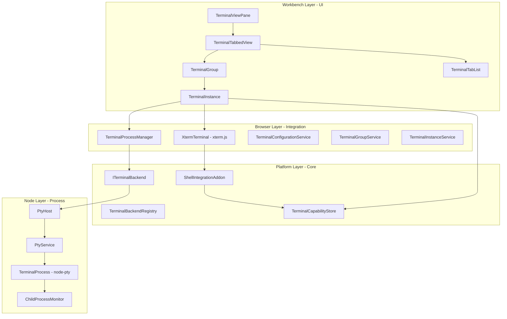
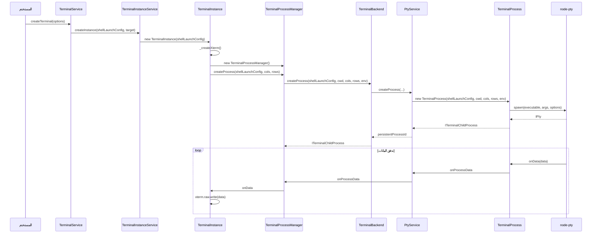
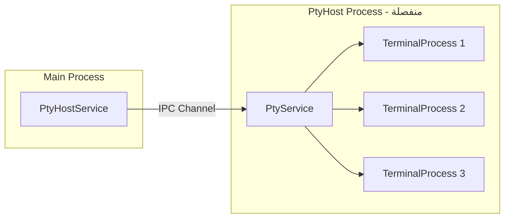
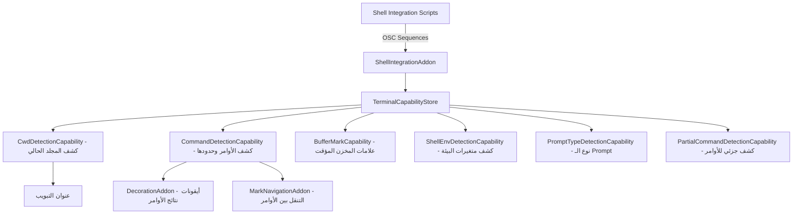
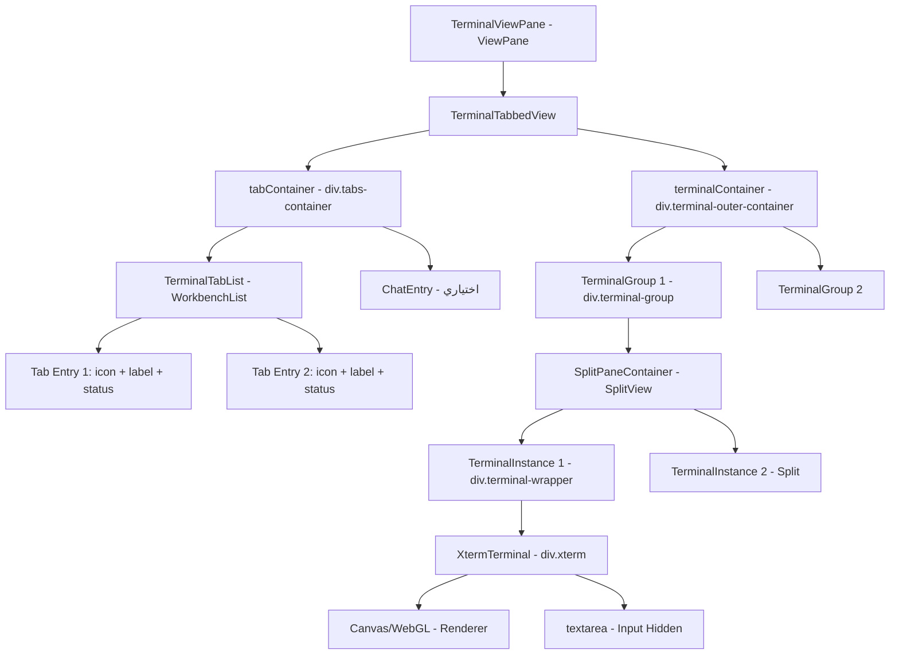
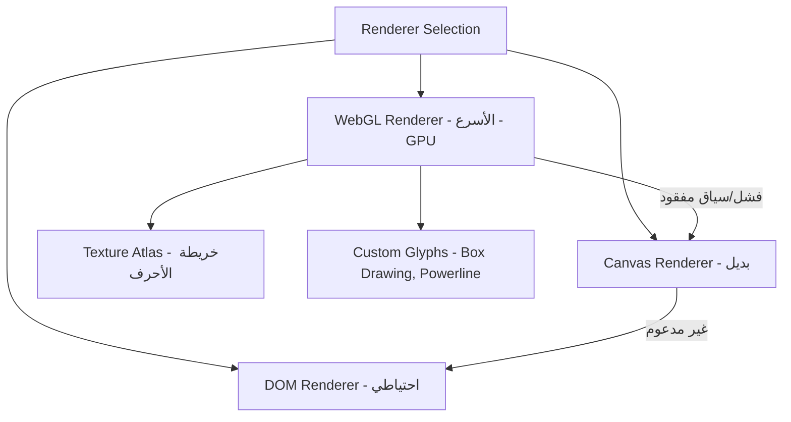
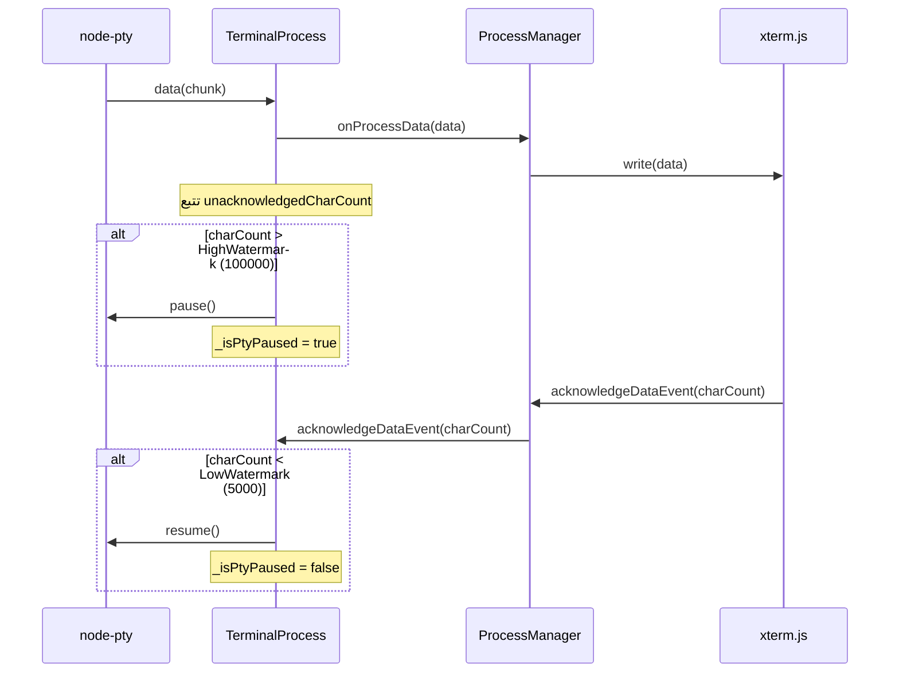
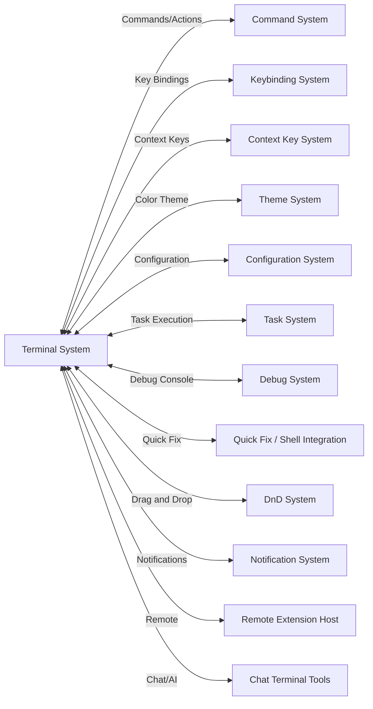

# تحليل نظام Terminal في VS Code

> تحليل معماري وتصميمي شامل لنظام الطرفية المدمجة في VS Code
> المصدر: `vscode-main/src/vs/`

---

## 1. نظرة عامة على الهندسة المعمارية

نظام Terminal في VS Code مبني على **هندسة معمارية متعددة الطبقات (Layered Architecture)** تفصل بين المنطق الأساسي (Platform)، وواجهة المستخدم (Browser/Workbench)، والعمليات الأصلية (Node/Electron):



---

## 2. هيكل الملفات والمجلدات

### 2.1 طبقة المنصة (`src/vs/platform/terminal/`)

| المسار | الوظيفة |
| -------- | --------- |
| `common/terminal.ts` | الواجهات الأساسية: `ITerminalBackend`, `IShellLaunchConfig`, `TerminalSettingId`, أنواع الـ Shell |
| `common/terminalProcess.ts` | تعريفات بيانات العمليات: `IProcessDetails`, `IProcessDataEvent` |
| `common/terminalEnvironment.ts` | إدارة متغيرات البيئة |
| `common/capabilities/` | نظام القدرات (Capabilities): كشف الأوامر، كشف المجلد الحالي |
| `common/xterm/shellIntegrationAddon.ts` | إضافة تكامل الشل (Shell Integration) |
| `node/terminalProcess.ts` | `TerminalProcess` - الغلاف حول `node-pty` |
| `node/ptyService.ts` | `PtyService` - إدارة عمليات PTY المستمرة |
| `node/ptyHost.ts` | `IPtyHostStarter` - تشغيل عملية PtyHost المنفصلة |
| `node/ptyHostService.ts` | خدمة الاتصال بـ PtyHost عبر IPC |
| `electron-main/electronPtyHostStarter.ts` | تشغيل PtyHost في بيئة Electron |

### 2.2 طبقة واجهة المستخدم (`src/vs/workbench/contrib/terminal/`)

| المسار | الوظيفة |
| -------- | --------- |
| `browser/terminal.ts` | واجهات UI: `ITerminalService`, `ITerminalInstance`, `IXtermTerminal` |
| `browser/terminalView.ts` | `TerminalViewPane` - اللوحة الرئيسية |
| `browser/terminalTabbedView.ts` | `TerminalTabbedView` - عرض التبويبات + المحتوى |
| `browser/terminalInstance.ts` | `TerminalInstance` - نسخة طرفية واحدة |
| `browser/terminalGroup.ts` | `TerminalGroup` - مجموعة طرفيات (Split) |
| `browser/terminalTabsList.ts` | `TerminalTabList` - قائمة التبويبات الجانبية |
| `browser/terminalProcessManager.ts` | `TerminalProcessManager` - إدارة العملية لكل نسخة |
| `browser/terminalConfigurationService.ts` | إدارة الإعدادات والخطوط |
| `browser/xterm/xtermTerminal.ts` | `XtermTerminal` - غلاف xterm.js مع الإضافات |
| `browser/xterm/decorationAddon.ts` | إضافة الزخارف (أيقونات الأوامر) |
| `browser/xterm/markNavigationAddon.ts` | التنقل بين علامات الأوامر |
| `browser/media/terminal.css` | أنماط CSS الرئيسية |
| `browser/media/xterm.css` | أنماط خاصة بـ xterm |
| `browser/widgets/` | أدوات واجهة إضافية (Hover, Widgets) |

---

## 3. تدفق إنشاء طرفية جديدة



---

## 4. المكونات الأساسية بالتفصيل

### 4.1 TerminalProcess (طبقة Node)

```typescript
// src/vs/platform/terminal/node/terminalProcess.ts
export class TerminalProcess extends Disposable implements ITerminalChildProcess {
    private _ptyProcess: IPty | undefined;        // عملية node-pty
    private _exitCode: number | undefined;
    private _childProcessMonitor: ChildProcessMonitor;
    private _windowsShellHelper: WindowsShellHelper;  // Windows فقط

    constructor(
        shellLaunchConfig: IShellLaunchConfig,
        cwd: string,
        cols: number, rows: number,
        env: IProcessEnvironment,
        options: ITerminalProcessOptions
    ) {
        // إعداد خيارات PTY
        this._ptyOptions = {
            name: 'xterm-256color',  // نوع الطرفية
            cwd, env, cols, rows,
            useConpty,               // Windows ConPTY
            useConptyDll
        };
    }

    async start(): Promise<...> {
        // تطبيق تكامل Shell
        const injection = getShellIntegrationInjection(shellLaunchConfig, options, env);
        // تشغيل العملية عبر node-pty
        this._ptyProcess = spawn(executable, args, this._ptyOptions);

        // الاستماع للبيانات
        this._ptyProcess.onData(data => this._onProcessData.fire(data));
        this._ptyProcess.onExit(e => this._onProcessExit.fire(e.exitCode));
    }

    // التحكم بالتدفق (Flow Control)
    acknowledgeDataEvent(charCount: number): void {
        if (this._isPtyPaused && this._unacknowledgedCharCount < FlowControlConstants.LowWatermarkChars) {
            this._ptyProcess.resume();
            this._isPtyPaused = false;
        }
    }
}
```

**النقاط المهمة:**

- يستخدم `node-pty` لإنشاء عمليات pseudo-terminal حقيقية
- يدعم ConPTY على Windows (بناء 18309+)
- يطبق **Flow Control** لمنع إغراق الذاكرة بالبيانات
- يراقب العمليات الفرعية عبر `ChildProcessMonitor`
- يحقن سكربتات Shell Integration تلقائياً

### 4.2 PtyService (إدارة PTY المستمرة)

```typescript
// src/vs/platform/terminal/node/ptyService.ts
export class PtyService extends Disposable implements IPtyService {
    private readonly _ptys: Map<number, PersistentTerminalProcess> = new Map();

    async createProcess(
        shellLaunchConfig, cwd, cols, rows,
        unicodeVersion, env, options, shouldPersist
    ): Promise<number> {
        const process = new TerminalProcess(...);
        const persistentProcess = new PersistentTerminalProcess(id, process, ...);
        this._ptys.set(id, persistentProcess);
        return id;
    }
}
```

**الخصائص:**

- يعمل في **عملية منفصلة** (PtyHost Process) لعزل الأعطال
- يدعم **الجلسات المستمرة** (Persistent Sessions) - إعادة الاتصال بعد إعادة التحميل
- يسجل ويعيد تشغيل مخرجات الطرفية عبر `TerminalRecorder`
- يتواصل عبر **IPC Channel** مع العملية الرئيسية

### 4.3 PtyHost (عملية منفصلة)



- يعمل في عملية Node.js منفصلة لمنع تأثير أعطال PTY على VS Code
- نظام **Heartbeat** لاكتشاف عدم الاستجابة
- إمكانية إعادة التشغيل التلقائي عند التعطل

### 4.4 TerminalInstance (نسخة الطرفية)

```typescript
// src/vs/workbench/contrib/terminal/browser/terminalInstance.ts
export class TerminalInstance extends Disposable implements ITerminalInstance {
    private _wrapperElement: HTMLDivElement;        // حاوية DOM
    private _widgetManager: TerminalWidgetManager;
    private _processManager: TerminalProcessManager;

    // Context Keys للحالة
    private _terminalFocusContextKey: IContextKey<boolean>;
    private _terminalHasTextContextKey: IContextKey<boolean>;
    private _terminalAltBufferActiveContextKey: IContextKey<boolean>;

    // الأحداث
    readonly onData: Event<string>;                // بيانات من xterm
    readonly onLineData: Event<string>;            // سطر كامل
    readonly onDidChangeFocus: Event<boolean>;
    readonly onDidChangeTitle: Event<string>;

    constructor(
        shellLaunchConfig: IShellLaunchConfig,
        // ... 20+ خدمة أخرى عبر Dependency Injection
    ) {
        this._wrapperElement = document.createElement('div');
        this._wrapperElement.classList.add('terminal-wrapper');
        this._widgetManager = instantiationService.createInstance(TerminalWidgetManager);
    }

    async sendText(text: string, addNewLine: boolean): Promise<void>;
    layout(dimension: dom.Dimension): void;
    focus(force?: boolean): void;
    dispose(): void;
}
```

### 4.5 XtermTerminal (غلاف xterm.js)

```typescript
// src/vs/workbench/contrib/terminal/browser/xterm/xtermTerminal.ts
export class XtermTerminal extends Disposable implements IXtermTerminal {
    readonly raw: RawXtermTerminal;  // نسخة xterm.js الأصلية

    // الإضافات (Addons)
    private _shellIntegrationAddon: ShellIntegrationAddon;
    private _decorationAddon: DecorationAddon;
    private _markNavigationAddon: MarkNavigationAddon;
    private _searchAddon?: SearchAddon;
    private _serializeAddon?: SerializeAddon;
    private _unicode11Addon?: Unicode11Addon;
    private _webglAddon?: WebglAddon;
    private _imageAddon?: ImageAddon;
    private _ligatureAddon?: LigaturesAddon;

    attachToElement(container: HTMLElement, options?: IXtermAttachToElementOptions): void {
        this.raw.open(container);
        if (options?.enableGpu) {
            this._enableWebglRenderer();
        }
    }

    getXtermTheme(theme?: IColorTheme): ITheme {
        return {
            background: backgroundColor?.toString(),
            foreground: foregroundColor?.toString(),
            cursor: cursorColor?.toString(),
            // 16 لون ANSI (أساسي + ساطع)
            black, red, green, yellow, blue, magenta, cyan, white,
            brightBlack, brightRed, brightGreen, brightYellow, ...
            // شريط التمرير
            scrollbarSliderBackground,
            scrollbarSliderHoverBackground,
            scrollbarSliderActiveBackground,
        };
    }
}
```

---

## 5. نظام القدرات (Capabilities System)

نظام تدريجي يُفعّل ميزات متقدمة عند توفر تكامل الشل:



### تسلسلات OSC المستخدمة

| التسلسل | المعنى |
| --------- | -------- |
| `OSC 633;A ST` | بداية Prompt (VS Code) |
| `OSC 633;B ST` | بداية إدخال الأمر |
| `OSC 633;C ST` | بداية مخرجات الأمر |
| `OSC 633;D;exitCode ST` | انتهاء الأمر مع كود الخروج |
| `OSC 633;E;commandLine ST` | سطر الأمر المُنفذ |
| `OSC 633;P;property=value ST` | خصائص إضافية (Cwd, IsWindows...) |
| `OSC 133;A-D ST` | تسلسلات FinalTerm (توافقية) |
| `OSC 1337;...ST` | تسلسلات iTerm (توافقية) |
| `OSC 7;uri ST` | تعيين المجلد الحالي |

---

## 6. التصميم المرئي (UI Design)

### 6.1 هيكل واجهة المستخدم

```
┌─────────────────────────────────────────────────────────────┐
│ Panel Header (Terminal Actions Bar)                          │
│ ┌─[+▾]──[⌄]──[×]──────────────── [bash ⚡] ──[≡]──[□]──[×]│
│ ├────────────┬──────────────────────────────────────────────┤
│ │ Tab List   │  Terminal Content Area                        │
│ │ (Optional) │                                               │
│ │            │  ┌─────────────────────────────────────┐      │
│ │ ○ bash     │  │ $ ls -la                            │      │
│ │ ● zsh  ✓   │  │ total 64                            │      │
│ │ ○ node     │  │ drwxr-xr-x  5 user staff  160 ...  │      │
│ │            │  │ -rw-r--r--  1 user staff 1234 ...   │      │
│ │            │  │                                     │      │
│ │ [+ New]    │  │ $ █                                 │      │
│ │            │  └─────────────────────────────────────┘      │
│ └────────────┴──────────────────────────────────────────────┤
│                          [Split View Support]                │
│ ┌──────────────────────┬────────────────────────────────────┤
│ │  Terminal 1 (bash)   │  Terminal 2 (zsh)                  │
│ │  $ npm start         │  $ git status                     │
│ │  > ready on :3000    │  On branch main                   │
│ └──────────────────────┴────────────────────────────────────┘
└─────────────────────────────────────────────────────────────┘
```

### 6.2 التسلسل الهرمي للعناصر



### 6.3 نظام التبويبات

```typescript
// أبعاد التبويبات
export const enum TerminalTabsListSizes {
    TabHeight = 22,                    // ارتفاع كل تبويب
    NarrowViewWidth = 46,              // عرض ضيق (أيقونات فقط)
    WideViewMinimumWidth = 80,         // عرض واسع (أيقونة + نص)
    DefaultWidth = 120,                // العرض الافتراضي
    ActionbarMinimumWidth = 105,       // الحد الأدنى لشريط الأدوات
    MaximumWidth = 500                 // الحد الأقصى للعرض
}
```

**سلوك التبويبات:**

- **عرض ضيق** (< 63px): أيقونات فقط بدون نص
- **عرض واسع** (>= 63px): أيقونة + عنوان + حالة
- **إخفاء تلقائي**: يمكن إخفاء التبويبات عند وجود طرفية واحدة
- **موقع**: يسار أو يمين (قابل للتغيير)
- **السحب والإفلات**: دعم كامل لإعادة الترتيب والنقل بين المجموعات

### 6.4 نظام الألوان

```typescript
// ألوان الطرفية المخصصة
TERMINAL_FOREGROUND_COLOR           // لون النص الأمامي
TERMINAL_BACKGROUND_COLOR           // لون الخلفية
TERMINAL_CURSOR_FOREGROUND_COLOR    // لون مؤشر الكتابة
TERMINAL_CURSOR_BACKGROUND_COLOR    // خلفية مؤشر الكتابة
TERMINAL_SELECTION_BACKGROUND_COLOR // لون خلفية التحديد
TERMINAL_INACTIVE_SELECTION_BACKGROUND_COLOR // تحديد غير نشط

// 16 لون ANSI (أساسي + ساطع)
ansiColorIdentifiers = [
    ANSI_BLACK, ANSI_RED, ANSI_GREEN, ANSI_YELLOW,
    ANSI_BLUE, ANSI_MAGENTA, ANSI_CYAN, ANSI_WHITE,
    ANSI_BRIGHT_BLACK, ANSI_BRIGHT_RED, ...
];

// ألوان الزخارف
terminalCommandDecoration_successBackground // أخضر - نجاح
terminalCommandDecoration_errorBackground   // أحمر - خطأ
terminalCommandDecoration_defaultBackground // رمادي - افتراضي
```

### 6.5 أنماط CSS الرئيسية

```css
/* الحاوية الرئيسية */
.pane-body.integrated-terminal {
    display: flex;
}

/* حاوية الطرفية */
.terminal-outer-container {
    display: flex;
    flex-direction: column;
    flex: 1;
}

/* غلاف النسخة */
.terminal-wrapper {
    position: relative;
    overflow: hidden;
}

/* حاوية التبويبات */
.tabs-container {
    display: flex;
    flex-direction: column;
}

/* إدخال تبويب */
.terminal-tabs-entry {
    text-align: center;
    padding-left: 10px;
    padding-right: 10px;
    height: 22px;
}

/* مؤشر السحب والإفلات */
.terminal-drop-overlay {
    position: absolute;
    left: 0; right: 0; top: 0; bottom: 0;
    pointer-events: none;
    transition: left 70ms ease-out, opacity 150ms ease-out;
}

/* زخارف الأوامر */
.terminal-command-decoration {
    color: var(--vscode-terminalCommandDecoration-successBackground);
}
.terminal-command-decoration.error {
    color: var(--vscode-terminalCommandDecoration-errorBackground);
}

/* تمييز التمرير */
.terminal-scroll-highlight {
    border-left: 5px solid #ffffff;
    pointer-events: none;
}

/* High Contrast */
.hc-black .xterm.focus::before,
.hc-light .xterm.focus::before {
    border-color: var(--vscode-contrastActiveBorder);
}
```

### 6.6 نظام العرض (Rendering)



- **WebGL**: الافتراضي، الأسرع، يستخدم GPU
- **Canvas**: بديل عند فشل WebGL
- **DOM**: احتياطي أخير، الأبطأ
- **Custom Glyphs**: رسم مخصص لحروف Box Drawing و Powerline

### 6.7 الخطوط

```typescript
export class TerminalFontMetrics {
    getFont(w: Window, xtermCore?: IXtermCore): ITerminalFont {
        return {
            fontFamily,          // عائلة الخط
            fontSize,            // حجم الخط (6-100)
            letterSpacing,       // المسافة بين الحروف
            lineHeight,          // ارتفاع السطر
            charWidth,           // عرض الحرف (محسوب)
            charHeight,          // ارتفاع الحرف (محسوب)
            fontWeight,          // وزن الخط العادي
            fontWeightBold       // وزن الخط السميك
        };
    }

    // معالجة خاصة لتوزيعات Linux
    // Fedora -> 'DejaVu Sans Mono'
    // Ubuntu -> 'Ubuntu Mono' (مع fontSize + 2)
}
```

---

## 7. نظام التحكم بالتدفق (Flow Control)



ثوابت التحكم:

- **HighWatermarkChars**: 100,000 حرف (إيقاف مؤقت)
- **LowWatermarkChars**: 5,000 حرف (استئناف)
- **CharCountAckSize**: 5,000 حرف (حجم الإقرار)

---

## 8. إعادة التشغيل السلسة (Seamless Relaunch)

```typescript
class SeamlessRelaunchDataFilter extends Disposable {
    // تسجيل مخرجات العملية الحالية
    private _firstRecorder?: TerminalRecorder;
    // تسجيل مخرجات العملية الجديدة
    private _secondRecorder?: TerminalRecorder;

    // عند إعادة التشغيل:
    // 1. تسجيل مخرجات العملية الجديدة
    // 2. مقارنتها مع القديمة
    // 3. إذا تطابقت: لا تغيير مرئي
    // 4. إذا اختلفت: إعادة رسم بـ \x1bc (Full Reset) + البيانات الجديدة

    triggerSwap() {
        const firstData = this._getDataFromRecorder(this._firstRecorder);
        const secondData = this._getDataFromRecorder(this._secondRecorder);

        if (firstData === secondData) {
            // لا يوجد وميض!
        } else {
            this._onProcessData.fire({ data: `\x1bc${secondData}`, trackCommit: false });
        }
    }
}
```

---

## 9. نظام الإعدادات

### 9.1 إعدادات رئيسية

| الإعداد | الوظيفة | القيمة الافتراضية |
| --------- | --------- | ------------------- |
| `terminal.integrated.fontFamily` | عائلة الخط | وراثة من المحرر |
| `terminal.integrated.fontSize` | حجم الخط | 12 |
| `terminal.integrated.lineHeight` | ارتفاع السطر | 1.0 |
| `terminal.integrated.cursorStyle` | شكل المؤشر | `block` |
| `terminal.integrated.cursorBlinking` | وميض المؤشر | `false` |
| `terminal.integrated.scrollback` | سطور التمرير | 1000 |
| `terminal.integrated.gpuAcceleration` | تسريع GPU | `auto` |
| `terminal.integrated.tabs.enabled` | تفعيل التبويبات | `true` |
| `terminal.integrated.tabs.location` | موقع التبويبات | `right` |
| `terminal.integrated.defaultProfile.*` | الملف الشخصي الافتراضي | حسب النظام |
| `terminal.integrated.shellIntegration.enabled` | تكامل الشل | `true` |
| `terminal.integrated.enablePersistentSessions` | جلسات مستمرة | `true` |
| `terminal.integrated.copyOnSelection` | نسخ عند التحديد | `false` |
| `terminal.integrated.rightClickBehavior` | النقر الأيمن | `selectWord` |
| `terminal.integrated.enableBell` | صوت الجرس | `false` |
| `terminal.integrated.smoothScrolling` | تمرير سلس | `false` |
| `terminal.integrated.enableImages` | دعم الصور | `false` |

### 9.2 ملفات Shell الشخصية

```typescript
interface ITerminalProfile {
    profileName: string;     // اسم الملف الشخصي
    path: string;            // مسار الملف التنفيذي
    isDefault: boolean;
    icon?: ThemeIcon | URI;  // أيقونة
    color?: string;          // لون التبويب
    args?: string[];         // وسائط إضافية
    env?: { [key: string]: string }; // متغيرات بيئة
    overrideName?: boolean;
}

// أنواع الشل المدعومة
type PosixShellType = 'bash' | 'fish' | 'sh' | 'csh' | 'ksh' | 'zsh';
type WindowsShellType = 'cmd' | 'wsl' | 'gitbash';
type GeneralShellType = 'pwsh' | 'python' | 'julia' | 'nu' | 'node' | 'xonsh';
```

---

## 10. التكامل مع أنظمة VS Code الأخرى



### Context Keys المهمة

```typescript
TerminalContextKeys = {
    focus,                              // الطرفية مُركّزة
    focusInAny,                         // أي طرفية مُركّزة
    textSelected,                       // نص محدد
    altBufferActive,                    // الـ Alt Buffer نشط (vim, less...)
    terminalShellIntegrationEnabled,    // تكامل الشل مُفعّل
    terminalHasFixedWidth,              // عرض ثابت
    processSupported,                   // العمليات مدعومة
    isOpen,                             // الطرفية مفتوحة
    tabsFocus,                          // تبويبات الطرفية مُركّزة
};
```

---

## 11. أنماط التصميم المستخدمة

| النمط | الاستخدام |
| ------- | ----------- |
| **Dependency Injection** | جميع الخدمات تُحقن عبر `@` decorators و `createDecorator` |
| **Event Emitter Pattern** | كل مكون يُصدر أحداثاً عبر `Emitter<T>` |
| **Registry Pattern** | `TerminalBackendRegistry` لتسجيل الخلفيات |
| **Strategy Pattern** | Renderers (WebGL/Canvas/DOM)، Shell profiles |
| **Decorator Pattern** | `traceRpc` لتتبع استدعاءات RPC |
| **Observer Pattern** | `TerminalCapabilityStore` يُراقب القدرات |
| **Proxy Pattern** | `TerminalProcessExtHostProxy` للامتدادات |
| **Disposable Pattern** | كل كائن يمتد `Disposable` لإدارة الموارد |
| **Factory Pattern** | `TerminalInstanceService.createInstance()` |
| **Facade Pattern** | `TerminalService` يجمع كل الوظائف |
| **Adapter Pattern** | `XtermTerminal` يغلف xterm.js |
| **Command Pattern** | `TerminalActions` - كل إجراء ككائن مستقل |

---

## 12. ملخص للتنفيذ في مشروعنا

### المتطلبات الأساسية

1. **PTY Backend**: استخدام مكتبة PTY أصلية (مثل `dart:ffi` مع `libutil` أو `pty` عبر platform channel)
2. **Terminal Emulator**: استخدام مكتبة محاكي طرفية (مثل `xterm` عبر WebView أو تنفيذ مخصص)
3. **Process Management**: إدارة العمليات مع Flow Control
4. **Tab System**: نظام تبويبات مع Split View

### الهندسة المقترحة

```
terminal/
├── models/
│   ├── terminal_process.dart          # غلاف العملية
│   ├── terminal_profile.dart          # ملفات Shell الشخصية
│   └── terminal_capabilities.dart     # نظام القدرات
├── services/
│   ├── terminal_service.dart          # الخدمة الرئيسية
│   ├── terminal_backend.dart          # الخلفية (PTY)
│   ├── terminal_config_service.dart   # الإعدادات
│   └── terminal_process_manager.dart  # إدارة العمليات
├── views/
│   ├── terminal_view.dart             # اللوحة الرئيسية
│   ├── terminal_tabbed_view.dart      # التبويبات + المحتوى
│   ├── terminal_tab_list.dart         # قائمة التبويبات
│   └── terminal_instance_view.dart    # نسخة واحدة
├── widgets/
│   ├── terminal_renderer.dart         # عارض الطرفية
│   └── terminal_toolbar.dart          # شريط الأدوات
└── utils/
    ├── ansi_parser.dart               # تحليل تسلسلات ANSI
    ├── shell_integration.dart         # تكامل الشل
    └── flow_control.dart              # التحكم بالتدفق
```

### أولويات التنفيذ

1. **مرحلة 1**: PTY Backend + عرض أساسي (إدخال/إخراج)
2. **مرحلة 2**: نظام التبويبات + Split View
3. **مرحلة 3**: Shell Integration + القدرات المتقدمة
4. **مرحلة 4**: السمات + التخصيص الكامل
